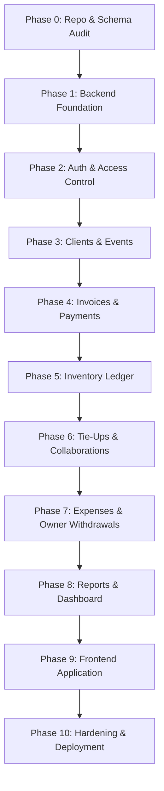

# Event Management System (EMS) — Implementation Roadmap

**Document Version:** 1.0.0  
**Status:** Approved Baseline  
**Context:** Small event-management business in India (INR ₹)  
**Parent Document:** [LLD.md](file:///C:/Users/N/Documents/projects/EMS/docs/LLD.md)  
**Open Questions:** [OPEN_QUESTIONS.md](file:///C:/Users/N/Documents/projects/EMS/docs/OPEN_QUESTIONS.md)  

---

## 1. Overview & Phasing Principles

This roadmap provides an ordered, actionable execution plan for developing the Event Management System. It is organized into strictly sequenced phases where each phase builds upon the verified deliverables of the preceding phase.

### Core Engineering Rules During Implementation:
1. **Never mock business logic:** Service layers must implement actual mathematical calculations and database operations.
2. **Atomic transactions:** Multi-table writes (invoices + items, payments + allocations, inventory movements + stock totals, expenses + payments) must execute inside `prisma.$transaction`.
3. **Decimal precision:** All monetary and quantitative calculations must use `Prisma.Decimal` or `decimal.js`. JavaScript native floats (`number`) are forbidden for financial arithmetic.
4. **Independent verification:** Each task must satisfy clear Acceptance Criteria and the global Definition of Done before advancing to the next task.

---

## 2. Phase-by-Phase Execution Plan

---

### Phase 0: Repository & Schema Audit (Completed)
- **Objective:** Establish the ground truth of existing code, dependencies, configuration, and database schema.
- **Tasks:**
  - [x] Audit `backend/package.json`, `tsconfig.json`, `prisma7.config.js`, and `prisma/schema.prisma`.
  - [x] Compare database migration (`20261109204135_init`) against planned models.
  - [x] Audit generated Prisma client location (`src/generated/prisma`) and driver adapter (`@prisma/adapter-pg`).
  - [x] Identify code anomalies (empty `src/lib/prisma.ts`, `package.json` dev script pointing to missing `src/index.ts`, dual `UserRole`/`USERROLE` enums).
  - [x] Produce `docs/LLD.md`, `docs/OPEN_QUESTIONS.md`, and `docs/IMPLEMENTATION_ROADMAP.md`.
- **Exit Criteria:** LLD, Open Questions, and Roadmap documents written and reviewed.

---

### Phase 1: Backend Foundation & Configuration
- **Dependencies:** Phase 0
- **Objective:** Fix entry points, solidify Prisma 7 client initialization, validate runtime environment, and establish standardized error handling.
- **Tasks:**
  - **Task 1.1: Fix Backend Scripts & Entry Point**
    - Align `package.json` scripts: `"dev": "tsx watch src/server.ts"` and `"start": "node dist/server.js"`.
    - Create `.env.example` containing non-secret placeholder keys (`DATABASE_URL`, `DIRECT_URL`, `PORT`, `NODE_ENV`, `JWT_ACCESS_SECRET`, `JWT_REFRESH_SECRET`, `CORS_ORIGIN`).
  - **Task 1.2: Prisma Client Singleton & Driver Adapter**
    - Populate `src/lib/prisma.ts` with the unified, lazy-instantiated `PrismaClient` using `@prisma/adapter-pg` and PostgreSQL connection pooling.
    - Export `prisma` instance and re-export `Prisma` types for consistent access.
    - Ensure clean shutdown hooks (`SIGINT`, `SIGTERM`) calling `prisma.$disconnect()`.
  - **Task 1.3: Centralized Environment & Error Pipeline**
    - Extend `src/config/env.ts` with Zod validation for JWT secrets, token expiry windows, and CORS allowed origins.
    - Implement `AppError` base class with subclasses: `NotFoundError`, `UnauthorizedError`, `ForbiddenError`, `ValidationError`, `ConflictError`.
    - Enhance `src/middlewares/error.middleware.ts` to map Prisma errors (e.g., `P2002` unique constraint violation, `P2025` record not found) and Zod errors to standardized JSON responses.
  - **Task 1.4: Base Response Formatter & Request Logger**
    - Create standard API response helper: `{ success: true, data: T, message?: string, meta?: PaginationMeta }`.
    - Configure `morgan` HTTP logging with structured token formats.
- **Acceptance Criteria:**
  - `npm run dev` starts Express server cleanly on configured port.
  - `GET /api/v1/health` returns status `200` with database ping confirmation.
  - Database connection error aborts startup gracefully with an informative error log.

---

### Phase 2: Authentication & Access Control
- **Dependencies:** Phase 1
- **Objective:** Implement secure multi-role authentication (Admin and Client) with token rotation, credential hashing, and role/ownership authorization guards.
- **Tasks:**
  - **Task 2.1: Password Hashing & Seed Admin Script**
    - Implement password hashing utility using `bcrypt` (work factor 12).
    - Create an idempotent CLI seed script (`npm run seed:admin`) that provisions the initial Admin user if not present.
  - **Task 2.2: Dual-Token Session Engine**
    - Implement `AuthService.login(email, password)`: validates user, verifies `isActive`, generates 15-minute Access JWT and 7-day Refresh JWT.
    - Hash Refresh Token using SHA-256 and persist into `RefreshToken` table with expiration timestamp.
    - Set tokens into secure `httpOnly`, `sameSite: 'lax'`, `secure: NODE_ENV === 'production'` cookies.
  - **Task 2.3: Token Refresh & Revocation**
    - Implement `AuthService.refresh(refreshToken)`: performs token rotation (deletes/revokes old token, generates new pair).
    - Implement `AuthService.logout(refreshToken)`: marks token revoked or removes record from `RefreshToken`.
  - **Task 2.4: Authentication & Authorization Middleware**
    - Implement `authenticate` middleware: extracts JWT from cookie or `Authorization: Bearer` header, verifies signature, loads `req.user = { id, role, clientId }`.
    - Implement `requireRole(USERROLE.ADMIN)` guard: rejects non-admins with `403 Forbidden`.
    - Implement `requireOwnership` helper: enforces that Client users can only access records where `clientId === req.user.clientId`.
- **Acceptance Criteria:**
  - Admin login issues valid tokens and permits access to protected admin routes.
  - Client login limits access strictly to records with matching `clientId`.
  - Stale/tampered tokens return `401 Unauthorized`.
  - Clients attempting to call Admin endpoints receive `403 Forbidden`.
  - Refresh token reuse triggers full session revocation.

---

### Phase 3: Clients & Event Management
- **Dependencies:** Phase 2
- **Objective:** Build client registry management and core event lifecycle management with strict budget/state validations.
- **Tasks:**
  - **Task 3.1: Client Service & Endpoints**
    - Implement CRUD for `Client` model (`name`, `email`, `phone`, `address`, `city`, `notes`).
    - Implement search and pagination by name, phone, and email.
    - Implement client account invitation/linking: optionally link a `Client` record to a `User` login account.
  - **Task 3.2: Event Number Sequence Generator**
    - Implement thread-safe event numbering: `EVT-YYYY-XXXX` (e.g., `EVT-2026-0001`).
  - **Task 3.3: Event Lifecycle & Validation Service**
    - Implement `EventService.createEvent`: validates client existence, event dates (`eventDate >= today`), and initial budget (`Decimal >= 0`). Sets initial status `DRAFT`.
    - Implement `EventService.updateStatus`: enforces permitted state machine transitions (`DRAFT` → `CONFIRMED` → `PLANNING` → `IN_PROGRESS` → `COMPLETED`, or `*` → `CANCELLED`).
    - Implement `EventService.getEventSummary`: aggregates budget, linked invoices, received payments, outstanding balance, and linked expenses.
  - **Task 3.4: Client-Facing Event Views**
    - Implement `GET /api/v1/events/my-events` filtered strictly by `req.user.clientId`.
    - Sanitize client-facing response: omit internal notes, vendor costs, and organizer margins.
- **Acceptance Criteria:**
  - Admin can create, update, search, and filter clients and events.
  - Client can retrieve only their own events and sees `403 Forbidden` if requesting another client's event ID.
  - Budget validation rejects negative values.
  - Invalid state transition (e.g. `COMPLETED` → `DRAFT`) is rejected with `400 Bad Request`.

---

### Phase 4: Invoices & Client Payment Engine
- **Dependencies:** Phase 3
- **Objective:** Create professional invoice generation, itemized billing, partial payments, and multi-invoice payment allocations with atomic consistency.
- **Tasks:**
  - **Task 4.1: Invoice Number Sequence & Creation**
    - Implement sequential invoice generator: `INV-YYYY-XXXX`.
    - Implement `InvoiceService.createInvoice`: creates `Invoice` and associated `InvoiceItem` rows in a single `prisma.$transaction`.
    - Validate line item arithmetic: `totalPrice = quantity * unitPrice`, `subtotal = sum(totalPrice)`, `totalAmount = (subtotal - discount) + taxAmount`.
  - **Task 4.2: Proforma Invoice & Advance Handling**
    - Support `InvoiceType.PROFORMA` for initial quote/advance billing.
    - Link advance payments to `Payment.proformaInvoiceId`.
  - **Task 4.3: Client Payment Processing & Allocation**
    - Implement `PaymentService.recordPayment`: records payment with method (`CASH`, `UPI`, `BANK_TRANSFER`, `CARD`, `CHEQUE`).
    - Transactionally allocate payment to one or more invoices via `PaymentAllocation`.
    - Recompute invoice status: `PAID` if allocated amount equals `totalAmount`, `PARTIALLY_PAID` if greater than zero, `OVERDUE` if past `dueDate`.
    - Prevent over-allocation: reject payments that exceed the aggregate outstanding balance.
  - **Task 4.4: Outstanding Balance Reconciliation**
    - Provide `/api/v1/invoices/:id/balance` calculating derived balance: `totalAmount - sum(PaymentAllocation.amount)`.
- **Acceptance Criteria:**
  - Multi-item invoices calculate subtotal, discount, tax, and grand total with Decimal precision.
  - Recording partial payment updates invoice status to `PARTIALLY_PAID` atomically.
  - Total allocated payments cannot exceed invoice grand total.
  - Client users can download/view their own invoices; cross-client access returns `403`.

---

### Phase 5: Reusable & Consumable Inventory Ledger
- **Dependencies:** Phase 3
- **Objective:** Implement complete stock ledger tracking purchases, event issue/returns, damage/loss, and prevent negative stock.
- **Tasks:**
  - **Task 5.1: Inventory Category & Item Management**
    - Implement category and item CRUD (`name`, `itemType` [`REUSABLE`/`CONSUMABLE`], `sku`, `unit`, `minimumStock`, `purchasePrice`).
    - Maintain `currentStock` with database-level non-negative constraint check.
  - **Task 5.2: Purchase Stock-In Movement**
    - Implement `InventoryService.recordPurchase`: creates `InventoryMovement` with type `PURCHASE`, increases `InventoryItem.currentStock`, and optionally links to `Expense` ID in a single transaction.
  - **Task 5.3: Event Allocation & Issue**
    - Implement `InventoryService.issueToEvent`: validates `quantity <= currentStock`.
    - Upserts `EventInventory` record (`issuedQuantity += quantity`), creates `InventoryMovement` (`EVENT_ISSUE`), and decrements `currentStock` atomically.
  - **Task 5.4: Event Return, Damage, and Loss**
    - Implement `InventoryService.returnFromEvent`: validates `returnQty + damagedQty <= issuedQty - previouslyReturnedQty`.
    - For undamaged returns: increments `currentStock`, logs `EVENT_RETURN`.
    - For damaged/lost items: logs `DAMAGE` or `LOSS` movement; does not increment available stock.
  - **Task 5.5: Manual Stock Adjustment & Audit Reconciliation**
    - Implement `ADJUSTMENT_IN` and `ADJUSTMENT_OUT` with mandatory justification notes.
    - Provide reconciliation endpoint verifying `currentStock === sum(movements)`.
- **Acceptance Criteria:**
  - Issuing more inventory than available stock fails with `400 Bad Request` ("Insufficient stock").
  - Returned quantity cannot exceed net unreturned issued quantity.
  - Every stock balance change has a corresponding `InventoryMovement` row.
  - Total stock ledger matches `currentStock` for all items.

---

### Phase 6: Tie-Up & Collaboration Management
- **Dependencies:** Phase 3, Phase 4
- **Objective:** Manage banquet/hotel/restaurant partners, refundable deposits, event tie-up associations, and historical commission snapshots.
- **Tasks:**
  - **Task 6.1: Partner Master Management**
    - Implement CRUD for `TieUp` (`name`, `type` [`RESTAURANT`/`HOTEL`], `contactPerson`, `phone`, `commissionType`, `commissionValue`, `securityDeposit`).
  - **Task 6.2: Refundable Security Deposit Engine**
    - Implement `TieUpService.recordDepositTransaction`:
      - `SECURITY_DEPOSIT_PAID`: increases recorded deposit asset balance.
      - `SECURITY_DEPOSIT_REFUNDED`: decreases deposit balance.
    - Validate that refund amount does not exceed active deposit balance.
  - **Task 6.3: Event Tie-Up Link & Commission Snapshot**
    - Implement `TieUpService.linkEvent`: connects `TieUp` and `Event` via `TieUpEvent`.
    - Calculate and freeze commission terms in `TieUpEvent`:
      - If `FIXED`: `commissionAmount = commissionValue`.
      - If `PERCENTAGE`: `commissionAmount = commissionBaseAmount * (commissionValue / 100)`.
    - Save snapshot so future changes to the master `TieUp` do not alter historical event records.
  - **Task 6.4: Commission Settlement Workflow**
    - Create commission payout expense linking `tieUpEventId` (Phase 7 integration).
- **Acceptance Criteria:**
  - Linking partner to event records exact commission snapshot values.
  - Master commission rate changes do not alter existing `TieUpEvent` values.
  - Deposit refunds exceeding active deposit balance are rejected.
  - Client users cannot access tie-up or commission details.

---

### Phase 7: Expense & Owner Withdrawal Management
- **Dependencies:** Phase 5, Phase 6
- **Objective:** Manage event-level and business operating costs, reconcile inventory purchase expenses, handle partial expense payments, and isolate owner withdrawals.
- **Tasks:**
  - **Task 7.1: Expense Creation with Scoping Rules**
    - Implement `ExpenseService.createExpense`:
      - Validate `scope`: If `EVENT`, `eventId` is required. If `BUSINESS`, `eventId` must be null.
      - Validate `category`: If `BANQUET_COMMISSION`, `tieUpEventId` is required, and `tieUpEvent.eventId` must match `expense.eventId`.
  - **Task 7.2: Inventory Purchase Reconciliation**
    - For `category === INVENTORY_PURCHASE`: transactionally create the `Expense` and all associated `PURCHASE` inventory movements.
    - Set `InventoryMovement.expenseId = Expense.id`.
  - **Task 7.3: Expense Payment Engine**
    - Implement `ExpenseService.recordExpensePayment`: supports multiple partial payments.
    - Enforce payment limit: `sum(payments) <= Expense.amount`.
  - **Task 7.4: Owner Withdrawal Isolation**
    - Implement `OwnerWithdrawalService.recordWithdrawal`: records date, amount, payment method, purpose, and reference.
    - Strictly isolate `OwnerWithdrawal` from `Expense` queries: owner withdrawals must never appear in operating expense aggregates or reduce event operating profit.
- **Acceptance Criteria:**
  - Business expense with an `eventId` is rejected with `400 Bad Request`.
  - Banquet commission referencing a mismatched event is rejected.
  - Expense payment exceeding outstanding expense payable amount is rejected.
  - Owner withdrawal records are completely excluded from event profit calculations.

---

### Phase 8: Dashboard & Financial Reporting
- **Dependencies:** Phases 3 through 7
- **Objective:** Provide accurate operational and financial summaries with strict separation of cash vs accrual metrics.
- **Tasks:**
  - **Task 8.1: Operational Dashboard Metrics**
    - Upcoming events by date range and status.
    - Low stock inventory alert list (`currentStock <= minimumStock`).
    - Pending invoices and overdue client receivables.
  - **Task 8.2: Event Profitability Report**
    - Implement dual perspective calculation per event:
      - **Accrual Margin:** `Invoiced Amount - Event Operating Expenses - Damaged/Consumed Inventory Cost`.
      - **Cash Realized Margin:** `Received Client Payments - Event Expense Payments Paid`.
    - Exclude business-level overhead and owner withdrawals from event-level margin.
  - **Task 8.3: Tie-Up & Commission Summary**
    - Commission payable/paid by event and partner.
    - Active security deposit balance held by venue partners.
  - **Task 8.4: Cash Flow & Owner Ledger**
    - Net cash flow = `Total Payments Received - Total Expense Payments Paid - Total Owner Withdrawals + Deposit Refunds`.
- **Acceptance Criteria:**
  - Event profitability accurately reflects invoiced revenue and event-specific costs without including general inventory purchases or owner withdrawals.
  - Reports reconcile down to the cent with underlying transaction tables.
  - All aggregation queries run using database indexes without N+1 overhead.

---

### Phase 9: Frontend Architecture & User Portals
- **Dependencies:** Phases 1 through 8
- **Objective:** Initialize Next.js frontend, establish typed API client with cookie auth, and build complete Admin and Client interfaces.
- **Tasks:**
  - **Task 9.1: Next.js Setup & Design System**
    - Initialize Next.js in `frontend/` directory with App Router and Tailwind CSS / shadcn/ui.
    - Implement responsive layout with navigation, sidebar, and theme tokens.
  - **Task 9.2: Auth Provider & Session State**
    - Implement client-side AuthContext with automatic token refresh on `401`.
    - Route protection: redirect unauthorized users to `/login`.
  - **Task 9.3: Admin Portal Features**
    - Clients & Events: list, filter, create, edit, calendar view, event detail workspace.
    - Billing & Invoices: invoice builder with dynamic line items, payment recording modal.
    - Inventory Manager: stock levels, movement history drawer, event issue/return workflows.
    - Tie-Up Directory: partner profiles, deposit log, commission terms.
    - Expenses & Withdrawals: categorized expense logger, receipt image preview, withdrawal form.
    - Financial Dashboard: charts, KPI cards, profitability data tables.
  - **Task 9.4: Client Portal Features**
    - Client Dashboard: view assigned events, booking schedule, payment summary.
    - Invoices & Receipts: download/print invoice views, transaction payment history.
    - Security guard: verify frontend client interface exposes no administrative or internal cost data.
- **Acceptance Criteria:**
  - Seamless responsive experience on desktop, tablet, and mobile.
  - Client users cannot navigate to or view administrative screens.
  - Form validation with instant feedback using Zod and React Hook Form.
  - Loading skeletons, empty states, and error toasts across all data tables.

---

### Phase 10: Production Hardening, Security & Deployment
- **Dependencies:** Phase 9
- **Objective:** Secure, containerize, and deploy EMS to low-cost production hosting.
- **Tasks:**
  - **Task 10.1: Security & Rate Limiting**
    - Configure `express-rate-limit` on `/api/v1/auth/login` (5 attempts per 15 minutes).
    - Configure Helmet CSP and secure CORS origin whitelist.
  - **Task 10.2: Production Build & Process Management**
    - Configure production build pipeline (`tsc` for backend, `next build` for frontend).
    - Setup PM2 process configuration (`ecosystem.config.cjs`) with clustering and auto-restart.
  - **Task 10.3: Reverse Proxy & SSL Configuration**
    - Configure Nginx reverse proxy routing `/` to Next.js and `/api/` to Express backend.
    - Enable Let's Encrypt automated SSL via Certbot.
  - **Task 10.4: Database Backups & Operational Runbook**
    - Set up automated daily PostgreSQL logical backups (`pg_dump`) with retention rotation.
    - Document rollback, disaster recovery, and environment variable configuration runbook.
- **Acceptance Criteria:**
  - Backend runs continuously under PM2 with zero downtime restarts.
  - SSL report achieves Grade A rating.
  - Automated database backup script successfully executes and tests restoration.

---

## 3. Global Definition of Done (DoD)

For every individual task and phase:
1. **Code Quality:** Fully typed TypeScript without `any`. Strict linter passes.
2. **Data Integrity:** All monetary operations handle `Prisma.Decimal`. Multi-write actions use transactions.
3. **Authorization:** Server-side role guard and client ID ownership checks verified.
4. **Documentation:** API endpoints, data models, and business logic updated in [LLD.md](file:///C:/Users/N/Documents/projects/EMS/docs/LLD.md).
5. **No Breaking Changes:** Zero destructive database resets (`prisma migrate reset` prohibited).
