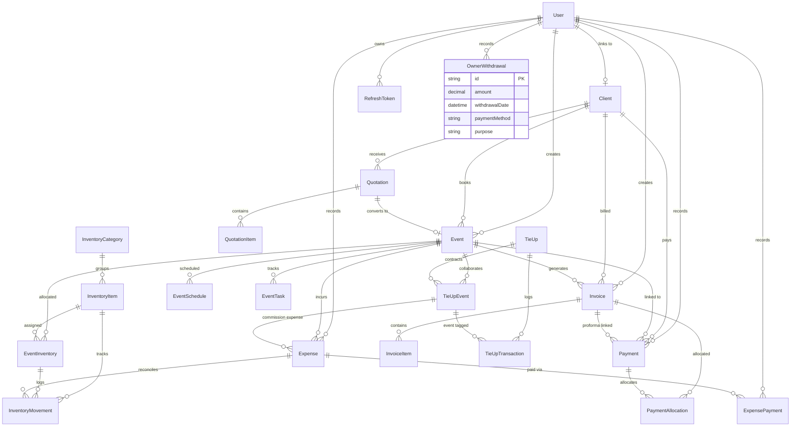
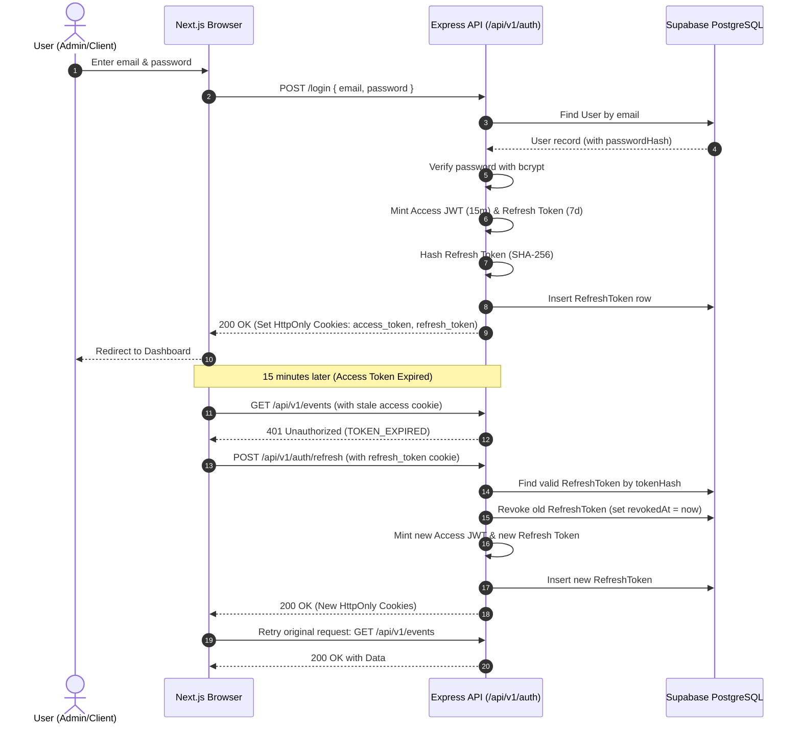
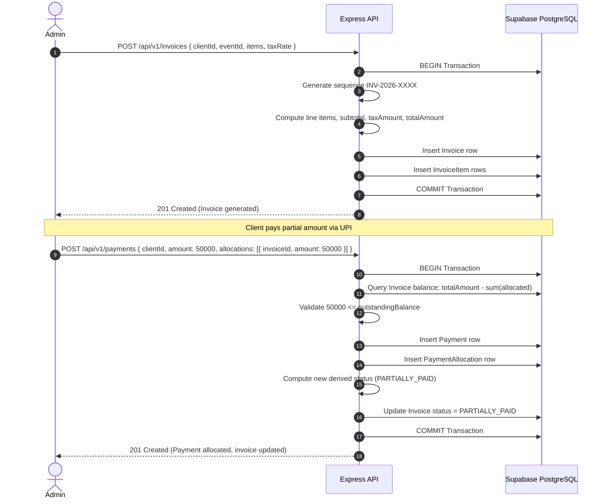
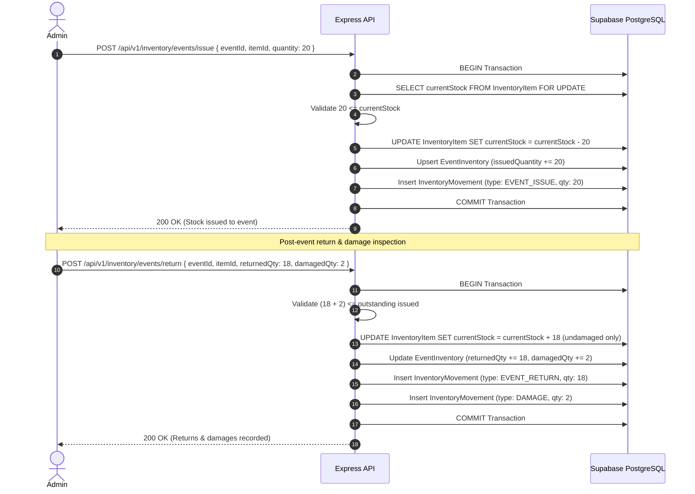
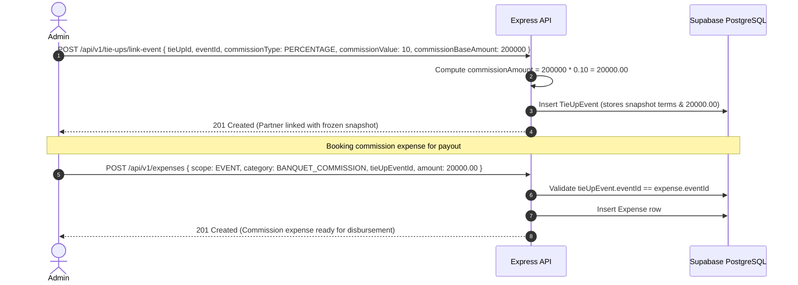
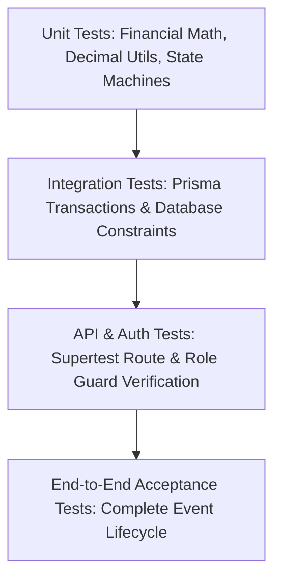

# Event Management System (EMS) — Low-Level Design (LLD)

**Document Version:** 1.0.0  
**Date:** November 2026  
**System Context:** Small Event Management Business (India, INR ₹)  
**Authors:** Senior Software Architect & Technical Lead  
**Reference Documents:**  
- [Product Plan (plan.md)](file:///C:/Users/N/Documents/projects/EMS/plan.md)  
- [Open Decisions Register](file:///C:/Users/N/Documents/projects/EMS/docs/OPEN_QUESTIONS.md)  
- [Implementation Roadmap](file:///C:/Users/N/Documents/projects/EMS/docs/IMPLEMENTATION_ROADMAP.md)  
- [Prisma Schema](file:///C:/Users/N/Documents/projects/EMS/backend/prisma/schema.prisma)  

---

## 1. Document Control & Status Legend

### 1.1 Purpose & Scope
This Low-Level Design (LLD) document specifies the comprehensive technical, architectural, and mathematical implementation blueprint for the Event Management System (EMS). It provides implementation-ready specifications covering database schema, service logic, API contracts, sequence flows, security controls, financial calculations, and deployment topology.

### 1.2 Status Legend
In accordance with system design guidelines, every technical specification, business rule, and data contract in this document is labeled with one of three statuses:
- **[Confirmed]:** Explicitly validated by existing codebase, verified Prisma schema, or confirmed product decisions in `plan.md`.
- **[Proposed]:** Recommended engineering solution based on industry best practices and architectural coherence; ready for implementation upon approval.
- **[Open decision]:** Business or policy choice that is not yet finalized. Options and trade-offs are documented; no unilateral assumptions are made in code.

---

## 2. System Overview

### 2.1 Goals & Business Context
The EMS is designed for an Indian boutique event management company managing weddings, corporate functions, banquets, and social celebrations. The business operates with a core operational team (2–7 users) handling concurrent events.

The system centralizes:
1. Client and event portfolio management.
2. Itemized quotation and invoicing workflows with partial client payment allocations.
3. Physical reusable and consumable inventory tracking with movement-based stock accounting.
4. Banquet hall, restaurant, and hotel tie-up partnerships, including security deposit asset tracking and event commission snapshots.
5. Direct event operating expenses vs. business-level operating and inventory purchase expenses.
6. Owner equity/personal cash withdrawals strictly isolated from operating expenses and event profit calculations.
7. Executive operational dashboards and financial margin reports distinguishing cash vs. accrual performance.

### 2.2 System Actors & User Roles
- **Admin [Confirmed]:** Business owner, event director, or administrative manager. Has unrestricted operational and financial read/write permissions across all modules.
- **Client [Confirmed]:** External client. Has read-only access strictly restricted to their own client profile, assigned events, invoices, payment history, and event schedules. Completely forbidden from viewing internal costs, margins, inventory purchase prices, tie-up commissions, or owner withdrawals.

### 2.3 Scope Boundaries

#### In-Scope (Release 1.0) [Confirmed]
- Multi-role authentication (Admin & Client) with JWT token rotation.
- Client profile management.
- Event management (dates, venues, planning budgets, lifecycle state machine).
- Quotation and Invoicing with line-item calculations, discounts, and flat GST rates.
- Client payment recording and multi-invoice allocations.
- Reusable and consumable inventory management with movement ledger.
- Event-to-inventory allocations, issues, returns, damages, and loss accounting.
- Venue tie-up management with refundable security deposit ledgers.
- Event-specific tie-up linking with immutable commission snapshots.
- Categorized expense management (event-scoped and business-scoped).
- Reconciled inventory purchase expenses linked to stock-in movements.
- Owner withdrawal ledger isolated from operating profit.
- Financial dashboards (accrual contract margins vs. cash flow margins).

#### Out-of-Scope (Release 1.0) [Confirmed]
- Multi-tenant SaaS or separate databases per tenant.
- Employee/staff roles, task assignment to workers, worker timesheets, and payroll.
- Statutory multi-state GST filing engine or automated e-invoicing portals.
- Public booking or vendor marketplace.
- Native mobile applications (iOS/Android).
- Automated AI agents inside application workflows.

---

## 3. High-Level Architecture & Request Flow

### 3.1 Architectural Topology
The EMS follows a decoupled client-server architecture consisting of a standalone Next.js frontend, a stateless Node.js/Express backend API, and a managed PostgreSQL database on Supabase using Prisma 7 ORM with PostgreSQL driver adapter.

```mermaid
flowchart TB
    subgraph Clients["Client Layer"]
        AB[Admin Web Browser]
        CB[Client Web Browser]
    end

    subgraph Frontend["Frontend Application (Port 3000)"]
        NJS[Next.js App Router / React Server Components]
        ZOD_FE[Zod Client Schemas & React Hook Form]
    end

    subgraph ReverseProxy["Reverse Proxy & Edge"]
        NGX[Nginx / Cloudflare Edge (HTTPS)]
    end

    subgraph Backend["Backend Application (Port 5000)"]
        EXP[Express.js Application]
        MW[Security, Auth & Validation Middlewares]
        CTRL[Controller Layer]
        SVC[Service Layer - Pure Business Logic]
        P7[Prisma 7 Client Singleton]
        ADPT[@prisma/adapter-pg Connection Pool]
    end

    subgraph Persistence["Storage & Data Layer"]
        PG[(Supabase PostgreSQL Database)]
        SBS[Supabase Storage - Private Buckets]
    end

    AB -->|HTTPS| NGX
    CB -->|HTTPS| NGX
    NGX -->|Reverse Proxy /| NJS
    NGX -->|Reverse Proxy /api/v1| EXP
    NJS -->|API Requests /api/v1| EXP
    EXP --> MW --> CTRL --> SVC --> P7 --> ADPT --> PG
    SVC -.->|Signed Document Uploads| SBS
```

### 3.2 Request & Data Flow Lifecycle
1. **Client Request:** Browser transmits HTTPS request with HttpOnly session cookies.
2. **Reverse Proxy:** Nginx handles TLS termination, enforces HTTP/2, security headers, and routes `/api/v1/*` to Express.
3. **Express Middleware Pipeline:**
   - `helmet`: Applies Content Security Policy (CSP), frameguard, and XSS filtering.
   - `cors`: Validates origin against whitelist; allows credentials for cookie transmission.
   - `morgan`: Logs structured HTTP transaction metadata.
   - `express.json`: Parses incoming JSON payload (limited to 2MB).
   - `authenticate`: Extracts access JWT, verifies signature, decodes `{ id, role, clientId }`.
   - `requireRole` / `requireOwnership`: Rejects unauthorized actors before controller invocation.
   - `validateRequest`: Zod schema validator parses and sanitizes `body`, `query`, and `params`.
4. **Controller Layer:** Unpacks typed inputs, delegates to domain services, formats standardized JSON envelopes.
5. **Service Layer:** Executes domain rules, validates business constraints, computes financial/stock balances, and wraps multi-record writes inside `prisma.$transaction`.
6. **Data Access Layer:** Prisma 7 Client interacts with PostgreSQL via `@prisma/adapter-pg` over an optimized connection pool.

---

## 4. Codebase Audit & Repository Baseline

### 4.1 Repository Structure Discovered
Inspection of `C:\Users\N\Documents\projects\EMS` confirms:
- **Monorepo Status:** Negative. Frontend and backend are completely separate projects.
- **Root Directory:**
  - `backend/`: Node.js Express + TypeScript backend application.
  - `LLD_Generation_Prompt.md`: Architectural assignment and prompt requirements.
  - `plan.md`: Authoritative baseline product plan.
  - `docs/`: Created to house architectural specifications (`LLD.md`, `OPEN_QUESTIONS.md`, `IMPLEMENTATION_ROADMAP.md`).
- **Frontend Status:** The `frontend/` directory does not yet exist in the root folder. It will be initialized during Phase 9 as a Next.js application.

### 4.2 Backend Inspection Audit

| Aspect | Actual Discovered Configuration | Plan / Audit Finding |
|---|---|---|
| **Module Type** | `"type": "module"` (ESM) | Confirmed. Strict ESM import syntax required (`.js` extensions). |
| **Node / TS Target** | `"module": "nodenext"`, `"target": "esnext"` | Confirmed. High strictness (`strict: true`, `noUncheckedIndexedAccess: true`). |
| **Express Version** | `express: ^5.3.0` (Express 5) | Confirmed. Built-in async route error propagation. |
| **Prisma Version** | `prisma: ^7.10.1`, `@prisma/client: ^7.10.1` | Confirmed Prisma 7 setup. |
| **Prisma Driver Adapter** | `@prisma/adapter-pg: ^7.10.1`, `pg: ^8.23.1` | Confirmed. Client configured with connection pooling adapter. |
| **Prisma Client Generator** | `output = "../src/generated/prisma"` | Generated client files located under `backend/src/generated/prisma`. |
| **Prisma Config** | `prisma7.config.js` and `prisma7.config.ts` | Uses `DIRECT_URL` for CLI migrations via `defineConfig`. |
| **Runtime Database URL** | `DATABASE_URL` | Used at runtime via `src/config/database.ts` with `PrismaPg`. |
| **Migration Database URL**| `DIRECT_URL` | Used by Prisma CLI migrations. |

### 4.3 Technical Inconsistencies & Required Corrections
During the technical audit, the following specific discrepancies were identified:
1. **`package.json` Scripts Mismatch [Confirmed]:**
   - Script `"dev": "tsx watch src/index.ts"` points to `src/index.ts`, which **does not exist**. The actual application entry point is `src/server.ts`.
   - Script `"start": "node dist/index.js"` similarly targets `dist/index.js`.
   - *Correction:* Update `package.json` scripts to reference `src/server.ts` and `dist/server.js`.
2. **Prisma Client Instantiation Location [Confirmed]:**
   - `plan.md` Section 11 specifies `src/lib/prisma.ts` as the single reusable Prisma client instance.
   - The file `backend/src/lib/prisma.ts` was found to be **empty (0 bytes)**.
   - An active PrismaClient instance is currently initialized in `backend/src/config/database.ts`.
   - *Correction:* Unify client initialization in `src/lib/prisma.ts` and import it in `src/config/database.ts` and domain services to eliminate confusion.
3. **Dual Role Enums in Schema [Confirmed]:**
   - `prisma/schema.prisma` declares both `enum UserRole { ADMIN, CLIENT }` and `enum USERROLE { ADMIN, CLIENT }`.
   - `User.role` uses `USERROLE`. `UserRole` is unused.
   - *Correction:* Document this anomaly. Retain `USERROLE` to prevent breaking existing migration `20261109204135_init`.
4. **Missing Environment Schema Keys [Confirmed]:**
   - `src/config/env.ts` validates `DATABASE_URL`, `PORT`, and `NODE_ENV`.
   - It is missing definitions for `JWT_ACCESS_SECRET`, `JWT_REFRESH_SECRET`, and `CORS_ORIGIN`.
   - *Correction:* Expand `env.ts` Zod schema to include all mandatory security tokens.

---

## 5. Role and Permission Matrix

### 5.1 Actor Capabilities Matrix

| Resource / Action | Admin | Client | Enforcement Mechanism |
|---|:---:|:---:|---|
| **Auth / Login** | Full | Full | `POST /api/v1/auth/login` |
| **User Management** | Create / Update / Deactivate | None (403) | `requireRole('ADMIN')` |
| **Clients (Directory)** | Full CRUD | None (403) | `requireRole('ADMIN')` |
| **Client (Self Profile)** | Full | Read Only (Self) | Scoped by `req.user.clientId` |
| **Events (All)** | Full CRUD | None (403) | `requireRole('ADMIN')` |
| **Events (Assigned)** | Full CRUD | Read Only (Self) | Scoped by `where: { clientId: req.user.clientId }` |
| **Quotations** | Full CRUD | Read Only (Self) | Scoped by `where: { clientId: req.user.clientId }` |
| **Invoices (All)** | Full CRUD | None (403) | `requireRole('ADMIN')` |
| **Invoices (Assigned)** | Full CRUD | Read Only (Self) | Filtered by client association; internal margins omitted |
| **Client Payments** | Create / View All | View Self History | Client can only see receipts linked to own invoices |
| **Inventory (Items/Stock)** | Full CRUD | None (403) | `requireRole('ADMIN')` |
| **Inventory Movements** | Full CRUD | None (403) | `requireRole('ADMIN')` |
| **Tie-Up Venues** | Full CRUD | None (403) | `requireRole('ADMIN')` |
| **Tie-Up Commissions** | Full CRUD | None (403) | `requireRole('ADMIN')` (Forbidden for Client) |
| **Security Deposits** | Full CRUD | None (403) | `requireRole('ADMIN')` (Forbidden for Client) |
| **Expenses (All)** | Full CRUD | None (403) | `requireRole('ADMIN')` (Forbidden for Client) |
| **Expense Payments** | Full CRUD | None (403) | `requireRole('ADMIN')` (Forbidden for Client) |
| **Owner Withdrawals** | Full CRUD | None (403) | `requireRole('ADMIN')` (Forbidden for Client) |
| **Financial Reports** | Full Access | None (403) | `requireRole('ADMIN')` |

### 5.2 Server-Side Ownership Enforcement Rules
1. **Never trust client-supplied identity:** A Client request must never use body or query params like `?clientId=xyz` or `{ clientId: "..." }` as authorization proof. The server strictly uses `req.user.clientId` from the cryptographically verified JWT.
2. **Client Scope Traversal:** When a Client queries an invoice `/api/v1/invoices/:id`, the query enforces:
   ```ts
   const invoice = await prisma.invoice.findFirst({
     where: { id, clientId: req.user.clientId }
   });
   if (!invoice) throw new NotFoundError("Invoice not found or access denied");
   ```
3. **Data Sanitization for Clients:** Client-facing responses strip internal administrative metadata:
   - Quotation / Invoice: Omits vendor cost fields, internal notes, and profit estimates.
   - Event: Omits internal task lists, tie-up commissions, and event expense summaries.
4. **Standardized Rejection Codes:**
   - Unauthenticated / Invalid / Expired Token: `401 Unauthorized` with `{ success: false, code: 'UNAUTHORIZED' }`.
   - Authenticated user lacking role or accessing alien resource: `403 Forbidden` with `{ success: false, code: 'FORBIDDEN' }`.

---

## 6. Detailed Module Design

### 6.1 Authentication & Session Management Module
- **Purpose:** Secure identity verification, role-based token minting, and session revocation.
- **Actors:** Admin, Client.
- **Features:**
  - Login via email and password.
  - Dual-token lifecycle: 15-minute Access JWT, 7-day Refresh JWT.
  - Cryptographic token hashing (`sha256`) stored in `RefreshToken` table.
  - Automated token rotation on refresh to neutralize stolen refresh tokens.
  - Secure HttpOnly cookie transport.
- **Validations:**
  - Email format compliance.
  - Password minimum 8 characters with complexity requirements.
  - Inactive user accounts (`isActive === false`) immediately blocked.
- **Failure Cases:**
  - Invalid password: `401 Unauthorized`.
  - Refresh token reuse detected: Entire token family revoked for user; forces re-authentication.

### 6.2 Client Management Module
- **Purpose:** Centralized repository of customer contact and business information.
- **Actors:** Admin.
- **Features:**
  - Client profile creation with duplicate phone/email detection.
  - View client engagement history (historical events, quotation history, total invoiced, total collected).
  - Optional linking of `Client` entity to `User` login credentials.
- **Validations:**
  - Mandatory Indian phone number (10 digits).
  - Optional unique email validation.
- **Failure Cases:**
  - Deleting client with linked active events or invoices is prohibited (`400 Bad Request` / Prisma `Restrict`).

### 6.3 Event Management Module
- **Purpose:** Core operational entity coordinating planning budgets, schedules, inventory, and billing.
- **Actors:** Admin (full), Client (read-only self).
- **Features:**
  - Event creation with unique auto-generated number (`EVT-YYYY-XXXX`).
  - Strict lifecycle management: `DRAFT` → `CONFIRMED` → `PLANNING` → `IN_PROGRESS` → `COMPLETED` (or `CANCELLED`).
  - Planning budget recording (stored as `Decimal(12,2)`).
  - Event detail overview aggregating linked invoices, received payments, issued inventory, and operating expenses.
- **Validations:**
  - `eventDate` must be a valid future or current timestamp.
  - `budget` must be greater than or equal to 0.
  - Valid transition: An event cannot transition from `DRAFT` directly to `COMPLETED`.
- **Failure Cases:**
  - Modifying financial records of a `CANCELLED` event requires explicit administrator override.

### 6.4 Invoice & Client Payment Management Module
- **Purpose:** Commercial billing, tax computation, proforma advance receipts, and client payment allocation.
- **Actors:** Admin (full), Client (read-only self).
- **Features:**
  - Multi-item invoice generation with auto-sequenced numbering (`INV-YYYY-XXXX`).
  - Proforma vs. Final invoice classification (`InvoiceType`).
  - Line-item calculations: subtotal, discount, flat tax percentage, grand total.
  - Client payment recording supporting payment modes: `CASH`, `UPI`, `BANK_TRANSFER`, `CARD`, `CHEQUE`.
  - Atomic payment allocations via `PaymentAllocation` junction table.
  - Dynamic derived invoice status (`DRAFT`, `SENT`, `PARTIALLY_PAID`, `PAID`, `OVERDUE`, `CANCELLED`).
- **Validations:**
  - Decimal precision enforced on every line item (`totalPrice = quantity * unitPrice`).
  - Grand total formula: `totalAmount = (subtotal - discountValue) + taxAmount`.
  - Payment allocated amount must not exceed invoice outstanding balance.
- **Failure Cases:**
  - Overpayment attempt: Rejected with `400 Bad Request` ("Payment exceeds invoice balance").

### 6.5 Inventory Management Module
- **Purpose:** Movement-based tracking of physical reusable and consumable event assets, plus third-party vendor rental management.
- **Actors:** Admin.
- **Features:**
  - Item categorization (`InventoryCategory`) and item master (`InventoryItem`).
  - Classification: `REUSABLE` (furniture, electronics, cutlery) vs. `CONSUMABLE` (decor flowers, paper products).
  - Ownership & Usage Type (`InventoryUsageType`):
    - `OWNED`: Capital assets stored in company warehouse. Dispatches deduct stock; undamaged returns replenish stock.
    - `RENTED`: External equipment sourced from rental vendors. Dispatches bypass warehouse stock; returns are returned to vendors. Tracks rental dates, automated `rentalDays`, `rentPerUnit`, and `totalRent`.
  - Purchase movement (`PURCHASE`) updating available stock and linking to purchase expense.
  - Event issuance (`EVENT_ISSUE`) with stock decrements (for owned) and `EventInventory` tracking.
  - Event returns (`EVENT_RETURN`), damages (`DAMAGE`), and losses (`LOSS`).
  - Manual stock adjustments (`ADJUSTMENT_IN`, `ADJUSTMENT_OUT`) with required audit notes.
  - Single event item rate/term update via `PUT /events/:eventId/items/:inventoryItemId`.
- **Validations:**
  - Stock non-negativity constraint for owned assets: `currentStock - issueQty >= 0`.
  - Event return constraint: `returnedQty + damagedQty <= issuedQty - previouslyProcessedQty`.
- **Failure Cases:**
  - Insufficient stock on owned issue: Fails transactionally with `400 Bad Request` ("Insufficient stock").
- **Frontend Integration Guide:** Detailed UI component breakdown, wireframes, and API payloads are documented in [docs/inventory-frontend-guide.md](file:///C:/Users/N/Documents/projects/EMS/docs/inventory-frontend-guide.md).

### 6.6 Tie-Up & Collaboration Management Module
- **Purpose:** Partner directory for venues (Banquet Halls, Hotels, Restaurants), security deposit asset ledgers, and event commission tracking.
- **Actors:** Admin.
- **Features:**
  - Partner master profile (`TieUp`) with default commission terms (`FIXED` or `PERCENTAGE`).
  - Refundable security deposit ledger via `TieUpTransaction` (`SECURITY_DEPOSIT_PAID`, `SECURITY_DEPOSIT_REFUNDED`).
  - Event association via `TieUpEvent` with immutable snapshot of commission terms and base amounts.
- **Validations:**
  - Deposit refund cannot exceed recorded active deposit balance.
  - Event link requires valid `eventId` and `tieUpId`.
- **Failure Cases:**
  - Duplicate linking of the same partner to the same event blocked by `@@unique([tieUpId, eventId])`.

### 6.7 Expense Management Module
- **Purpose:** Categorized tracking of operating costs, commission payouts, and inventory asset purchases.
- **Actors:** Admin.
- **Features:**
  - Scope isolation: `EVENT` scope (requires `eventId`) vs. `BUSINESS` scope (prohibits `eventId`).
  - Category classification: `TRANSPORTATION`, `BANQUET_COMMISSION`, `OTHER_OPERATING`, `INVENTORY_PURCHASE`.
  - Banquet commission linkage: Requires `tieUpEventId` matching the specified `eventId`.
  - Inventory purchase reconciliation: Transactionally links `Expense` to `PURCHASE` inventory movements.
  - Partial/full expense payments recorded via `ExpensePayment`.
- **Validations:**
  - Total expense payments must not exceed `Expense.amount`.
  - Banquet commission expense must point to valid `TieUpEvent`.
- **Failure Cases:**
  - Attempting to attach an `eventId` to a `BUSINESS` scope expense fails validation.

### 6.8 Owner / Personal Withdrawal Management Module
- **Purpose:** Accurate bookkeeping of capital/equity withdrawals by the business owner.
- **Actors:** Admin.
- **Features:**
  - Record owner cash withdrawals (`amount`, `withdrawalDate`, `paymentMethod`, `purpose`, `referenceNo`).
  - Complete architectural separation from `Expense` table.
- **Accounting Rules:**
  - Owner withdrawals do **NOT** appear in operating expense totals.
  - Owner withdrawals do **NOT** reduce event gross margin or operating profit.
  - Owner withdrawals appear solely in owner equity and cash-flow reconciliation reports.
- **Validations:**
  - `amount > 0` and valid withdrawal date.

### 6.9 Admin Dashboard & Financial Reporting Module
- **Purpose:** Executive visibility into business performance, cash flow, receivables, and event margins.
- **Actors:** Admin.
- **Reports:**
  - Operational KPI overview: active events, low stock warnings, outstanding receivables.
  - Event Profitability Report: Dual-perspective view (Accrual Contract Margin vs. Cash Realized Margin).
  - Venue Tie-up & Commission Ledger: Total commission incurred vs. paid, active security deposits.
  - Business Cash Flow Statement: Net operating cash generated minus capital investments and owner drawings.

---

## 7. Database Design & Schema Audit

### 7.1 Schema Audit Summary

| Model / Table | Existing in Schema? | Migrated in DB? | Role in System | Notes / Modifications Needed |
|---|:---:|:---:|---|---|
| `User` | Yes | Yes | Authentication principal | Uses `USERROLE` enum. Has 1:1 relation to `Client`. |
| `RefreshToken` | Yes | Yes | Session tokens | Stores `tokenHash`, `userId`, `expiresAt`, `revokedAt`. |
| `Client` | Yes | Yes | Customer entity | Has relations to Quotations, Events, Invoices, Payments. |
| `Quotation` | Yes | Yes | Pre-sale quote | Present in schema and migration. Linked to Event and Invoices. |
| `QuotationItem` | Yes | Yes | Quote line items | Line items with quantity, unitPrice, totalPrice. |
| `Event` | Yes | Yes | Central operational unit | Tracks `budget`, `status`, `eventNumber`. |
| `EventTask` | Yes | Yes | Operational tasks | Deferred assignment; present in schema without worker relation. |
| `EventSchedule` | Yes | Yes | Day-of timelines | Stores `startAt`, `endAt`, `title`. |
| `Invoice` | Yes | Yes | Billing document | Tracks `subtotal`, `discountValue`, `taxAmount`, `totalAmount`. |
| `InvoiceItem` | Yes | Yes | Invoice line items | Tracks quantity, pricing, `advanceAdjusted`, `InvoiceType`. |
| `Payment` | Yes | Yes | Client money received | Tracks `amount`, `paymentMethod`, `proformaInvoiceId`. |
| `PaymentAllocation` | Yes | Yes | Payment-to-invoice link | Resolves many-to-many payments to invoices. |
| `InventoryCategory` | Yes | Yes | Stock grouping | Master categories (Decor, Sound, Catering, Lighting). |
| `InventoryItem` | Yes | Yes | Stock item master | Tracks `currentStock`, `minimumStock`, `purchasePrice`. |
| `EventInventory` | Yes | Yes | Event stock allotment | Tracks `requiredQuantity`, `issuedQuantity`, `returnedQuantity`, `damagedQuantity`. |
| `InventoryMovement` | Yes | Yes | Stock ledger | Records `PURCHASE`, `EVENT_ISSUE`, `EVENT_RETURN`, `DAMAGE`, `LOSS`. |
| `TieUp` | Yes | Yes | Partner directory | Tracks default commission terms and security deposit. |
| `TieUpEvent` | Yes | Yes | Event-partner junction | Stores frozen commission snapshot for the specific event. |
| `TieUpTransaction`| Yes | Yes | Partner cash movements | Tracks security deposit paid/refunded and commission transactions. |
| `Expense` | Yes | Yes | Operating cost record | Has `scope`, `category`, links to `Event`, `TieUpEvent`, `InventoryMovement`. |
| `ExpensePayment` | Yes | Yes | Expense cash outflow | Tracks partial/full cash payments for expenses. |
| `OwnerWithdrawal`| Yes | Yes | Owner capital drawings | Completely separate from Expense table. |

### 7.2 Entity Relationship Diagram (ERD)



---

## 8. Financial Logic & Mathematical Rules

### 8.1 Money Precision & Decimal Guardrails
- **Floating-point Forbidden:** All monetary and quantitative calculations must utilize `Prisma.Decimal` or `decimal.js`. JavaScript native `number` floating-point types are strictly prohibited to prevent IEEE-754 binary rounding discrepancies.
- **Database Scale:** Monies stored as `DECIMAL(12, 2)` (up to ₹9,999,999,999.99).
- **Rounding Strategy:** Half-up rounding (`ROUND_HALF_UP`) executed strictly at the final settlement step.

### 8.2 Invoice & Payment Mathematics
For each `Invoice`:
1. Line Item Total:
   $$\text{totalPrice}_i = \text{round}(\text{quantity}_i \times \text{unitPrice}_i, 2)$$
2. Invoice Subtotal:
   $$\text{subtotal} = \sum_{i=1}^{n} \text{totalPrice}_i$$
3. Discount Calculation:
   $$\text{discountValue} = \begin{cases} \text{fixedValue}, & \text{if } \text{discountType} = \text{FIXED} \\ \text{round}\left(\text{subtotal} \times \frac{\text{discountRate}}{100}, 2\right), & \text{if } \text{discountType} = \text{PERCENTAGE} \end{cases}$$
4. Taxable Amount:
   $$\text{taxableAmount} = \max(0, \text{subtotal} - \text{discountValue})$$
5. Tax Calculation:
   $$\text{taxAmount} = \text{round}\left(\text{taxableAmount} \times \frac{\text{taxRate}}{100}, 2\right)$$
6. Grand Total:
   $$\text{totalAmount} = \text{taxableAmount} + \text{taxAmount}$$
7. Client Payment Allocation & Derived Balance:
   $$\text{amountPaid} = \sum \text{PaymentAllocation.amount}$$
   $$\text{amountDue} = \max(0, \text{totalAmount} - \text{amountPaid})$$
8. Status Derivation:
   $$\text{status} = \begin{cases} 
   \text{PAID}, & \text{if } \text{amountDue} = 0 \text{ and } \text{totalAmount} > 0 \\
   \text{PARTIALLY\_PAID}, & \text{if } \text{amountPaid} > 0 \text{ and } \text{amountDue} > 0 \\
   \text{OVERDUE}, & \text{if } \text{amountDue} > 0 \text{ and } \text{now}() > \text{dueDate} \\
   \text{DRAFT} / \text{SENT}, & \text{otherwise}
   \end{cases}$$

### 8.3 Tie-Up Commission Mathematics
Inside `TieUpEvent`:
- If `commissionType === FIXED`:
  $$\text{commissionAmount} = \text{commissionValue}$$
- If `commissionType === PERCENTAGE`:
  $$\text{commissionAmount} = \text{round}\left(\text{commissionBaseAmount} \times \frac{\text{commissionValue}}{100}, 2\right)$$

### 8.4 Event Profitability Formula Candidates

#### Formula A: Accrual / Contract Operational Margin [Confirmed for Operational Reporting]
Reflects the economic profitability of the event contract independent of cash collection timing:
$$\text{Event Revenue} = \sum \text{Invoice.totalAmount (where status} \neq \text{CANCELLED)}$$
$$\text{Event Direct Costs} = \sum \text{Expense.amount (where scope} = \text{EVENT and eventId} = E)$$
$$\text{Inventory Loss/Damage Cost} = \sum (\text{damagedQuantity} \times \text{unitCost})$$
$$\mathbf{\text{Accrual Event Profit}} = \text{Event Revenue} - \text{Event Direct Costs} - \text{Inventory Loss Cost}$$

#### Formula B: Cash-Realized Event Margin [Confirmed for Cash Flow Reporting]
Reflects liquid cash surplus generated by the event to date:
$$\text{Cash Collected} = \sum \text{PaymentAllocation.amount (for Event's invoices)}$$
$$\text{Cash Paid to Vendors} = \sum \text{ExpensePayment.amount (for Event's expenses)}$$
$$\mathbf{\text{Cash Realized Profit}} = \text{Cash Collected} - \text{Cash Paid to Vendors}$$

#### Critical Accounting Guardrails [Confirmed]
- **Event Budget is NOT Revenue:** `Event.budget` is purely a planning figure. It is never included in revenue or profit calculations.
- **Inventory Purchases are Capital Assets:** An `Expense` under `INVENTORY_PURCHASE` represents an asset acquisition and cash outflow. It is never charged directly to an individual event's operating expenses.
- **Owner Withdrawals are NOT Expenses:** `OwnerWithdrawal` rows are excluded from all operating expense totals and event profit calculations.

---

## 9. Inventory Movement & Stock Logic

### 9.1 Movement Ledger Axioms
1. **Ledger Immutability:** Stock balances are never updated via arbitrary SQL `UPDATE currentStock = ...` statements without a balancing row in `InventoryMovement`.
2. **Current Stock Formula:**
   $$\text{currentStock}_{\text{calculated}} = \sum (\text{PURCHASE} + \text{EVENT\_RETURN} + \text{ADJUSTMENT\_IN}) - \sum (\text{EVENT\_ISSUE} + \text{DAMAGE} + \text{LOSS} + \text{ADJUSTMENT\_OUT})$$
3. **Atomic Consistency:** The `InventoryItem.currentStock` column serves as an indexed read-cache and is updated inside the exact same database transaction as the corresponding `InventoryMovement`.

### 9.2 Event Issue, Return & Damage Flow Rules

| Action | Required Validations | Movement Type Logged | Stock Effect | `EventInventory` Update |
|---|---|:---:|:---:|---|
| **Stock Purchase** | `quantity > 0` | `PURCHASE` | `currentStock += qty` | None |
| **Issue to Event** | `qty <= currentStock` | `EVENT_ISSUE` | `currentStock -= qty` | `issuedQuantity += qty` |
| **Undamaged Return**| `qty + damagedQty <= issued - processed` | `EVENT_RETURN` | `currentStock += qty` | `returnedQuantity += qty` |
| **Damaged Item** | `qty + undamaged <= issued - processed` | `DAMAGE` | None (Stays out of stock)| `damagedQuantity += qty` |
| **Lost Item** | `qty <= issued - processed` | `LOSS` | None (Permanently gone) | `notes` updated |
| **Manual Write-down**| Reason string required | `ADJUSTMENT_OUT` | `currentStock -= qty` | None |
| **Stock Audit Find** | Reason string required | `ADJUSTMENT_IN` | `currentStock += qty` | None |

---

## 10. Tie-Up & Collaboration Architecture

### 10.1 Partner Data Structure & Master vs. Snapshot
- **Master Record (`TieUp`):** Stores partner profile, address, contact person, default commission configuration (`FIXED` vs `PERCENTAGE`), and rolling security deposit balance.
- **Event Junction (`TieUpEvent`):** Represents a specific engagement. It takes a complete **snapshot** of the commission structure at the time of booking:
  - `commissionType`: Copied from master or overridden for this event.
  - `commissionValue`: Rate or fixed sum.
  - `commissionBaseAmount`: The base venue cost or client billing amount.
  - `commissionAmount`: Calculated monetary commission.
- **Historical Protection:** If Admin later updates the master `TieUp` commission from 10% to 15%, historical `TieUpEvent` records retain their snapshotted 10% calculation.

### 10.2 Refundable Security Deposit Lifecycle
Security deposits are balance sheet assets (receivables from venues), **not operating expenses**.
- When deposit is paid to venue:
  - Create `TieUpTransaction` with `transactionType = SECURITY_DEPOSIT_PAID`.
  - Transactionally increment `TieUp.securityDeposit += amount`.
- When deposit is refunded by venue:
  - Validate: `refundAmount <= TieUp.securityDeposit`.
  - Create `TieUpTransaction` with `transactionType = SECURITY_DEPOSIT_REFUNDED`.
  - Transactionally decrement `TieUp.securityDeposit -= refundAmount`.

### 10.3 Single Canonical Path for Commission Expenses
To prevent double-counting commissions across modules:
- An approved banquet commission payable is recorded as an `Expense` with:
  - `scope = EVENT`
  - `category = BANQUET_COMMISSION`
  - `eventId = tieUpEvent.eventId`
  - `tieUpEventId = tieUpEvent.id`
- Cash paid against this commission is logged via `ExpensePayment`.
- It does **not** create a duplicate row in `TieUpTransaction`. `TieUpTransaction` is reserved for direct security deposits and direct venue kickback receipts.

---

## 11. REST API Specification (`/api/v1`)

All endpoints are prefixed with `/api/v1`. All JSON responses follow the standardized payload structure defined in Section 15.

### 11.1 Authentication Endpoints

#### `POST /api/v1/auth/login`
- **Purpose:** Authenticate Admin or Client user.
- **Auth:** Public. Rate-limited (5 req / 15 min).
- **Request Body:**
  ```json
  {
    "email": "admin@ems.local",
    "password": "Password123!"
  }
  ```
- **Response `200 OK`:** Sets `accessToken` and `refreshToken` in HttpOnly cookies.
  ```json
  {
    "success": true,
    "data": {
      "user": {
        "id": "uuid-v4",
        "name": "Managing Director",
        "email": "admin@ems.local",
        "role": "ADMIN",
        "clientId": null
      }
    }
  }
  ```

#### `POST /api/v1/auth/refresh`
- **Purpose:** Rotate access token using valid refresh cookie.
- **Auth:** Public (reads `refreshToken` cookie).
- **Response `200 OK`:** Sets fresh cookie pair.

#### `POST /api/v1/auth/logout`
- **Purpose:** Revoke active refresh token and clear session cookies.
- **Auth:** Authenticated.

---

### 11.2 Client Management Endpoints

#### `GET /api/v1/clients`
- **Purpose:** Search and list client profiles with pagination.
- **Auth:** Admin only.
- **Query Params:** `?page=1&limit=20&search=Sharma`
- **Response `200 OK`:**
  ```json
  {
    "success": true,
    "data": [
      {
        "id": "client-uuid",
        "name": "Rahul Sharma",
        "phone": "9876543210",
        "email": "rahul@example.com",
        "city": "Mumbai",
        "_count": { "event": 3, "invoice": 4 }
      }
    ],
    "meta": { "total": 1, "page": 1, "limit": 20, "totalPages": 1 }
  }
  ```

#### `POST /api/v1/clients`
- **Purpose:** Create a new client profile.
- **Auth:** Admin only.
- **Request Body:**
  ```json
  {
    "name": "Anita Verma",
    "phone": "9820098200",
    "email": "anita@example.com",
    "address": "Bandra West",
    "city": "Mumbai",
    "notes": "Referred by Hotel Taj"
  }
  ```

---

### 11.3 Event Management Endpoints

#### `GET /api/v1/events`
- **Purpose:** List events with status and date filtering.
- **Auth:** Admin (sees all), Client (auto-scoped to `req.user.clientId`).
- **Query Params:** `?status=CONFIRMED&from=2026-11-01&to=2026-12-31`

#### `POST /api/v1/events`
- **Purpose:** Create a new event.
- **Auth:** Admin only.
- **Request Body:**
  ```json
  {
    "clientId": "client-uuid",
    "title": "Verma Wedding Sangeet",
    "eventType": "Wedding",
    "eventDate": "2026-12-15T18:00:00.000Z",
    "venueName": "Grand Orchid Ballroom",
    "guestCount": 350,
    "budget": "500000.00",
    "notes": "Requires stage lighting and sound setup"
  }
  ```
- **Response `201 Created`:** Returns created event with auto-generated `eventNumber` (e.g., `EVT-2026-0012`).

#### `PATCH /api/v1/events/:id/status`
- **Purpose:** Transition event status along strict state machine.
- **Auth:** Admin only.
- **Request Body:** `{ "status": "PLANNING" }`

---

### 11.4 Invoicing & Client Payment Endpoints

#### `POST /api/v1/invoices`
- **Purpose:** Generate itemized invoice for an event.
- **Auth:** Admin only.
- **Request Body:**
  ```json
  {
    "clientId": "client-uuid",
    "eventId": "event-uuid",
    "title": "Wedding Decor & Audio Invoice",
    "invoiceDate": "2026-11-20T00:00:00.000Z",
    "dueDate": "2026-12-05T00:00:00.000Z",
    "discountType": "FIXED",
    "discountValue": "10000.00",
    "taxRate": "18.00",
    "items": [
      {
        "itemName": "Theme Stage Setup & Decor",
        "quantity": "1.00",
        "unitPrice": "200000.00",
        "type": "FINAL"
      },
      {
        "itemName": "Line Array Sound System",
        "quantity": "2.00",
        "unitPrice": "25000.00",
        "type": "FINAL"
      }
    ]
  }
  ```

#### `POST /api/v1/payments`
- **Purpose:** Record client payment and allocate to one or more invoices.
- **Auth:** Admin only.
- **Request Body:**
  ```json
  {
    "clientId": "client-uuid",
    "eventId": "event-uuid",
    "amount": "150000.00",
    "paymentMethod": "UPI",
    "paymentType": "PARTIAL",
    "paymentDate": "2026-11-21T14:30:00.000Z",
    "transactionReference": "UPI/1234567890/HDFC",
    "notes": "Advance for stage setup",
    "allocations": [
      {
        "invoiceId": "invoice-uuid",
        "amount": "150000.00"
      }
    ]
  }
  ```

---

### 11.5 Inventory Endpoints

#### `GET /api/v1/inventory/items`
- **Purpose:** List inventory with stock levels and low-stock filters.
- **Auth:** Admin only.

#### `POST /api/v1/inventory/movements/purchase`
- **Purpose:** Record incoming purchased stock and link to purchase expense.
- **Auth:** Admin only.
- **Request Body:**
  ```json
  {
    "inventoryItemId": "item-uuid",
    "quantity": "50.00",
    "unitCost": "1200.00",
    "referenceNumber": "BILL-9988",
    "expenseId": "cuid-expense-id",
    "notes": "Acquired 50 banquet chairs"
  }
  ```

#### `POST /api/v1/inventory/events/issue`
- **Purpose:** Issue stock to an event.
- **Auth:** Admin only.
- **Request Body:**
  ```json
  {
    "eventId": "event-uuid",
    "inventoryItemId": "item-uuid",
    "quantity": "20.00",
    "notes": "Stage backdrop truss"
  }
  ```

#### `POST /api/v1/inventory/events/return`
- **Purpose:** Record returns and damages after event completion.
- **Auth:** Admin only.
- **Request Body:**
  ```json
  {
    "eventId": "event-uuid",
    "inventoryItemId": "item-uuid",
    "returnedQuantity": "18.00",
    "damagedQuantity": "2.00",
    "notes": "2 units bent during transit"
  }
  ```

---

### 11.6 Tie-Up Endpoints

#### `POST /api/v1/tie-ups`
- **Purpose:** Create partner venue profile.
- **Auth:** Admin only.
- **Request Body:**
  ```json
  {
    "name": "Regal Banquet Hall",
    "type": "HOTEL",
    "contactPerson": "Mr. Kapoor",
    "phone": "9811198111",
    "commissionType": "PERCENTAGE",
    "commissionValue": "10.00"
  }
  ```

#### `POST /api/v1/tie-ups/:id/transactions`
- **Purpose:** Record refundable deposit payment or refund.
- **Auth:** Admin only.
- **Request Body:**
  ```json
  {
    "transactionType": "SECURITY_DEPOSIT_PAID",
    "amount": "50000.00",
    "referenceNumber": "NEFT-776655",
    "notes": "Annual refundable standing deposit"
  }
  ```

#### `POST /api/v1/tie-ups/link-event`
- **Purpose:** Link venue to event with frozen commission snapshot.
- **Auth:** Admin only.
- **Request Body:**
  ```json
  {
    "tieUpId": "tieup-uuid",
    "eventId": "event-uuid",
    "commissionType": "PERCENTAGE",
    "commissionValue": "10.00",
    "commissionBaseAmount": "300000.00",
    "notes": "Agreed 10% on catering bill of 3 lakhs"
  }
  ```

---

### 11.7 Expense & Owner Withdrawal Endpoints

#### `POST /api/v1/expenses`
- **Purpose:** Record operating or inventory purchase expense.
- **Auth:** Admin only.
- **Request Body:**
  ```json
  {
    "title": "Stage Transport Tempo",
    "amount": "4500.00",
    "scope": "EVENT",
    "category": "TRANSPORTATION",
    "eventId": "event-uuid",
    "paidTo": "Sharma Logistics",
    "expenseDate": "2026-12-14T10:00:00.000Z"
  }
  ```

#### `POST /api/v1/expenses/:id/payments`
- **Purpose:** Record cash payment towards an expense.
- **Auth:** Admin only.
- **Request Body:**
  ```json
  {
    "amount": "4500.00",
    "paymentMethod": "CASH",
    "referenceNo": "VOUCHER-101",
    "note": "Paid cash on delivery"
  }
  ```

#### `POST /api/v1/withdrawals`
- **Purpose:** Record owner personal/equity withdrawal.
- **Auth:** Admin only.
- **Request Body:**
  ```json
  {
    "amount": "50000.00",
    "withdrawalDate": "2026-11-30T18:00:00.000Z",
    "paymentMethod": "BANK_TRANSFER",
    "purpose": "Monthly owner profit drawing",
    "referenceNo": "IMPS/998822"
  }
  ```

---

### 11.8 Dashboard & Reports Endpoints

#### `GET /api/v1/reports/event-profitability/:eventId`
- **Purpose:** Detailed accrual vs. cash margin report for an event.
- **Auth:** Admin only.
- **Response `200 OK`:**
  ```json
  {
    "success": true,
    "data": {
      "eventId": "event-uuid",
      "eventNumber": "EVT-2026-0012",
      "planningBudget": "500000.00",
      "accrualPerspective": {
        "invoicedRevenue": "480000.00",
        "operatingExpenses": "85000.00",
        "banquetCommission": "30000.00",
        "inventoryDamagedCost": "2400.00",
        "netContractProfit": "362600.00",
        "marginPercentage": "75.54"
      },
      "cashPerspective": {
        "clientPaymentsReceived": "300000.00",
        "expensePaymentsDisbursed": "115000.00",
        "netCashRealized": "185000.00",
        "outstandingReceivable": "180000.00"
      }
    }
  }
  ```

---

## 12. Sequence Diagrams

### 12.1 Authentication & Token Rotation Flow


### 12.2 Invoice Creation & Partial Client Payment Allocation


### 12.3 Event Inventory Allocation, Issue, and Return


### 12.4 Tie-Up Event Link & Commission Snapshot Flow


---

## 13. Backend Architectural Design

### 13.1 Layered Module Structure
The backend follows a domain-driven modular structure:
```text
backend/
├── prisma/
│   ├── schema.prisma              # Authoritative schema
│   └── migrations/                # Versioned SQL migrations
├── src/
│   ├── generated/prisma/          # Prisma 7 generated client
│   ├── config/
│   │   ├── env.ts                 # Zod validated environment variables
│   │   └── database.ts            # Database connection configuration
│   ├── lib/
│   │   └── prisma.ts              # Global PrismaClient singleton
│   ├── middlewares/
│   │   ├── auth.middleware.ts     # JWT verification & role authorization
│   │   ├── error.middleware.ts    # Centralized error & Prisma exception mapper
│   │   ├── notFound.middleware.ts # 404 handler
│   │   └── validate.middleware.ts # Zod request validator
│   ├── modules/
│   │   ├── auth/                  # Login, refresh, token revocation
│   │   ├── clients/               # Customer master & history
│   │   ├── events/                # Event lifecycle & summaries
│   │   ├── invoices/              # Itemized billing & tax logic
│   │   ├── payments/              # Payment recording & allocations
│   │   ├── inventory/             # Stock items, movements & allocations
│   │   ├── tieups/                # Partners, deposits & commissions
│   │   ├── expenses/              # Categorized operating expenses
│   │   ├── withdrawals/           # Owner capital drawings
│   │   └── reports/               # Financial & operational summaries
│   ├── utils/
│   │   ├── decimal.ts             # Decimal arithmetic helpers
│   │   ├── sequence.ts            # Safe invoice/event sequence generator
│   │   └── response.ts            # Standardized JSON response envelope
│   ├── app.ts                     # Express middleware & route composition
│   └── server.ts                  # Server entry point & graceful shutdown
├── package.json
└── tsconfig.json
```

### 13.2 Prisma Singleton & Adapter Setup (`src/lib/prisma.ts`)
```ts
import { PrismaClient } from "../generated/prisma/client.js";
import { PrismaPg } from "@prisma/adapter-pg";
import { env } from "../config/env.js";

const globalForPrisma = globalThis as unknown as { prisma: PrismaClient | undefined };

const adapter = new PrismaPg({
  connectionString: env.DATABASE_URL,
});

export const prisma =
  globalForPrisma.prisma ??
  new PrismaClient({
    adapter,
    log: env.NODE_ENV === "development" ? ["warn", "error"] : ["error"],
  });

if (env.NODE_ENV !== "production") {
  globalForPrisma.prisma = prisma;
}
```

---

## 14. Frontend Architecture & Design

### 14.1 Next.js Application Route Map
The frontend is a dedicated Next.js application using the App Router:
```text
frontend/src/app/
├── (auth)/
│   └── login/                     # Secure login screen
├── (admin)/                       # Protected Admin Portal layout
│   ├── dashboard/                 # KPI metrics, upcoming events, alerts
│   ├── clients/                   # Client directory & client detail views
│   ├── events/                    # Event board, calendar & event workspace
│   │   └── [id]/                  # Tabs: Overview, Billing, Inventory, Costs
│   ├── invoices/                  # Invoice builder, printable view
│   ├── inventory/                 # Stock levels, purchase & issue modals
│   ├── tie-ups/                   # Partners, deposit balances, event links
│   ├── expenses/                  # Categorized logger, receipt viewer
│   ├── withdrawals/               # Owner drawing log & form
│   └── reports/                   # Profitability, cash flow, receivables
└── (client)/                      # Protected Client Portal layout
    └── portal/
        ├── events/                # Client's assigned events & timelines
        └── invoices/              # Client's bills, download receipts
```

### 14.2 UI State Standards
- **Loading State:** Data tables and summaries render animated skeleton placeholders (`SkeletonTable`, `CardSkeleton`).
- **Empty State:** Clear graphical empty state with contextual call-to-action button (e.g. "No invoices recorded for this event. Create Invoice").
- **Error State:** Dismissible toast notifications (`sonner`) and inline error alerts detailing validation issues.
- **Client Security Guard:** Client layout contains zero navigational links to expenses, vendor commissions, or owner withdrawals.

---

## 15. Validation, Error Handling & Response Envelope

### 15.1 Standard API Response Envelopes

#### Success Payload
```json
{
  "success": true,
  "data": { ... },
  "message": "Operation completed successfully",
  "meta": {
    "page": 1,
    "limit": 20,
    "total": 45,
    "totalPages": 3
  }
}
```

#### Error Payload
```json
{
  "success": false,
  "error": {
    "code": "VALIDATION_ERROR",
    "message": "Invalid request parameters",
    "details": [
      {
        "field": "budget",
        "message": "Budget must be greater than or equal to 0"
      }
    ]
  }
}
```

### 15.2 Error Hierarchy
- `AppError` (Base class with HTTP status code and error code)
  - `ValidationError` (400)
  - `UnauthorizedError` (401)
  - `ForbiddenError` (403)
  - `NotFoundError` (404)
  - `ConflictError` (409)
  - `BusinessLogicError` (422)

---

## 16. Transactions & Concurrency Control

### 16.1 Critical Atomic Operations
The following multi-table workflows **must** execute inside `prisma.$transaction`:

| Operation | Affected Tables | Concurrency & Rollback Risk |
|---|---|---|
| **Create Invoice** | `Invoice`, `InvoiceItem` | Partial invoice write leaves broken billing record. |
| **Record Payment & Allocation** | `Payment`, `PaymentAllocation`, `Invoice` | Race condition can cause double allocation exceeding invoice balance. |
| **Inventory Purchase** | `Expense`, `InventoryMovement`, `InventoryItem` | Stock increases without expense record, causing audit drift. |
| **Event Stock Issue** | `InventoryItem`, `EventInventory`, `InventoryMovement` | Concurrent issues can drive stock below zero without row locking. |
| **Post-Event Stock Return** | `InventoryItem`, `EventInventory`, `InventoryMovement` | Return quantities could exceed net issued count. |
| **Tie-Up Deposit Settlement** | `TieUpTransaction`, `TieUp` | Deposit balance drops below zero if concurrent refunds occur. |

### 16.2 Concurrency Defense Strategy
For stock issues and payment allocations, apply pessimistic locking or transactional verification:
```ts
await prisma.$transaction(async (tx) => {
  const item = await tx.inventoryItem.findUnique({
    where: { id: itemId }
  });
  if (item.currentStock.lessThan(requestedQty)) {
    throw new BusinessLogicError("INSUFFICIENT_STOCK", "Available stock is less than requested quantity");
  }
  await tx.inventoryItem.update({
    where: { id: itemId },
    data: { currentStock: { decrement: requestedQty } }
  });
  // Log movement & update allocation
});
```

---

## 17. Security Architecture & Controls

### 17.1 Token & Credential Storage
- **Passwords:** Salted and hashed using `bcrypt` (work factor 12).
- **Access Tokens:** Signed JWT (HMAC-SHA256), lifespan 15 minutes. Contains `{ sub: userId, role: USERROLE, clientId: string | null }`.
- **Refresh Tokens:** High-entropy cryptographically random strings (32 bytes hex). Stored as SHA-256 hashes in `RefreshToken` table with explicit `expiresAt` and `revokedAt`.
- **Cookie Security:** Delivered in `Set-Cookie` header with:
  - `HttpOnly: true` (neutralizes XSS extraction).
  - `Secure: true` in production (enforced over HTTPS).
  - `SameSite: 'lax'` (defends against cross-site request forgery).

### 17.2 Network & Input Hardening
- **Rate Limiting:** `express-rate-limit` limits sensitive endpoints (Login: 5 attempts / 15 mins).
- **Header Security:** `helmet` sets strict CSP, frameguard `DENY`, and HSTS.
- **SQL Injection Defense:** Fully prevented by Prisma's parameterized queries.

---

## 18. Non-Functional Requirements (NFRs)

- **Performance:** Sub-200ms API response time (p95) for all primary queries under concurrent team usage (2–7 users).
- **Reliability:** Graceful handling of database pool reconnects; clean SIGTERM shutdown hooks.
- **Auditability:** Immutability of financial movements (`InventoryMovement`, `PaymentAllocation`, `TieUpTransaction`).
- **Data Integrity:** Database foreign keys (`ON DELETE RESTRICT`) prevent accidental orphaned financial records.
- **Device Responsiveness:** Admin and Client interfaces fully functional across tablet and desktop viewports.

---

## 19. Testing Strategy & Acceptance Criteria



### 19.1 Testing Layers & Targets
1. **Unit Tests (Vitest):**
   - Decimal tax, discount, and invoice arithmetic.
   - Event state machine transition rules.
   - Commission calculation snapshot logic.
2. **Integration Tests (PostgreSQL Test DB):**
   - Multi-record transaction rollbacks on failure.
   - Inventory non-negative stock constraint enforcement.
   - Payment allocation overpayment prevention.
3. **Security & Ownership Tests:**
   - Client attempting to access Admin endpoint receives `403 Forbidden`.
   - Client attempting to access another client's invoice receives `404 Not Found` or `403 Forbidden`.
4. **Acceptance Criteria for Sign-off:**
   - 100% of financial calculations verified with Decimal precision.
   - Zero hard deletes permitted on invoices or payments with historical allocations.

---

## 20. Deployment & Operational Runbook

### 20.1 Environment Variable Configuration
The backend strictly relies on the following environment variables:

| Variable Name | Environment | Description / Purpose |
|---|---|---|
| `NODE_ENV` | All | `development`, `production`, or `test` |
| `PORT` | All | Port for Express HTTP server (e.g., `5000`) |
| `DATABASE_URL` | All | Supabase PostgreSQL pooled connection string for runtime |
| `DIRECT_URL` | All | Supabase direct connection string for Prisma CLI migrations |
| `JWT_ACCESS_SECRET` | Production | High-entropy secret key for access token signing |
| `JWT_REFRESH_SECRET`| Production | High-entropy secret key for refresh token signing |
| `CORS_ORIGIN` | Production | Whitelisted frontend URL (e.g. `https://ems.example.com`) |

### 20.2 Operational Commands

```bash
# Backend Build & Production Start
cd backend
npm run build
npm run start

# Database Migration Deployment (Prisma 7)
npx prisma migrate deploy

# Seed Initial Administrator Account
npm run seed:admin
```

### 20.3 Database Backup Strategy
- Supabase provides automated daily snapshots.
- Automated logical backup cron job runs nightly via `pg_dump` targeting `DIRECT_URL`, outputting compressed GZIP dumps to secured offsite object storage with 30-day retention.

---

## 21. Open Decisions Summary & References

The complete analysis of all 15 open decisions is maintained in [OPEN_QUESTIONS.md](file:///C:/Users/N/Documents/projects/EMS/docs/OPEN_QUESTIONS.md). The recommended baseline configurations adopted in this design include:
1. **Client Identity:** Hybrid 1:1 `User` & `Client` model.
2. **Registration:** Admin invitation only.
3. **Auth Engine:** Dual-token JWT via HttpOnly cookies.
4. **Event Lifecycle:** Strict sequential state machine (`DRAFT` → `COMPLETED`).
5. **Billing:** Auto-sequenced `INV-YYYY-XXXX`, flat GST percentage.
6. **Commission Base:** Snapshot base selected per `TieUpEvent`.
7. **Commission Separation:** Expense for commission paid; `TieUpTransaction` for commission received.
8. **Security Deposit:** Partner-level asset with event transaction links.
9. **Inventory Costing:** Reusable damage write-downs + consumable standard cost.
10. **Reconciliation:** 1 Expense to Many `PURCHASE` movements.
11. **Profit Reporting:** Dual perspective (Accrual Contract Margin vs. Cash Realized Margin).
12. **Attachments:** Supabase Storage private buckets.
13. **Notifications:** Deferred post-Release 1.0.
14. **Audit Logging:** Relational ledgers with soft cancellations.
15. **Hosting:** VPS (Ubuntu + Nginx + PM2) with Supabase PostgreSQL.

---

## 22. Implementation Sequence & Phase Gate

The detailed actionable task breakdown is maintained in [IMPLEMENTATION_ROADMAP.md](file:///C:/Users/N/Documents/projects/EMS/docs/IMPLEMENTATION_ROADMAP.md).
- **Phase 0:** Codebase & Schema Audit (Completed)
- **Phase 1:** Backend Foundation & Scripts (Immediate Next Step)
- **Phase 2:** Authentication & Access Control
- **Phase 3:** Clients & Events Management
- **Phase 4:** Invoices & Payments Engine
- **Phase 5:** Inventory Movement Ledger
- **Phase 6:** Tie-Ups & Collaborations
- **Phase 7:** Expenses & Owner Withdrawals
- **Phase 8:** Dashboard & Financial Reports
- **Phase 9:** Frontend Application (Next.js)
- **Phase 10:** Production Hardening & Deployment

---

## 23. Risks and Mitigations Matrix

| Risk Identified | Severity | Potential Impact | Architectural Mitigation |
|---|:---:|---|---|
| **Double-counting Commissions** | High | Distorts event profit by recording commission in both Expenses and Tie-Up Ledgers. | Enforce single canonical path: Expense with `category = BANQUET_COMMISSION` is the sole outflow record. |
| **Inventory Stock Drift** | High | Physical inventory mismatches database stock counts. | Strict movement ledger requirement. All stock mutations wrapped in atomic `prisma.$transaction`. |
| **Unauthorized Client Data Exfiltration** | Critical | Client accesses other clients' quotes, invoices, or internal company profit margins. | Server-side `req.user.clientId` scoping on all queries; strict response sanitization. |
| **Duplicate Payment Recording** | High | Double-recording payments on network retry leads to incorrect accounts receivable. | Idempotency keys on payment submissions and transaction locks on invoice allocations. |
| **Floating-Point Rounding Error** | High | Tax and subtotal sums drift by paise over large invoices. | Mandatory use of `Prisma.Decimal` across backend services and database columns. |
| **Database Free-Tier Inactivity / Quotas** | Medium | Supabase free-tier project pausing causes application downtime. | Connection pool configuration; documented pg_dump backup procedure for portability to any VPS PostgreSQL. |
