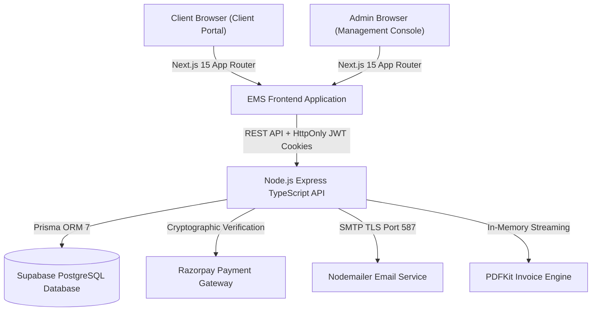
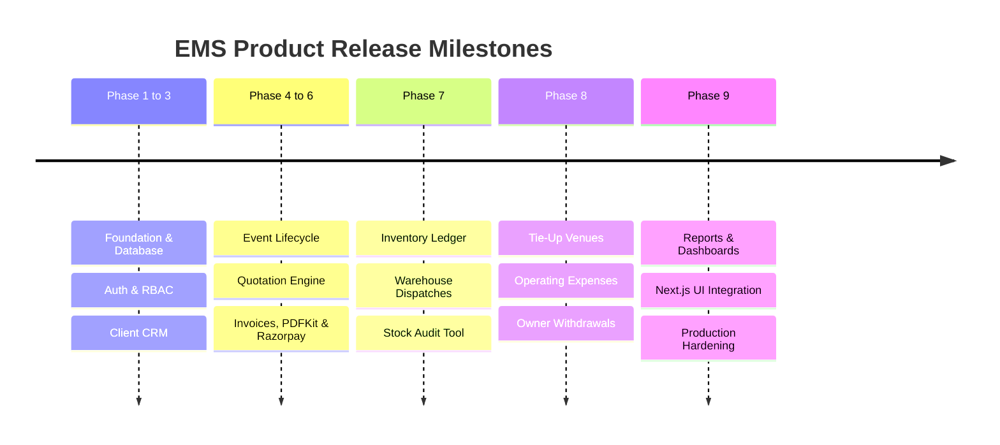

# Product Requirements Document (PRD)
# Event Management System (EMS)

**Document Version:** 1.0.0  
**Status:** Approved Baseline  
**Target Market:** Indian Event Management Companies (Weddings, Banquets, Corporate Galas, Social Events)  
**Currency Standard:** Indian Rupee (INR ₹)  
**System Architecture:** Decoupled Architecture (Next.js Frontend + Node.js/Express TypeScript Backend + Supabase PostgreSQL via Prisma 7)  
**Author:** Product & Architecture Team  

---

## 1. Executive Summary & Product Vision

### 1.1 Product Vision
The **Event Management System (EMS)** is an enterprise operational and financial operating system custom-tailored for boutique Indian event management businesses handling concurrent weddings, corporate conferences, and social galas. 

Traditional event firms frequently face four acute operational risks:
1. **Uncollected Client Balances**: Fragmented invoices, unmonitored advances, and confusion over proforma versus final tax invoices.
2. **Missing Warehouse Equipment**: Untracked sound systems, stage lighting, and decor disappearing between warehouse dispatch and event teardown.
3. **Venues & Commission Disputes**: Loss of revenue tracking for banquet hall, restaurant, and hotel kickbacks and referral commissions.
4. **Commingled Finances**: Confounding event operating costs with business overhead and owner personal withdrawals.

EMS centralizes end-to-end event operations—from pre-sale quotation drafting to warehouse dispatch, post-event returns, vendor expense settlements, Razorpay client payment collections, and owner draw accounting.

### 1.2 Target Business Context
- **Organization Profile:** Boutique event management firm managing 10–50 high-touch events per quarter.
- **Internal Core Team:** 2–10 concurrent operational users (Founders, Event Directors, Operations Managers, Logistics Coordinators, Accountants).
- **External Stakeholders:** Corporate and wedding clients accessing a dedicated, secure Client Portal.

---

## 2. User Personas & Target Audience

| Persona | Role | Primary Goals | Key Pain Points |
|---|---|---|---|
| **Managing Director / Founder** | Super Admin / Business Owner | Monitor real-time net profitability per event, manage personal drawings/withdrawals, oversee partner commissions, approve quotations. | Commingling of personal and business cash flow; blind spots regarding uncollected invoices. |
| **Event Operations Manager** | Admin / Event Coordinator | Plan event day-of schedules, request equipment from warehouse, monitor venue tie-ups, book vendors. | Stock shortages on event day; conflicting event equipment reservations; fragmented communication. |
| **Warehouse / Inventory Supervisor** | Admin / Logistics Lead | Track item dispatches to trucks, verify return conditions, record broken/damaged gear, monitor minimum stock alerts. | Unaccounted gear loss; lack of proof regarding whether gear was damaged on-site or in warehouse. |
| **Client (Bride, Groom, Corporate POC)** | Client (External Portal) | Review and accept quotations, download official PDF tax invoices, make online UPI/Card payments via Razorpay, view event schedules. | Cluttered email threads; uncertainty about advance balances adjusted on final bills. |

---

## 3. Product Architecture & Technical Stack



- **Frontend:** Next.js 15 (App Router), React 19, TypeScript, Tailwind CSS, Shadcn UI, TanStack Query, Zustand.
- **Backend:** Node.js, Express 5, TypeScript (Strict ESM, layered architecture: `controllers/`, `routes/`, `services/`, `validations/`), Zod validation.
- **Database:** Supabase-managed PostgreSQL, Prisma ORM 7 (`Prisma.Decimal` high-precision arithmetic).
- **Integrations:**
  - **Razorpay**: Order creation, webhooks, cryptographic HMAC-SHA256 signature verification.
  - **PDFKit**: Server-side tax invoice PDF generation and inline streaming.
  - **Nodemailer**: Transactional email dispatch for client portal invitations.

---

## 4. Key Functional Modules & Scope

### 4.1 Module 1: Authentication & Access Control (RBAC)
- **Multi-Role Support:** Strict division between `ADMIN` (internal staff) and `CLIENT` (customer portal).
- **Session Architecture:** Dual-token model (15-minute cryptographically signed JWT access tokens + 7-day revolving refresh tokens stored as SHA-256 hashes in database).
- **Client Portal Security:** Closed invitation-only registration via 32-byte cryptographic activation tokens delivered via email.
- **Role Guards:** Server-side `requireAdmin` and tenant-scoped `clientId` validation preventing Insecure Direct Object References (IDOR).

### 4.2 Module 2: Client Management & CRM
- **Customer Profiles:** Comprehensive registry supporting corporate entities (with GSTIN, PAN, billing addresses) and private individuals.
- **Portal Status Engine:** Track portal lifecycle (`UNINVITED` → `INVITED` → `ACTIVE` → `DEACTIVATED`).
- **Activity Timeline:** Log meetings, calls, site visits, and client status transitions with audit history.

### 4.3 Module 3: Event Lifecycle & Scheduling
- **Event Identifiers:** Auto-sequenced `EVT-YYYY-XXXX` tracking.
- **Lifecycle State Machine:**
  ```
  DRAFT ──> CONFIRMED ──> PLANNING ──> IN_PROGRESS ──> COMPLETED
    │            │            │
    └────────────┴────────────┴──────────> CANCELLED
  ```
- **Operational Tools:**
  - Day-of-event schedule timelines (`EventSchedule`) with start/end timestamps and location details.
  - Operational checklist tasks (`EventTask`) with priority and status flags.

### 4.4 Module 4: Quotation Management & Atomic Conversion
- **Sequential Numbering:** `QUO-YYYY-XXXX`.
- **Itemized Pricing Engine:** High-precision decimal calculations supporting line items, percentage or fixed discounts, and standard GST rates (0%, 5%, 12%, 18%, 28%).
- **State Progression:** `DRAFT` → `SENT` → `VIEWED` (auto-triggered when client opens link) → `ACCEPTED` / `REJECTED` / `EXPIRED`.
- **Atomic Event Conversion:** One-click conversion of accepted quotes into confirmed operational events, automatically creating default timelines.

### 4.5 Module 5: Invoicing & Client Payment Engine
- **Sequential Invoices:** `INV-YYYY-XXXX`.
- **Dual Invoice Architecture:**
  - **Proforma Invoices (`PROFORMA`)**: Pre-event milestone demand notes for client advances.
  - **Final Tax Invoices (`FINAL`)**: Official GST-compliant tax invoices with explicit line-item tracking of `advanceAdjusted`.
- **Payment Collection Engine:**
  - Multi-invoice payment splitting (one lump-sum client transfer allocated across multiple open invoices).
  - Payment modes: `CASH`, `UPI`, `BANK_TRANSFER`, `CHEQUE`, `ONLINE_PAYMENT`, `OTHER`.
  - Automatic invoice settlement (`UNPAID` → `PARTIALLY_PAID` → `PAID`).
  - Razorpay Gateway integration (order creation, HMAC-SHA256 verification, automatic ledger posting).
  - Server-side dynamic PDF generation via PDFKit.

### 4.6 Module 6: Inventory Management & Movement Ledger
- **Master Catalog:** Categorized items with SKU, unit of measure, minimum stock threshold, and purchase prices.
- **Item Classifications:**
  - `REUSABLE`: Mics, stage lights, sound mixers, trussing, furniture.
  - `CONSUMABLE`: Wristbands, badges, gaffer tape, party poppers.
- **Double-Entry Stock Ledger:**
  - Inflows: Purchases (`PURCHASE`), positive adjustments (`ADJUSTMENT_IN`), event returns (`EVENT_RETURN`).
  - Outflows: Event dispatches (`EVENT_ISSUE`), negative adjustments (`ADJUSTMENT_OUT`), warehouse write-offs (`DAMAGE`, `LOSS`).
- **Event Logistics Cycle:**
  1. *Requirement Planning*: Allocate required equipment without altering warehouse stock.
  2. *Dispatch*: Validate warehouse stock availability; atomically decrement warehouse stock and record `EVENT_ISSUE`.
  3. *Post-Event Return*: Inspect return. Good gear increments warehouse stock (`EVENT_RETURN`). Broken/damaged gear is excluded from warehouse stock and recorded as `DAMAGE`.
  4. *Audit Tool*: Real-time ledger reconciliation calculating:
     $$\text{Warehouse Stock} = \sum(\text{Inflows}) - \sum(\text{Outflows})$$

### 4.7 Module 7: Tie-Up Venues & Banquet Commissions (Upcoming Phase 8)
- **Partner Registry:** Directory of banquet halls, hotels, and restaurants.
- **Commission Models:** Percentage of event billing or fixed amount per event.
- **Event Linkage:** Associating events with tie-up venues, recording frozen commission snapshots, and tracking security deposits.

### 4.8 Module 8: Operating Expenses & Owner Withdrawals (Upcoming Phase 8)
- **Operating Expense Ledger:** Direct vendor costs (catering, transport, banquet commission payouts, equipment rentals).
- **Inventory Purchase Linking:** Reconciling inventory purchase movements directly with expense records.
- **Owner Withdrawal Isolation:** Strict database and accounting separation between corporate operating expenses and owner personal profit drawings.

### 4.9 Module 9: Analytics, Reports & Dashboards (Upcoming Phase 9)
- **Operational Metrics:** Active events count, upcoming schedule timeline, low-stock inventory alerts.
- **Financial Intelligence:** Cash vs. Accrual revenue, gross margins per event, outstanding debtor aging, banquet commissions earned versus paid.

---

## 5. Non-Functional Requirements (NFRs)

### 5.1 Currency & Precision Standards
- All monetary amounts stored as `Prisma.Decimal(12, 2)` to eliminate IEEE 754 floating-point inaccuracies.
- All monetary inputs rounded to 2 decimal places with half-up rounding rules.

### 5.2 Performance & Responsiveness
- **API Response Latency (p95):** $\le 200\text{ ms}$ for standard queries under concurrent team usage.
- **Database Connection Pooling:** Managed via Supabase transaction pooler with graceful connection acquisition timeouts.
- **PDF Generation:** Streamed directly to response buffer without storing temporary files on local disk.

### 5.3 Security & Data Protection
- **Password Hashing:** Salted `bcrypt` hashing (cost factor 12).
- **Transport Security:** Strict CORS whitelist matching frontend origin, secure cookie flags (`HttpOnly: true`, `SameSite: 'lax'`, `Secure` in production).
- **HTTP Header Hardening:** `helmet` security suite enforcing CSP, frameguard `DENY`, and HSTS.
- **Rate Limiting:** IP and user-based throttling on authentication and payment verification endpoints.

---

## 6. Out of Scope (Release 1.0)
The following capabilities are explicitly excluded from Release 1.0:
- Multi-tenant SaaS architecture (database serves one organization).
- Native mobile applications (iOS/Android).
- Automated statutory GST tax filing portals (GSTR-1 / GSTR-3B).
- Public vendor marketplace or self-service booking engines.
- In-app payroll processing and biometric staff attendance tracking.

---

## 7. Success Metrics & Key Performance Indicators (KPIs)

| KPI | Target Metric | Business Impact |
|---|---|---|
| **Invoice Settlement Speed** | 30% reduction in average Days Sales Outstanding (DSO) | Faster cash collection via Razorpay links and clear Proforma tracking. |
| **Inventory Shrinkage Rate** | $< 1\%$ unaccounted equipment loss per quarter | Complete accountability through event dispatch/return damaged logs. |
| **Quotation Turnaround** | Under 10 minutes to draft and dispatch branded quote | Higher conversion rate of leads into confirmed events. |
| **Financial Reconciliation** | 100% mathematical match between warehouse stock and logged movements | Total audit compliance and accurate inventory valuation. |

---

## 8. Release Roadmap


