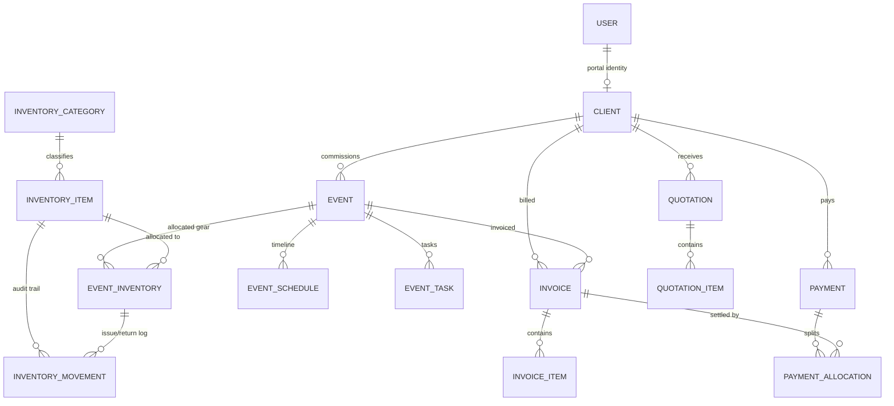

# Software Requirements Specification (SRS)
# Event Management System (EMS)

**Standard:** IEEE 830-1998 Compliant  
**Version:** 1.0.0  
**Status:** Approved Specification  
**Application Environment:** Node.js 20+ / Express 5 / Next.js 15 / PostgreSQL / Prisma ORM 7  
**Date:** November 2026  

---

## Table of Contents
1. [Introduction](#1-introduction)
   - 1.1 Purpose
   - 1.2 Document Conventions
   - 1.3 Intended Audience
   - 1.4 Product Scope
   - 1.5 References
2. [Overall Description](#2-overall-description)
   - 2.1 Product Perspective & Context
   - 2.2 Product Functions Summary
   - 2.3 User Roles & Characteristics
   - 2.4 Operating Environment
   - 2.5 Design & Implementation Constraints
   - 2.6 Assumptions & Dependencies
3. [External Interface Requirements](#3-external-interface-requirements)
   - 3.1 User Interfaces
   - 3.2 Software Interfaces
   - 3.3 Communication & Protocol Interfaces
4. [System Features & Functional Requirements](#4-system-features--functional-requirements)
   - 4.1 Authentication & Session Management
   - 4.2 Client Registry & Portal Activation
   - 4.3 Event Lifecycle & Operational Schedules
   - 4.4 Quotation Management & Pricing Formulas
   - 4.5 Invoices & Client Payment Engine
   - 4.6 Inventory Ledger & Logistics Movement
   - 4.7 Vendor Tie-Ups & Banquet Commissions
   - 4.8 Operating Expenses & Owner Withdrawals
   - 4.9 Reporting & Financial Summaries
5. [Non-Functional Requirements (NFRs)](#5-non-functional-requirements-nfrs)
   - 5.1 Performance Requirements
   - 5.2 Security & Access Guard Requirements
   - 5.3 Data Integrity & Transaction Guarantees
   - 5.4 Reliability & Availability
6. [Data Requirements & Schema Entities](#6-data-requirements--schema-entities)

---

## 1. Introduction

### 1.1 Purpose
This document specifies the software requirements for the **Event Management System (EMS)**. It defines the functional behavior, architectural constraints, interface integrations, and verification standards for both internal business administration and client-facing portal operations.

### 1.2 Document Conventions
- **Requirement Prioritization:** Requirements labeled **[MANDATORY]** must be strictly fulfilled in Release 1.0. **[OPTIONAL]** or **[DEFERRED]** items are reserved for subsequent phases.
- **Data Currency Standard:** All financial amounts are calculated and formatted in Indian Rupees (**INR ₹**) with two decimal places (`db.Decimal(12, 2)`).
- **HTTP API Conventions:** RESTful JSON APIs adhering to standardized response wrappers (`{ success: true, data, meta }` or `{ success: false, error: { code, message, details } }`).

### 1.3 Intended Audience
This SRS is written for backend software engineers, frontend application engineers, QA test automation engineers, DevOps deployment teams, and executive product stakeholders.

### 1.4 Product Scope
EMS is a specialized ERP and operations platform for boutique event management organizations. The system manages the entire operational lifecycle:
1. Lead to Client CRM transition.
2. Itemized quotation drafting with GST, discounts, and one-click atomic event creation.
3. Event milestone tracking, day-of-event schedules, and operational checklists.
4. Billing via Proforma advances and final GST-compliant Tax Invoices.
5. Online payments via Razorpay gateway and offline receipts with multi-invoice split allocations.
6. Reusable and consumable inventory tracking via a strict double-entry movement ledger.
7. Banquet venue tie-up commissions, corporate operating expenses, and owner drawings.

### 1.5 References
- [Product Requirements Document (docs/PRD.md)](file:///C:/Users/N/Documents/projects/EMS/docs/PRD.md)
- [Low-Level Design Specification (docs/LLD.md)](file:///C:/Users/N/Documents/projects/EMS/docs/LLD.md)
- [Implementation Roadmap (docs/IMPLEMENTATION_ROADMAP.md)](file:///C:/Users/N/Documents/projects/EMS/docs/IMPLEMENTATION_ROADMAP.md)
- [Prisma Schema Definition (backend/prisma/schema.prisma)](file:///C:/Users/N/Documents/projects/EMS/backend/prisma/schema.prisma)

---

## 2. Overall Description

### 2.1 Product Perspective & Context
EMS operates as a client-server architecture consisting of a Next.js 15 frontend consumer communicating with an Express.js TypeScript API server, backed by a managed PostgreSQL database via Supabase.

```
+-------------------------------------------------------------------+
|                        EMS Web Application                        |
|                                                                   |
|   +--------------------------+    +---------------------------+   |
|   |   Admin Portal (Next.js) |    |   Client Portal (Next.js) |   |
|   +-------------+------------+    +-------------+-------------+   |
+-----------------|-------------------------------|-----------------+
                  | HTTPS REST API                | HTTPS REST API
                  | (HttpOnly JWT Cookies)        | (Scoped by clientId)
+-----------------v-------------------------------v-----------------+
|               Node.js Express 5 TypeScript API Server             |
|                                                                   |
|  [AuthMw] -> [RoleMw] -> [ValidateMw] -> [Controller] -> [Service]|
+---------------------------------+---------------------------------+
                                  | Prisma ORM 7
+---------------------------------v---------------------------------+
|                   PostgreSQL Database (Supabase)                  |
|    - Decimal(12, 2) financial precision                           |
|    - Foreign key constraints (ON DELETE RESTRICT)                 |
+-------------------------------------------------------------------+
```

### 2.2 Product Functions Summary
- **Identity & RBAC:** Secure token-based session lifecycle with role guards (`ADMIN` vs `CLIENT`).
- **Customer Directory:** Managing private individuals and corporate entities with portal activation tokens.
- **Event Lifecycle State Engine:** Tracking status progression (`DRAFT` to `COMPLETED` or `CANCELLED`).
- **Pricing & Invoicing Engine:** Automated calculation of subtotals, percentage/fixed discounts, GST, and advance adjustments.
- **Logistics Ledger:** Real-time stock audit engine verifying warehouse stock against the algebraic sum of logged physical movements.

### 2.3 User Roles & Characteristics

| User Role | Identification | Permissions Scope |
|---|---|---|
| **Admin (`ADMIN`)** | System users where `role === "ADMIN"` and `clientId === null`. | Full operational and financial access: manage clients, create events, issue invoices, record payments, allocate warehouse stock, configure tie-ups, view financial reports. |
| **Client (`CLIENT`)** | External users where `role === "CLIENT"` and `clientId !== null`. | Scoped strictly to their own tenant record (`req.user.clientId`). View approved quotations, download tax invoices, make payments, inspect event itinerary. Cannot access internal vendor costs, expenses, or inventory catalogs. |

### 2.4 Operating Environment
- **Server Runtime:** Node.js v20.x or v22.x LTS (ESM modules).
- **Database Engine:** PostgreSQL 15+ hosted on Supabase with PgBouncer connection pooling.
- **Client Platforms:** Modern desktop and tablet browsers (Chromium 120+, Firefox 120+, Safari 17+).

### 2.5 Design & Implementation Constraints
1. **Architectural Purity:** Backend must strictly follow the layered pattern (`controllers/`, `routes/`, `services/`, `validations/`, `types/`). Creation of a `modules/` directory is strictly prohibited.
2. **Schema Invariance:** `prisma/schema.prisma` is an immutable ground truth. No migrations or resets may be executed without explicit operator consent.
3. **Financial Math:** Floating-point math (`number * number`) is forbidden for ledger entries; all calculations must utilize `round2()` and `Prisma.Decimal`.
4. **Third-Party Libraries:** External packages must be approved prior to installation.

---

## 3. External Interface Requirements

### 3.1 User Interfaces
- **Admin Dashboard:** Desktop-optimized management console providing table views, modal dialogs, status badges, and action dropdowns.
- **Client Portal:** Streamlined responsive portal displaying active event timelines, payable invoice lists with "Pay Now" actions, and PDF downloads.

### 3.2 Software Interfaces
- **Supabase PostgreSQL:** Managed relational storage accessed through Prisma 7 Client.
- **Razorpay API (v2.9+):** Payment gateway integration executing:
  - `POST /orders`: Generating unique `order_id` in paise ($1\text{ INR} = 100\text{ paise}$).
  - Webhook/Client Verification: Cryptographic HMAC-SHA256 signature verification over `${order_id}|${payment_id}` using `RAZORPAY_KEY_SECRET`.
- **PDFKit (v0.20+):** Programmatic PDF rendering generating GST-compliant tax invoices in memory buffers.
- **Nodemailer SMTP:** TLS connection over port 587 for transactional email dispatch.

### 3.3 Communication & Protocol Interfaces
- **Transport:** HTTPS/TLS 1.3 encrypted connections.
- **Authentication Credentials:** Dual JWT delivered via `Set-Cookie` header (`access_token` with 15-minute TTL, `refresh_token` with 7-day TTL).
- **Payload Format:** `application/json; charset=utf-8`.

---

## 4. System Features & Functional Requirements

### 4.1 Authentication & Session Management
- **Description:** Provides identity verification, token minting, token refresh rotation, and session invalidation.
- **Endpoints:**
  - `POST /api/v1/auth/login`: Authenticates credentials; returns user object, issues JWT in cookies.
  - `POST /api/v1/auth/refresh`: Validates refresh token against database hash; rotates both tokens.
  - `POST /api/v1/auth/logout`: Revokes database refresh token; clears browser cookies.
  - `POST /api/v1/auth/activate-portal`: Accepts activation token and password; activates client account.
  - `GET /api/v1/auth/me`: Returns active session profile.
- **Error Codes:** `401 UNAUTHORIZED` (invalid credentials/token), `403 FORBIDDEN` (account deactivated).

### 4.2 Client Registry & Portal Activation
- **Description:** Administers client directory and handles customer portal provisioning.
- **Endpoints:**
  - `GET /api/v1/clients`: Paginated directory search.
  - `POST /api/v1/clients`: Creates client record (does not create user login).
  - `POST /api/v1/clients/:id/assign-portal`: Generates 32-byte cryptographic token; creates inactive `User` (`role: CLIENT`, `clientId: id`); sends invite email.
  - `PATCH /api/v1/clients/:id/status`: Toggles portal login active status.

### 4.3 Event Lifecycle & Operational Schedules
- **Description:** Manages core event execution, milestone transitions, day-of schedules, and operational tasks.
- **Sequential ID Format:** `EVT-YYYY-XXXX` (auto-incremented within current calendar year).
- **State Machine Transitions:**
  $$\text{DRAFT} \longrightarrow \text{CONFIRMED} \longrightarrow \text{PLANNING} \longrightarrow \text{IN\_PROGRESS} \longrightarrow \text{COMPLETED}$$
  $$\text{Any Pre-Completion State} \longrightarrow \text{CANCELLED}$$
- **Endpoints:**
  - `GET /api/v1/events`: Filter by status, date range, client.
  - `POST /api/v1/events`: Creates event.
  - `PATCH /api/v1/events/:id/status`: Transitions lifecycle state.
  - `POST /api/v1/events/:id/schedules`: Adds day-of timeline item (`startAt`, `endAt`, `title`).
  - `POST /api/v1/events/:id/tasks`: Adds operational task (`priority`, `dueDate`, `title`).

### 4.4 Quotation Management & Pricing Formulas
- **Description:** Pre-sale itemized cost estimates with client review tracking and one-click event conversion.
- **Calculation Specifications:**
  $$\text{Subtotal} = \sum (\text{item.quantity} \times \text{item.unitPrice})$$
  $$\text{Discount} = \begin{cases} \text{round2}\left(\frac{\text{Subtotal} \times \text{rate}}{100}\right) & \text{if PERCENTAGE} \\ \min(\text{Subtotal}, \text{fixedValue}) & \text{if FIXED} \end{cases}$$
  $$\text{Taxable Amount} = \text{Subtotal} - \text{Discount}$$
  $$\text{Tax Amount} = \text{round2}\left(\frac{\text{Taxable Amount} \times \text{taxRate}}{100}\right)$$
  $$\text{Total Amount} = \text{Taxable Amount} + \text{Tax Amount}$$
- **Atomic Event Conversion:** When quotation status transitions to `ACCEPTED`, executing `POST /api/v1/quotations/:id/convert-to-event` creates an operational `Event` inside a single `prisma.$transaction`.

### 4.5 Invoices & Client Payment Engine
- **Description:** Generates Proforma advances and Final Tax Invoices, manages split allocations, and handles Razorpay gateway verification.
- **Sequential Format:** `INV-YYYY-XXXX` (Invoices), `PAY-YYYY-XXXX` (Payments).
- **Business Logic Rules:**
  1. *Proforma vs Final:* Proforma invoices record client advance requests. Final invoices track delivered services and explicitly adjust prior advances via `advanceAdjusted`.
  2. *Payment Allocation:* Single payment record can split its total amount across multiple outstanding invoices via `PaymentAllocation`.
  3. *Automatic Status Balancing:*
     $$\text{Total Paid} = \sum (\text{allocations.amount})$$
     $$\text{Status} = \begin{cases} \text{PAID} & \text{if Total Paid} \ge \text{Invoice.totalAmount} \\ \text{PARTIALLY\_PAID} & \text{if } 0 < \text{Total Paid} < \text{Invoice.totalAmount} \\ \text{UNPAID} & \text{if Total Paid} = 0 \end{cases}$$
  4. *PDF Invoices:* `GET /api/v1/invoices/:id/pdf` generates a dynamic, printable PDF stream.
  5. *Razorpay Order Verification:* Accepts `razorpay_order_id`, `razorpay_payment_id`, and `razorpay_signature`. Computes:
     $$\text{HMAC-SHA256}(\text{order\_id} + "|" + \text{payment\_id}, \text{RAZORPAY\_KEY\_SECRET})$$
     On matching signature, creates verified `Payment` and settles target invoice.

### 4.6 Inventory Ledger & Logistics Movement
- **Description:** Double-entry warehouse inventory accounting tracking reusables, consumables, and third-party rentals across events.
- **Equipment Ownership Classification (`InventoryUsageType`):**
  - `OWNED`: Company-owned assets stored in internal warehouse inventory.
  - `RENTED`: External third-party vendor equipment hired for event execution.
- **Rental Calculation Formulations:**
  $$\text{rentalDays} = \max(1, \lceil(\text{rentalEndDate} - \text{rentalStartDate}) / 86400000\rceil)$$
  $$\text{totalRent} = \text{round2}(\text{requiredQuantity} \times \text{rentPerUnit} \times \text{rentalDays})$$
- **Movement Types (`InventoryMovementType`):**
  - `PURCHASE`: Increments `currentStock`.
  - `ADJUSTMENT_IN`: Increments `currentStock`.
  - `ADJUSTMENT_OUT`: Decrements `currentStock` (fails if quantity exceeds available stock).
  - `DAMAGE` / `LOSS`: Decrements `currentStock` (warehouse write-off).
  - `EVENT_ISSUE`: For `OWNED`: decrements `currentStock` and increments `EventInventory.issuedQuantity`. For `RENTED`: leaves warehouse stock untouched; increments `issuedQuantity`.
  - `EVENT_RETURN`: For `OWNED`: increments `currentStock` for undamaged gear; increments `EventInventory.returnedQuantity`. For `RENTED`: leaves warehouse stock untouched; sets `actualReturnDate` and increments `returnedQuantity`.
- **Event Return Validation:**
  $$\text{Outstanding} = \text{issuedQuantity} - (\text{returnedQuantity} + \text{damagedQuantity})$$
  $$\text{Attempted Return} = \text{newReturned} + \text{newDamaged}$$
  If $\text{Attempted Return} > \text{Outstanding}$, reject with `400 BAD_REQUEST`.
- **Mathematical Audit Reconciliation:**
  $$\text{Inflows} = \sum(\text{PURCHASE}) + \sum(\text{ADJUSTMENT\_IN}) + \sum(\text{EVENT\_RETURN})$$
  $$\text{Outflows} = \sum(\text{EVENT\_ISSUE}) + \sum(\text{ADJUSTMENT\_OUT}) + \sum(\text{Warehouse DAMAGE}) + \sum(\text{LOSS})$$
  $$\text{Expected Stock} = \text{Inflows} - \text{Outflows}$$
  $$\text{Discrepancy} = \text{currentStock} - \text{Expected Stock}$$
- **Frontend Guidance Reference:** Complete UI wireframes, TypeScript contracts, and API routes are defined in [docs/inventory-frontend-guide.md](file:///C:/Users/N/Documents/projects/EMS/docs/inventory-frontend-guide.md).

### 4.7 Vendor Tie-Ups & Banquet Commissions (Phase 8 Specification)
- **Description:** Directory of external banquet halls, restaurants, and hotels linked to events.
- **Commission Models:** Tracks negotiated percentage or fixed commission per event.
- **Security Deposits:** Records refundable venue deposits held and returned.

### 4.8 Operating Expenses & Owner Withdrawals (Phase 8 Specification)
- **Description:** Expense management categorized into event costs, operational overhead, inventory purchases, and owner personal withdrawals.
- **Isolation Rule:** `OwnerWithdrawal` records must be strictly isolated from event operating expenses to ensure accurate corporate margin calculations.

### 4.9 Reporting & Financial Summaries (Phase 9 Specification)
- **Revenue Recognition:** Differentiates between Accrual Revenue (billed via `Invoice`) and Cash Revenue (received via `Payment`).
- **Profitability Metrics:** Gross Margin per event calculated as:
  $$\text{Margin} = \text{Event Invoiced Revenue} - (\text{Event Operating Expenses} + \text{Venue Commission Payouts})$$

---

## 5. Non-Functional Requirements (NFRs)

### 5.1 Performance Requirements
- **PR-1 (Latency):** 95% of read queries must respond in $< 200\text{ ms}$ under concurrent load of 10 internal users.
- **PR-2 (Database Connection Pooling):** Use connection pooling with timeout limits ($\le 10\text{ s}$) to prevent connection exhaustion.
- **PR-3 (Asset Streaming):** PDF invoice generation must execute in-memory and begin streaming within $500\text{ ms}$.

### 5.2 Security & Access Guard Requirements
- **SR-1 (Authentication):** Dual JWT architecture with cryptographic verification on every request.
- **SR-2 (Role Enforcement):** All administrative endpoints must be guarded by `requireAdmin`.
- **SR-3 (IDOR Mitigation):** Client requests accessing sub-resources (invoices, payments, quotations, events) must include database predicate:
  ```ts
  where: { id: resourceId, clientId: req.user.clientId }
  ```
- **SR-4 (Input Sanitization):** All incoming HTTP request parameters, queries, and bodies must be validated using Zod schemas; invalid payloads rejected with `422 VALIDATION_ERROR`.

### 5.3 Data Integrity & Transaction Guarantees
- **DIR-1 (Atomicity):** Multi-table updates (e.g., event conversion, payment settlement, inventory dispatch/return) must be enclosed inside `prisma.$transaction`.
- **DIR-2 (Deletion Constraints):** Foreign keys configured with `onDelete: Restrict` on critical tables (`Invoice`, `Payment`, `InventoryMovement`, `Event`) to prevent orphan records.

---

## 6. Data Requirements & Schema Entities



### Complete Model Summary
- **`User`**: Internal administrators and client portal credentials (`id`, `name`, `email`, `passwordHash`, `role: USERROLE`, `clientId`, `isActive`).
- **`Client`**: Company or individual profile (`id`, `name`, `email`, `phone`, `city`, `address`, `status`).
- **`Event`**: Core operational unit (`id`, `eventNumber`, `title`, `eventType`, `eventDate`, `budget`, `status: EventStatus`, `clientId`).
- **`Quotation` & `QuotationItem`**: Pre-sale pricing estimates (`quotationNumber`, `status: QuotationStatus`, `subtotal`, `discountAmount`, `taxAmount`, `totalAmount`).
- **`Invoice` & `InvoiceItem`**: Client billing records (`invoiceNumber`, `type: InvoiceType`, `status: InvoiceStatus`, `subtotal`, `taxAmount`, `totalAmount`).
- **`Payment` & `PaymentAllocation`**: Payment transactions and split allocations across invoices (`paymentNumber`, `amount`, `paymentMethod`, `status`).
- **`InventoryCategory`, `InventoryItem`, `EventInventory`, `InventoryMovement`**: Full warehouse inventory master and movement ledger.
- **`TieUp`, `TieUpEvent`, `Expense`, `ExpensePayment`, `OwnerWithdrawal`**: Partner venue commissions, operational expenses, and owner profit withdrawals.

---

## 7. Verification & Acceptance Criteria
For every module to achieve sign-off:
1. **Automated Test Suite:** Integration test script running against PostgreSQL achieving **100% pass rate**.
2. **Type Safety:** Compilation via `tsc` yielding **0 errors**.
3. **Database Schema Integrity:** SHA-256 hash of `prisma/schema.prisma` must remain completely unchanged.
4. **No Unauthorized Packages:** Only approved packages in `package.json`.
