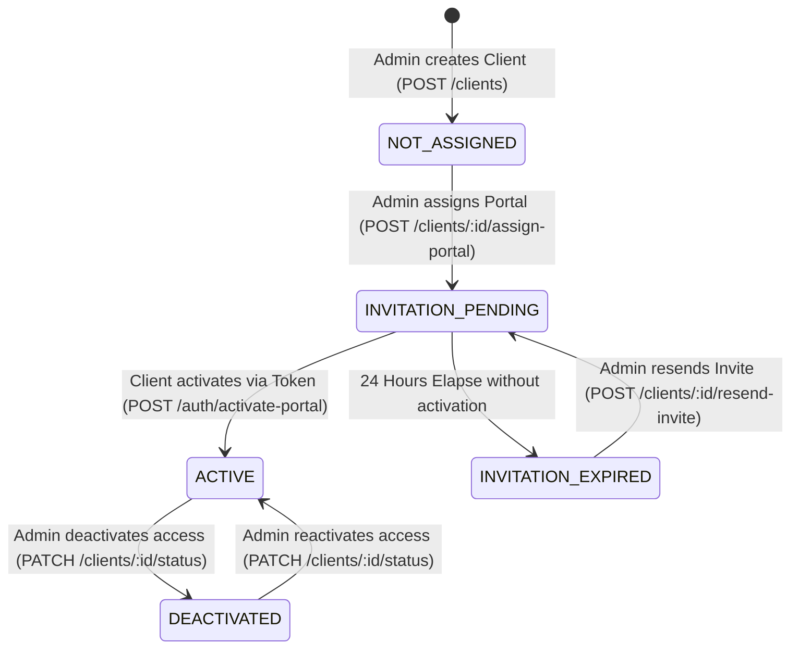
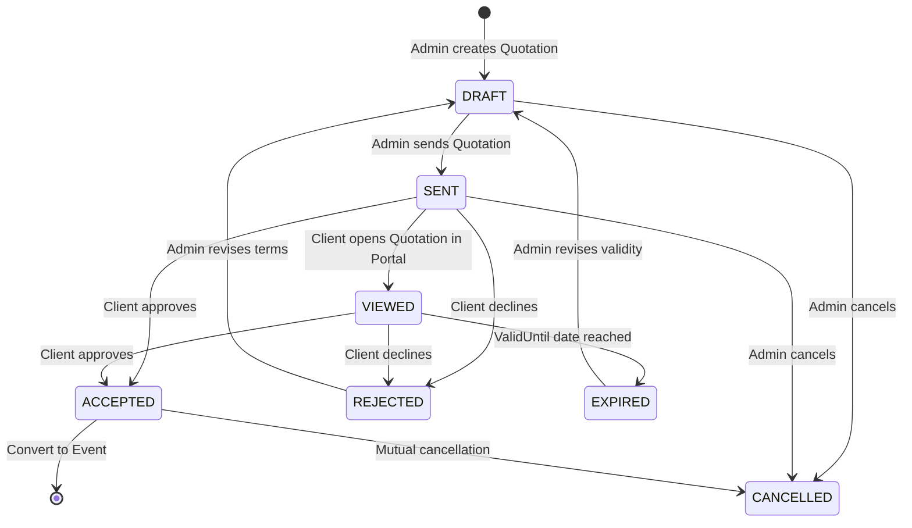
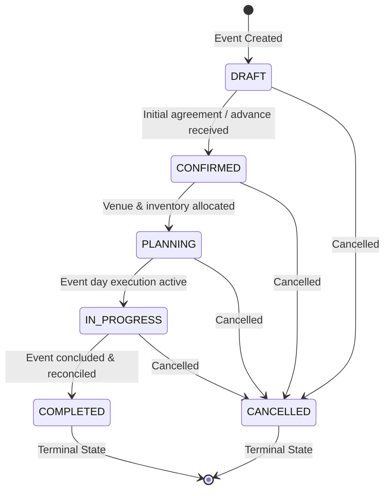
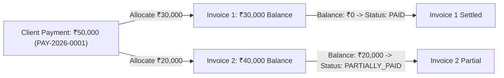
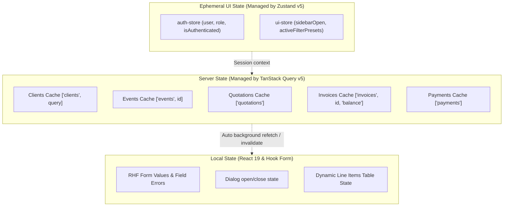

# Event Management System (EMS) — Frontend Functional Specifications & Business Workflows

**Document Version:** 1.0.0  
**Target Application:** `frontend/` (Next.js 16 App Router, React 19, TypeScript, TanStack Query v5, Zustand v5)  
**Parent Plan:** [frontend/plan.md](file:///C:/Users/N/Documents/projects/EMS/frontend/plan.md)  
**Status:** Authoritative Functional & Mathematical Specification  

---

## 1. Domain Logic & Business Rules

### 1.1 Client Identity & Account Representation
The system operates on a **Hybrid 1:1 Identity Profile** model:
- **`Client` (Business Profile):** Represents the customer entity (name, 10-digit Indian mobile number, optional email, address, city, notes). A walk-in or offline consultation client can exist in the system and be linked to quotations, events, and invoices without having login credentials.
- **`User` (Authentication Principal):** Represents credentials (email, bcrypt password hash, role, refresh tokens). Admin users have `role = ADMIN` and `clientId = null`. Client users have `role = CLIENT` and a non-null `clientId` linked 1:1 to their `Client` record.

#### Client Portal Lifecycle & State Machine


1. **`NOT_ASSIGNED`:** Client profile exists with no linked `User` record. Admin sees an **"Assign Portal Access"** button. (Requires valid client email).
2. **`INVITATION_PENDING`:** An inactive user record (`isActive = false`) has been created with a single-use cryptographic token (`invitationToken`) expiring in 24 hours. The activation link `${CORS_ORIGIN}/activate-portal?token=${token}` is delivered via email (or logged to console).
3. **`INVITATION_EXPIRED`:** If the client fails to activate within the expiry window, status shifts to `INVITATION_EXPIRED`. Admin sees a **"Resend Fresh Invitation"** button which generates a new token and extends expiry.
4. **`ACTIVE`:** Client opens the link, sets their password (`min(6)`), and submits to `POST /api/v1/auth/activate-portal`. The backend sets `isActive = true`, clears the one-time token, and issues active JWT session cookies.
5. **Deactivation & Audit Rule:** Admin can toggle `isActive` to `false` at any time via `PATCH /api/v1/clients/:id/status`. Doing so immediately revokes all active refresh tokens in the database, invalidating any active client sessions.

---

### 1.2 Quotation Management & Mathematical Rules

#### 1. Line Item & Total Calculations
Quotations use exact decimal precision with 2 decimal places to avoid floating-point drift:

$$\text{Line Total} = \text{round}_2(\text{Quantity} \times \text{UnitPrice})$$

$$\text{Subtotal} = \sum_{i=1}^{n} \text{Line Total}_i$$

$$\text{Discount Amount} = \begin{cases} 
\text{round}_2\left(\text{Subtotal} \times \frac{\text{Discount Value}}{100}\right) & \text{if Discount Type} = \text{PERCENTAGE} \\
\min(\text{Subtotal}, \text{Discount Value}) & \text{if Discount Type} = \text{FIXED} \\
0 & \text{if Discount Type} = \text{null}
\end{cases}$$

$$\text{Amount After Discount} = \max(0, \text{Subtotal} - \text{Discount Amount})$$

$$\text{Tax Amount} = \text{round}_2\left(\text{Amount After Discount} \times \frac{\text{Tax Rate}}{100}\right)$$

$$\text{Total Amount} = \text{Amount After Discount} + \text{Tax Amount}$$

#### 2. Quotation Status Workflow


- **Real-Time CRM Hook:** When a Client user queries `GET /api/v1/quotations/:id`, the backend automatically transitions status from `SENT` to `VIEWED` if not already viewed.
- **Client Action Boundaries:** Clients can only submit `PATCH /api/v1/quotations/:id/status` with `ACCEPTED` or `REJECTED`. They cannot edit quantities, items, or prices.
- **Convert to Event Rule:** When a quotation is `ACCEPTED`, Admin can trigger `POST /api/v1/quotations/:id/convert-to-event`. This transitions the quotation, mints a sequential `EVT-YYYY-XXXX` event number, links the quotation via `Event.quotationId`, and pre-populates event details.

---

### 1.3 Event Lifecycle & Operational Sub-Modules

#### 1. Sequential Numbering & State Machine
Every event is assigned an immutable sequential identifier `EVT-YYYY-XXXX` (e.g. `EVT-2026-0001`). Status transitions follow strict state machine rules:



- Any transition to `CANCELLED` requires an audit reason which is appended to `Event.notes`.
- Deletion rule: An event cannot be deleted if it has linked invoices, payments, or recorded expenses. It must be marked `CANCELLED` instead to preserve financial audit history.

#### 2. Event Financial Calculations
The event summary (`GET /api/v1/events/:id/summary`) calculates real-time profitability:
- **Planning Budget (`Event.budget`):** Initial operational cost estimate. *Strict rule: Planned budget is NEVER treated as revenue or money received.*
- **Total Invoiced Revenue:** $\sum \text{Invoice.totalAmount}$ (excluding `CANCELLED` invoices).
- **Total Paid Cash:** $\sum \text{Payment.amount}$ (where status is `COMPLETED`).
- **Total Direct Expenses:** $\sum \text{Expense.amount}$ (where `scope = EVENT`).
- **Balance Receivable:** $\text{Total Invoiced} - \text{Total Paid Cash}$.
- **Net Operating Margin:** $\text{Total Invoiced} - \text{Total Direct Expenses}$.

#### 3. Operational Tasks & Itinerary Schedules
- **`EventTask`:** Checklists tracked by status (`TODO`, `IN_PROGRESS`, `COMPLETED`, `CANCELLED`) and priority (`LOW`, `MEDIUM`, `HIGH`, `URGENT`).
- **`EventSchedule`:** Day-of-event timeline blocks defined by `startAt` and `endAt` (e.g., "Guest Arrival: 6:00 PM", "Stage Entry: 7:30 PM", "Dinner Service: 8:30 PM").

---

### 1.4 Invoicing & Multi-Invoice Payment Engine

#### 1. Itemized Invoicing
- **Sequential Number:** `INV-YYYY-XXXX` (e.g. `INV-2026-0001`).
- **Line Item Classification:**
  - `PROFORMA`: Requests advance deposits prior to service delivery.
  - `FINAL`: Comprehensive tax invoice issued upon milestone completion.
  - `advanceAdjusted`: Tracks advance payments deducted from line item totals.
- **Invoice Balance Derivation:**

$$\text{Paid Amount} = \sum \text{PaymentAllocation.amount}$$

$$\text{Balance Amount} = \max(0, \text{Invoice.totalAmount} - \text{Paid Amount})$$

- **PDF Generation:** Invoices are compiled server-side via PDFKit and streamed as raw binary (`application/pdf`) with `Content-Disposition: inline; filename="INV-YYYY-XXXX.pdf"`.
- **Status Lifecycle:** `DRAFT` ➔ `SENT` ➔ `PARTIALLY_PAID` ➔ `PAID` (or `OVERDUE` / `CANCELLED`). An invoice cannot be edited once payments have been allocated to it.

#### 2. Payment Allocations & Automatic Invoice Reconciliation
Payments are recorded with sequential numbers `PAY-YYYY-XXXX` and can be distributed across multiple invoices:



- **Allocation Mathematical Constraints:**
  1. $\sum \text{PaymentAllocation.amount} \le \text{Payment.amount}$ (Payment cannot be over-allocated).
  2. For each invoice: $\text{Allocation Amount} \le \text{Invoice.balanceAmount}$ (Invoice cannot be overpaid).
  3. All allocated invoices must belong to the client who made the payment.
- **Automatic Status Updates:** Upon allocation, backend automatically transitions invoice to `PAID` if remaining balance is ₹0, or `PARTIALLY_PAID` if balance $> 0$.
- **Rollback Guarantee:** Deleting a payment record deletes all linked allocations and automatically recalculates each affected invoice's balance and status.

---

### 1.5 Master Calendar & CRM Activities
- Tracks meetings, site visits, vendor reviews, and follow-up calls (`CalendarEntry`).
- Scoped to `clientId` and an optional linked `eventId`.
- Validation rule: `endAt >= startAt`.
- Client role scoping: Clients can only see activities linked to their own account.

---

### 1.6 Future Domain Rules (Backend Phases 7–10)
- **Inventory Ledger (Phase 7):** Stock changes are never directly edited; they are driven by `InventoryMovement` records (`PURCHASE`, `EVENT_ISSUE`, `EVENT_RETURN`, `DAMAGE`, `ADJUSTMENT`). Damaged goods are tracked separately and never returned to active stock.
- **Venue Collaborations (Phase 8):** Refundable security deposits paid to hotels/banquets are classified as company assets, **never as expenses**. Event commissions are snapshot into `TieUpEvent` at creation time.
- **Operating Expenses vs Owner Withdrawals (Phase 9):**
  - Event Expenses: Operating costs directly tied to an event (`scope = EVENT`).
  - Business Expenses: Overhead costs like office rent or utility bills (`scope = BUSINESS`).
  - **Owner Withdrawals:** Personal drawings by business owners (`OwnerWithdrawal`). These must remain completely segregated from operating expense ledgers and **must never reduce event operating profit**.
- **Financial Reports (Phase 10):** Reports distinguish **Accrual Profitability** (Invoiced Revenue minus Incurred Expenses) from **Cash Flow** (Actual Cash Collected minus Cash Disbursed).

---

## 2. State Management Architecture



### 2.1 TanStack Query Caching & Key Factory
Queries follow a strict hierarchical key convention to enable targeted cache invalidation:

```typescript
export const queryKeys = {
  auth: {
    me: ["auth", "me"] as const,
  },
  clients: {
    all: ["clients"] as const,
    list: (query?: Record<string, unknown>) => ["clients", "list", query] as const,
    detail: (id: string) => ["clients", "detail", id] as const,
    portalStatus: (id: string) => ["clients", "portalStatus", id] as const,
    activities: (id: string) => ["clients", "activities", id] as const,
  },
  events: {
    all: ["events"] as const,
    list: (query?: Record<string, unknown>) => ["events", "list", query] as const,
    detail: (id: string) => ["events", "detail", id] as const,
    summary: (id: string) => ["events", "summary", id] as const,
    tasks: (id: string) => ["events", "tasks", id] as const,
    schedules: (id: string) => ["events", "schedules", id] as const,
  },
  quotations: {
    all: ["quotations"] as const,
    list: (query?: Record<string, unknown>) => ["quotations", "list", query] as const,
    detail: (id: string) => ["quotations", "detail", id] as const,
  },
  invoices: {
    all: ["invoices"] as const,
    list: (query?: Record<string, unknown>) => ["invoices", "list", query] as const,
    detail: (id: string) => ["invoices", "detail", id] as const,
    balance: (id: string) => ["invoices", "balance", id] as const,
  },
  payments: {
    all: ["payments"] as const,
    list: (query?: Record<string, unknown>) => ["payments", "list", query] as const,
    detail: (id: string) => ["payments", "detail", id] as const,
  },
  calendar: {
    all: ["calendar"] as const,
    list: (query?: Record<string, unknown>) => ["calendar", "list", query] as const,
  },
};
```

### 2.2 Cache Invalidation Dependency Graph
When mutations occur, related queries are invalidated automatically:
- **Payment Recorded (`POST /payments`):**
  - Invalidates `queryKeys.payments.all`
  - Invalidates `queryKeys.invoices.all` (updates invoice balances and statuses)
  - Invalidates `queryKeys.events.summary(eventId)` (updates event cash collected)
- **Quotation Converted to Event (`POST /convert-to-event`):**
  - Invalidates `queryKeys.quotations.detail(id)`
  - Invalidates `queryKeys.events.all`
- **Client Portal Status Updated (`PATCH /clients/:id/status`):**
  - Invalidates `queryKeys.clients.portalStatus(id)`
  - Invalidates `queryKeys.clients.detail(id)`

### 2.3 Zustand Stores

#### Auth Store (`src/stores/auth-store.ts`)
```typescript
import { create } from "zustand";
import { UserRole } from "@/types/models";

interface AuthUser {
  id: string;
  email: string;
  name: string;
  role: UserRole;
  clientId: string | null;
}

interface AuthState {
  user: AuthUser | null;
  isAuthenticated: boolean;
  isLoading: boolean;
  setUser: (user: AuthUser | null) => void;
  clearSession: () => void;
}

export const useAuthStore = create<AuthState>((set) => ({
  user: null,
  isAuthenticated: false,
  isLoading: true,
  setUser: (user) => set({ user, isAuthenticated: Boolean(user), isLoading: false }),
  clearSession: () => set({ user: null, isAuthenticated: false, isLoading: false }),
}));
```

---

## 3. Form Validation & Error Handling Pipelines

### 3.1 Form Architecture (React Hook Form + Zod)
Forms use uncontrolled inputs with Zod resolvers (`@hookform/resolvers/zod`). Input errors display immediately beneath affected form controls:

```typescript
// Example: Client Creation Schema matching backend
export const createClientFormSchema = z.object({
  name: z.string().trim().min(2, "Name must be at least 2 characters"),
  phone: z
    .string()
    .trim()
    .regex(/^[6-9]\d{9}$/, "Phone number must be a valid 10-digit Indian mobile number"),
  email: z.string().trim().email("Invalid email format").optional().or(z.literal("")),
  address: z.string().trim().optional(),
  city: z.string().trim().optional(),
  notes: z.string().trim().optional(),
});
```

### 3.2 Server Validation Error Mapping
When backend returns status 422 with validation issues (`details: [{ field, message }]`), the form handler maps field paths directly to React Hook Form field errors using `form.setError(field, { message })`.

---

## 4. Authorization & Security Pipelines

### 4.1 Server-Authoritative Principle
The frontend NEVER relies solely on client-side route guards for security. 
1. If a Client user attempts to access `/api/v1/clients` or `/api/v1/events/:id` belonging to another client, the backend rejects the request with `403 Forbidden` (`FORBIDDEN`).
2. The frontend catches `403 Forbidden` globally in `apiClient`, displays a Sonner warning ("Access Denied: You do not have permission to view this resource"), and redirects to the portal dashboard.

### 4.2 Client Data Masking
When the logged-in user is `CLIENT`:
- Internal vendor purchase costs are stripped server-side from event details.
- Event profit margins, banquet commission values, and company expenses are omitted.
- Financial metrics only display client-facing figures: Total Agreed Price, Taxes, Amount Paid, and Outstanding Balance.
