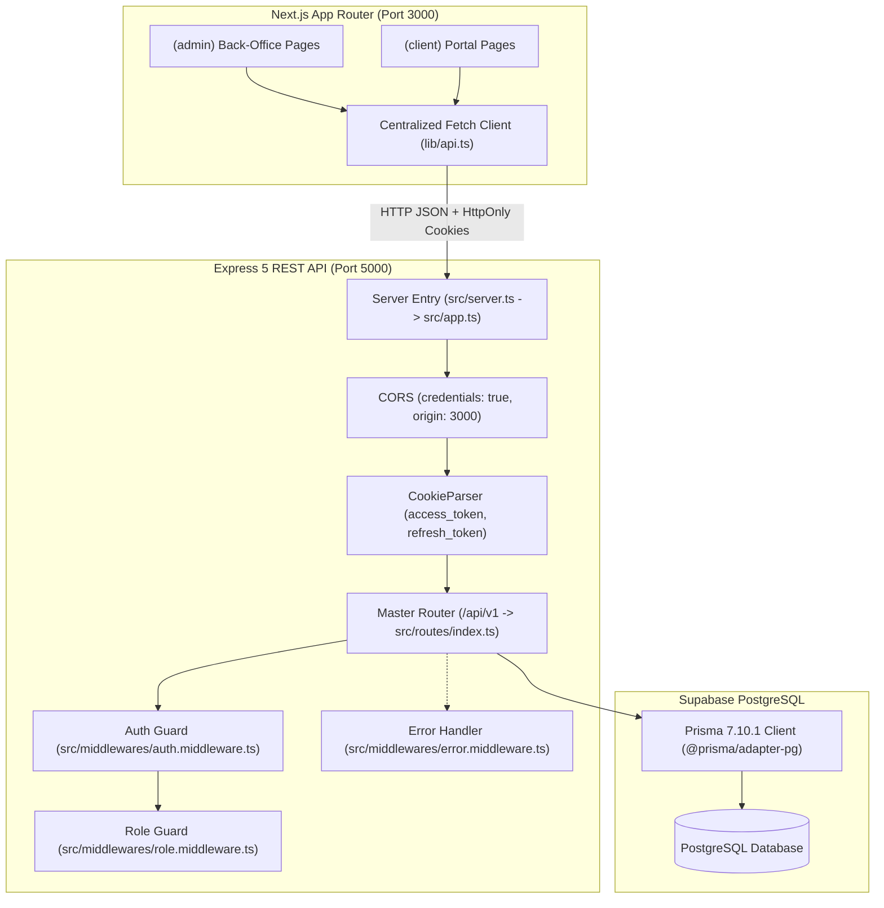
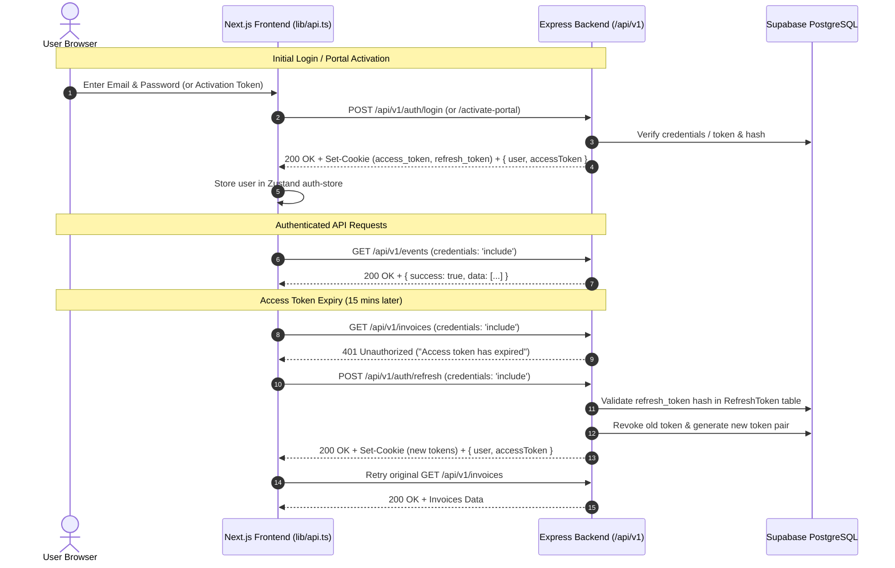
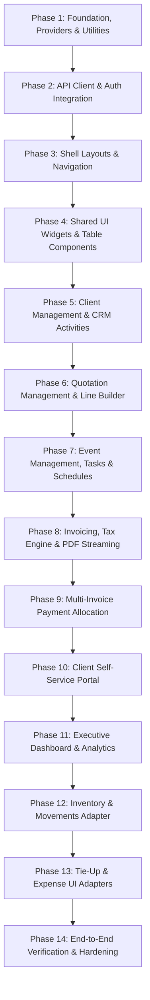

# Event Management System (EMS) — Frontend Development Plan & Technical Blueprint

**Document Version:** 1.0.0  
**Target Applications:**  
- `frontend/` — Next.js (App Router, React 19, TypeScript, Tailwind CSS v4, shadcn/ui Base UI Nova)  
- `backend/` — Node.js (Express 5, TypeScript, Prisma ORM 7, PostgreSQL on Supabase)  
**Currency & Localization:** India (INR ₹, Indian Mobile `^[6-9]\d{9}$`)  
**Status:** Authoritative Frontend Blueprint based on Verified Backend Audit  

---

## 1. Project Overview

The Event Management System (EMS) is a specialized SaaS application engineered for a boutique event-management firm operating in India. The application manages end-to-end event lifecycles: from initial walk-in client capture, quotation generation, and event scheduling, to itemized invoicing, multi-invoice payment allocation, inventory movement tracking, venue/vendor tie-up commissions, business expense monitoring, and isolated owner withdrawals.

### 1.1 Dual Application Portals
The frontend provides two discrete user experiences sharing a unified design language:
1. **Admin Portal (`(admin)`):** A high-density back-office operations console for the business owners and operational managers. Admins manage clients, convert quotations into events, track project schedules and checklist tasks, generate proforma and tax invoices, allocate payments, monitor equipment stock, manage venue collaborations, track business expenses, and inspect financial reports.
2. **Client Portal (`(client)`):** A dedicated, read-only/interactive self-service hub for client accounts. Clients inspect their scheduled events, review and officially Accept/Reject quotations, download itemized invoice PDFs, track payment history, and view outstanding balances. Crucially, internal vendor costs, tie-up commission structures, business operating expenses, and company profit margins are strictly hidden from this portal.

### 1.2 Technology Stack
The frontend is built upon the existing Next.js project baseline without unnecessary third-party bloat:

| Layer | Technology | Version | Purpose |
|---|---|---|---|
| **Framework** | Next.js (App Router) | 16.4.6 | Server and Client component orchestration, nested routing, layouts |
| **Runtime** | React | 19.3.0 | Modern UI rendering engine with Server Components |
| **Language** | TypeScript | ^5.0.0 | Strict static type safety across forms, APIs, and domain models |
| **Styling** | Tailwind CSS v4 | 4.3.3 | High-performance CSS engine using `@tailwindcss/turbopack` |
| **UI Primitives** | shadcn/ui + Base UI | Nova Preset | Accessible headless primitives (`@base-ui/react`) styled via Nova |
| **Data Fetching** | TanStack Query | ^5.107.1 | Server state caching, background refetching, mutations, optimistic UI |
| **Form Management** | React Hook Form | ^7.91.0 | High-performance uncontrolled form handling with minimal re-renders |
| **Schema Validation**| Zod | ^4.6.7 | Client-side input validation and API error response mapping |
| **Global UI State** | Zustand | ^5.1.0 | Ephemeral client UI state (sidebar state, active filters, auth session cache) |
| **Data Tables** | TanStack Table | ^9.3.1 | Headless tabular sorting, filtering, row selection, and pagination |
| **Data Analytics** | Recharts | ^3.10.1 | Responsive dashboard charts for cash flow, invoicing, and revenue |
| **Icons** | Lucide React | ^1.71.0 | Clean, consistent vector iconography |
| **Notifications** | Sonner | ^2.0.8 | Lightweight, accessible stacked toast notifications |
| **HTTP Client** | Native Fetch API | Built-in | Centralized API client configured with HttpOnly credentials and token refresh |

---

## 2. Inspected Backend Architecture

A thorough static code audit of the backend repository (`backend/src/`) reveals the exact runtime architecture, entry points, middleware pipelines, and data models:



### 2.1 Backend Entry Point & Middleware Chain
- **Server Entry:** `backend/src/server.ts` imports `app` from `backend/src/app.ts` and listens on `env.PORT` (default: 5000).
- **Security Middlewares:**
  - `helmet()`: Enforces standard secure HTTP headers.
  - `cors({ origin: env.CORS_ORIGIN, credentials: true })`: Explicitly allows `http://localhost:3000` with cookie transport.
  - `express.json({ limit: "2mb" })` & `express.urlencoded({ extended: true, limit: "2mb" })`.
  - `cookieParser()`: Reads HttpOnly cookies `access_token` and `refresh_token`.
- **Master Route Prefix:** All backend endpoints are mounted under `/api/v1` via `backend/src/routes/index.ts`.
- **Global Error Handling:** Any error thrown in controllers or services is trapped by `backend/src/middlewares/error.middleware.ts`.

### 2.2 Standard API Response Envelopes
The backend adheres strictly to standardized response structures defined in `backend/src/utils/response.ts`:

#### Success Response
```json
{
  "success": true,
  "data": { ... },
  "message": "Operation completed successfully",
  "meta": {
    "page": 1,
    "limit": 20,
    "total": 45,
    "totalPages": 3
  }
}
```
*Note: `meta` is present whenever paginated collections are returned.*

#### Error Response
```json
{
  "success": false,
  "error": {
    "code": "VALIDATION_ERROR",
    "message": "Request validation failed",
    "details": [
      {
        "field": "phone",
        "message": "Phone number must be a valid 10-digit Indian mobile number"
      }
    ]
  }
}
```

#### Standard Error Code Taxonomy
- `400 Bad Request` — `BAD_REQUEST`, `FOREIGN_KEY_CONSTRAINT_FAILED`
- `401 Unauthorized` — `UNAUTHORIZED` (missing token, expired token, deactivated account)
- `403 Forbidden` — `FORBIDDEN` (insufficient role, IDOR cross-client access attempt)
- `404 Not Found` — `NOT_FOUND`, `RECORD_NOT_FOUND`
- `409 Conflict` — `CONFLICT`, `UNIQUE_CONSTRAINT_VIOLATION` (duplicate email, SKU, event link)
- `422 Unprocessable Entity` — `VALIDATION_ERROR` (Zod schema failure with `details` array)
- `500 Internal Server Error` — `INTERNAL_SERVER_ERROR`, `DATABASE_ERROR`

### 2.3 Sequential Identifiers
The backend generates sequential business numbers with year scoping:
- Events: `EVT-YYYY-XXXX` (e.g. `EVT-2026-0001`)
- Quotations: `QUO-YYYY-XXXX` (e.g. `QUO-2026-0001`)
- Invoices: `INV-YYYY-XXXX` (e.g. `INV-2026-0001`)
- Payments: `PAY-YYYY-XXXX` (e.g. `PAY-2026-0001`)

---

## 3. Confirmed Backend Modules & Implementation Status

Our comprehensive codebase audit confirms the exact implementation status across all modules:

| Module | Prisma Models Available | Express Route Files | Controller & Service | Verified Status |
|---|---|---|---|:---:|
| **Health Check** | N/A | `health.routes.ts` | Inline database query | **Verified & Active** |
| **Authentication** | `User`, `RefreshToken` | `auth.routes.ts` | `auth.controller.ts`, `auth.service.ts` | **Verified & Active** |
| **Client Management** | `Client`, `User` | `client.routes.ts` | `client.controller.ts`, `client.service.ts` | **Verified & Active** |
| **Calendar & Activities** | `CalendarEntry` | `calendar.routes.ts` | `calendar.controller.ts`, `calendar.service.ts` | **Verified & Active** |
| **Event Management** | `Event`, `EventTask`, `EventSchedule` | `event.routes.ts` | `event.controller.ts`, `event.service.ts` | **Verified & Active** |
| **Quotation Management** | `Quotation`, `QuotationItem` | `quotation.routes.ts` | `quotation.controller.ts`, `quotation.service.ts` | **Verified & Active** |
| **Invoice Management** | `Invoice`, `InvoiceItem` | `invoice.routes.ts` | `invoice.controller.ts`, `invoice.service.ts`, `pdf.service.ts` | **Verified & Active** |
| **Payment Management** | `Payment`, `PaymentAllocation` | `payment.routes.ts` | `payment.controller.ts`, `payment.service.ts` | **Verified & Active** |
| **Inventory Management** | `InventoryCategory`, `InventoryItem`, `EventInventory`, `InventoryMovement` | None (`inventory.routes.ts` missing) | None (Phase 7 pending in backend) | ⚠️ **Pending Backend Phase 7** |
| **Tie-Up & Collaborations** | `TieUp`, `TieUpEvent`, `TieUpTransaction` | None (`tieup.routes.ts` missing) | None (Phase 8 pending in backend) | ⚠️ **Pending Backend Phase 8** |
| **Expense Management** | `Expense`, `ExpensePayment` | None (`expense.routes.ts` missing) | None (Phase 9 pending in backend) | ⚠️ **Pending Backend Phase 9** |
| **Owner Withdrawals** | `OwnerWithdrawal` | None (`withdrawal.routes.ts` missing) | None (Phase 9 pending in backend) | ⚠️ **Pending Backend Phase 9** |
| **Dashboard & Reports** | Aggregations of existing models | None (`report.routes.ts` missing) | None (Phase 10 pending in backend) | ⚠️ **Pending Backend Phase 10** |

> [!IMPORTANT]
> The backend already possesses **100% complete, tested, and active APIs** for Authentication, Clients, Calendar, Events, Quotations, Invoices, and Payments. Inventory, Tie-ups, Expenses, Withdrawals, and Reports exist in the Prisma database schema, but their HTTP endpoints have not yet been implemented in Express. The frontend plan defines complete UI requirements for verified modules and specifies mock/read-only UI adapters for pending modules until the backend completes Phases 7–10.

---

## 4. Backend API Mapping Table

The following table documents every real endpoint implemented in the backend, its authentication and authorization requirements, validation schemas, and expected responses:

| Module | Operation | HTTP | Exact Endpoint | Role | Status | Request Parameters / Body | Response Data Shape |
|---|---|:---:|---|:---:|:---:|---|---|
| **Health** | Health check | `GET` | `/api/v1/health` | Public | **Verified** | None | `{ status: "healthy", uptime, database: "connected" }` |
| **Auth** | User login | `POST` | `/api/v1/auth/login` | Public | **Verified** | Body: `{ email, password }` | `{ user: { id, email, name, role, clientId }, accessToken }` + sets cookies |
| **Auth** | Refresh session | `POST` | `/api/v1/auth/refresh` | Public | **Verified** | Cookie: `refresh_token` or Body: `{ refreshToken }` | `{ user, accessToken }` + rotates cookies |
| **Auth** | User logout | `POST` | `/api/v1/auth/logout` | Public | **Verified** | Cookie: `refresh_token` or Body: `{ refreshToken }` | `{ success: true, data: null }` + clears cookies |
| **Auth** | Activate portal | `POST` | `/api/v1/auth/activate-portal` | Public | **Verified** | Body: `{ token, password }` | `{ user, accessToken }` + sets cookies |
| **Auth** | Current user | `GET` | `/api/v1/auth/me` | Authenticated | **Verified** | Headers/Cookie | `{ user: { id, email, name, role, clientId, client? } }` |
| **Clients** | List clients | `GET` | `/api/v1/clients` | `ADMIN` | **Verified** | Query: `{ page, limit, search }` | Array of clients with `_count: { event, invoice }`, `meta` |
| **Clients** | Create client profile | `POST` | `/api/v1/clients` | `ADMIN` | **Verified** | Body: `{ name, phone, email?, address?, city?, notes? }` | Created client record (no user account created) |
| **Clients** | Get client details | `GET` | `/api/v1/clients/:id` | `ADMIN` / `CLIENT` (own) | **Verified** | Param: `:id` | Client profile. If Admin, includes recent quotations, events, invoices |
| **Clients** | Update client | `PUT` | `/api/v1/clients/:id` | `ADMIN` | **Verified** | Param: `:id`, Body: partial client data | Updated client record |
| **Clients** | Delete client | `DELETE` | `/api/v1/clients/:id` | `ADMIN` | **Verified** | Param: `:id` | `null` (fails if active events/invoices exist) |
| **Clients** | Link user account | `POST` | `/api/v1/clients/:id/link-user` | `ADMIN` | **Verified** | Param: `:id`, Body: `{ userId }` | Updated user record linked to client |
| **Clients** | Assign portal | `POST` | `/api/v1/clients/:id/assign-portal` | `ADMIN` | **Verified** | Param: `:id`, Body: `{ expiresInHours: 24 }` | `{ client, portalStatus, invitationToken, activationUrl }` |
| **Clients** | Portal status | `GET` | `/api/v1/clients/:id/portal-status` | `ADMIN` | **Verified** | Param: `:id` | `{ clientId, status: "NOT_ASSIGNED"|"ACTIVE"|"INVITATION_PENDING"|"INVITATION_EXPIRED", user? }` |
| **Clients** | Resend invite | `POST` | `/api/v1/clients/:id/resend-invite` | `ADMIN` | **Verified** | Param: `:id`, Body: `{ expiresInHours: 24 }` | `{ clientId, portalStatus: "INVITATION_PENDING", activationUrl }` |
| **Clients** | Toggle status | `PATCH` | `/api/v1/clients/:id/status` | `ADMIN` | **Verified** | Param: `:id`, Body: `{ isActive: boolean, reason? }` | Updated user account status |
| **Clients** | Client events | `GET` | `/api/v1/clients/:id/events` | `ADMIN` / `CLIENT` (own) | **Verified** | Param: `:id`, Query: `{ page, limit, status? }` | `{ client, events: Event[] }`, `meta` |
| **Clients** | Client quotations | `GET` | `/api/v1/clients/:id/quotations` | `ADMIN` / `CLIENT` (own) | **Verified** | Param: `:id`, Query: `{ page, limit, status? }` | `{ client, quotations: Quotation[] }`, `meta` |
| **Clients** | Client invoices | `GET` | `/api/v1/clients/:id/invoices` | `ADMIN` / `CLIENT` (own) | **Verified** | Param: `:id`, Query: `{ page, limit, status? }` | `{ client, invoices: Invoice[] }`, `meta` |
| **Clients** | Client payments | `GET` | `/api/v1/clients/:id/payments` | `ADMIN` / `CLIENT` (own) | **Verified** | Param: `:id`, Query: `{ page, limit }` | `{ client, payments: Payment[] }`, `meta` |
| **Clients** | Client activities | `GET` | `/api/v1/clients/:id/activities` | `ADMIN` / `CLIENT` (own) | **Verified** | Param: `:id`, Query: `{ page, limit }` | Array of `CalendarEntry` for client, `meta` |
| **Clients** | Add activity | `POST` | `/api/v1/clients/:id/activities` | `ADMIN` | **Verified** | Param: `:id`, Body: CalendarEntry payload | Created `CalendarEntry` |
| **Calendar** | List entries | `GET` | `/api/v1/calendar` | `ADMIN` / `CLIENT` (own) | **Verified** | Query: `{ page, limit, from?, to?, type?, clientId?, eventId?, search? }` | Array of calendar activities, `meta` |
| **Calendar** | Create entry | `POST` | `/api/v1/calendar` | `ADMIN` | **Verified** | Body: `{ title, description?, type, startAt, endAt?, allDay, location?, clientId, eventId? }` | Created `CalendarEntry` |
| **Calendar** | Get entry | `GET` | `/api/v1/calendar/:id` | `ADMIN` / `CLIENT` (own) | **Verified** | Param: `:id` | Single `CalendarEntry` with client and event details |
| **Calendar** | Update entry | `PUT` | `/api/v1/calendar/:id` | `ADMIN` | **Verified** | Param: `:id`, Body: partial entry payload | Updated `CalendarEntry` |
| **Calendar** | Delete entry | `DELETE` | `/api/v1/calendar/:id` | `ADMIN` | **Verified** | Param: `:id` | Deleted confirmation |
| **Events** | List events | `GET` | `/api/v1/events` | `ADMIN` / `CLIENT` (own) | **Verified** | Query: `{ page, limit, status?, clientId?, from?, to?, search? }` | Array of events with client, quotation, and `_count`, `meta` |
| **Events** | Create event | `POST` | `/api/v1/events` | `ADMIN` | **Verified** | Body: `{ clientId, quotationId?, title, eventType, description?, eventDate, startTime?, endTime?, venueName?, venueAddress?, guestCount?, budget?, notes? }` | Created event with sequential `EVT-YYYY-XXXX` |
| **Events** | Get event details | `GET` | `/api/v1/events/:id` | `ADMIN` / `CLIENT` (own) | **Verified** | Param: `:id` | Event details. If Client, internal expenses & commissions are stripped |
| **Events** | Update event | `PUT` | `/api/v1/events/:id` | `ADMIN` | **Verified** | Param: `:id`, Body: partial event data | Updated event record |
| **Events** | Transition status | `PATCH` | `/api/v1/events/:id/status` | `ADMIN` | **Verified** | Param: `:id`, Body: `{ status, reason? }` | Updated event with transition audit in notes |
| **Events** | Delete event | `DELETE` | `/api/v1/events/:id` | `ADMIN` | **Verified** | Param: `:id` | Fails if invoices, payments, or expenses linked |
| **Events** | Financial summary | `GET` | `/api/v1/events/:id/summary` | `ADMIN` | **Verified** | Param: `:id` | `{ event, financials: { budget, totalInvoiced, totalPaid, totalExpenses, balanceReceivable, profitMargin }, counts }` |
| **Events** | List tasks | `GET` | `/api/v1/events/:eventId/tasks` | `ADMIN` / `CLIENT` (own) | **Verified** | Param: `:eventId` | Array of `EventTask` records |
| **Events** | Create task | `POST` | `/api/v1/events/:eventId/tasks` | `ADMIN` | **Verified** | Param: `:eventId`, Body: `{ title, description?, dueDate?, priority?, status? }` | Created `EventTask` |
| **Events** | Update task | `PUT` | `/api/v1/events/tasks/:taskId` | `ADMIN` | **Verified** | Param: `:taskId`, Body: partial task payload | Updated `EventTask` |
| **Events** | Delete task | `DELETE` | `/api/v1/events/tasks/:taskId` | `ADMIN` | **Verified** | Param: `:taskId` | Deleted confirmation |
| **Events** | List schedules | `GET` | `/api/v1/events/:eventId/schedules` | `ADMIN` / `CLIENT` (own) | **Verified** | Param: `:eventId` | Array of `EventSchedule` records |
| **Events** | Create schedule | `POST` | `/api/v1/events/:eventId/schedules` | `ADMIN` | **Verified** | Param: `:eventId`, Body: `{ title, description?, startAt, endAt? }` | Created `EventSchedule` |
| **Events** | Update schedule | `PUT` | `/api/v1/events/schedules/:scheduleId` | `ADMIN` | **Verified** | Param: `:scheduleId`, Body: partial schedule payload | Updated `EventSchedule` |
| **Events** | Delete schedule | `DELETE` | `/api/v1/events/schedules/:scheduleId` | `ADMIN` | **Verified** | Param: `:scheduleId` | Deleted confirmation |
| **Quotations** | List quotations | `GET` | `/api/v1/quotations` | `ADMIN` / `CLIENT` (own) | **Verified** | Query: `{ page, limit, status?, clientId?, search?, from?, to? }` | Array of quotations with client and items summary, `meta` |
| **Quotations** | Create quotation | `POST` | `/api/v1/quotations` | `ADMIN` | **Verified** | Body: `{ clientId, title, eventType, eventDate?, venue?, guestCount?, discountType?, discountValue?, taxRate?, validUntil?, notes?, terms?, items: [{ itemName, quantity, unitPrice, sortOrder }] }` | Created quotation with calculated totals & `QUO-YYYY-XXXX` |
| **Quotations** | Get quotation | `GET` | `/api/v1/quotations/:id` | `ADMIN` / `CLIENT` (own) | **Verified** | Param: `:id` | Quotation with line items. Auto-marks as `VIEWED` if opened by Client |
| **Quotations** | Update quotation | `PUT` | `/api/v1/quotations/:id` | `ADMIN` | **Verified** | Param: `:id`, Body: partial quotation & items | Recalculates line items, subtotal, tax, and total |
| **Quotations** | Transition status | `PATCH` | `/api/v1/quotations/:id/status` | `ADMIN` / `CLIENT` (limited) | **Verified** | Param: `:id`, Body: `{ status, notes? }` | Admin: any valid transition. Client: `ACCEPTED` or `REJECTED` only |
| **Quotations** | Convert to event | `POST` | `/api/v1/quotations/:id/convert-to-event` | `ADMIN` | **Verified** | Param: `:id`, Body: optional event overrides | Transitions quotation to `ACCEPTED`, creates Event linked by `quotationId` |
| **Quotations** | Delete quotation | `DELETE` | `/api/v1/quotations/:id` | `ADMIN` | **Verified** | Param: `:id` | Fails if linked to event or invoice items |
| **Invoices** | List invoices | `GET` | `/api/v1/invoices` | `ADMIN` / `CLIENT` (own) | **Verified** | Query: `{ page, limit, status?, clientId?, eventId?, search?, from?, to? }` | Array of invoices with `paidAmount`, `balanceAmount`, `meta` |
| **Invoices** | Create invoice | `POST` | `/api/v1/invoices` | `ADMIN` | **Verified** | Body: `{ clientId, eventId?, title, invoiceDate, dueDate?, discountType?, discountValue?, taxRate?, notes?, terms?, items: [{ itemName, quantity, unitPrice, type: "PROFORMA"|"FINAL", advanceAdjusted? }] }` | Created invoice with `INV-YYYY-XXXX` |
| **Invoices** | Get invoice details | `GET` | `/api/v1/invoices/:id` | `ADMIN` / `CLIENT` (own) | **Verified** | Param: `:id` | Invoice with line items, payment allocations, `paidAmount`, `balanceAmount` |
| **Invoices** | Calculate balance | `GET` | `/api/v1/invoices/:id/balance` | `ADMIN` / `CLIENT` (own) | **Verified** | Param: `:id` | `{ invoiceId, invoiceNumber, status, totalAmount, paidAmount, balanceAmount }` |
| **Invoices** | Download PDF | `GET` | `/api/v1/invoices/:id/pdf` | `ADMIN` / `CLIENT` (own) | **Verified** | Param: `:id` | Binary PDF stream (`application/pdf`, filename: `INV-YYYY-XXXX.pdf`) |
| **Invoices** | Update invoice | `PUT` | `/api/v1/invoices/:id` | `ADMIN` | **Verified** | Param: `:id`, Body: partial invoice & items | Fails if payments already allocated |
| **Invoices** | Update status | `PATCH` | `/api/v1/invoices/:id/status` | `ADMIN` | **Verified** | Param: `:id`, Body: `{ status, notes? }` | Transitions invoice status |
| **Invoices** | Delete invoice | `DELETE` | `/api/v1/invoices/:id` | `ADMIN` | **Verified** | Param: `:id` | Fails if payment allocations or proforma advances exist |
| **Payments** | List payments | `GET` | `/api/v1/payments` | `ADMIN` / `CLIENT` (own) | **Verified** | Query: `{ page, limit, clientId?, eventId?, paymentType?, paymentMethod?, status?, search?, from?, to? }` | Array of payments with allocations, client, and event, `meta` |
| **Payments** | Record payment | `POST` | `/api/v1/payments` | `ADMIN` | **Verified** | Body: `{ clientId, eventId?, proformaInvoiceId?, amount, paymentType, paymentMethod, paymentDate, transactionReference?, notes?, allocations: [{ invoiceId, amount }] }` | Generates `PAY-YYYY-XXXX`, records allocations, auto-updates invoice statuses |
| **Payments** | Get payment details | `GET` | `/api/v1/payments/:id` | `ADMIN` / `CLIENT` (own) | **Verified** | Param: `:id` | Payment details with invoice allocations |
| **Payments** | Delete payment | `DELETE` | `/api/v1/payments/:id` | `ADMIN` | **Verified** | Param: `:id` | Deletes payment, rolls back allocations, recomputes affected invoice statuses |
| **Inventory** | All operations | `*` | `/api/v1/inventory/*` | `ADMIN` | ⚠️ **Pending** | Categories, items, movements, issue/return | Not implemented in backend yet (Phase 7) |
| **Tie-Ups** | All operations | `*` | `/api/v1/tie-ups/*` | `ADMIN` | ⚠️ **Pending** | Partners, deposits, event commissions | Not implemented in backend yet (Phase 8) |
| **Expenses** | All operations | `*` | `/api/v1/expenses/*` | `ADMIN` | ⚠️ **Pending** | Event/business expenses, payments | Not implemented in backend yet (Phase 9) |
| **Withdrawals** | All operations | `*` | `/api/v1/withdrawals/*` | `ADMIN` | ⚠️ **Pending** | Owner withdrawals ledger | Not implemented in backend yet (Phase 9) |
| **Reports** | All operations | `*` | `/api/v1/reports/*` | `ADMIN` | ⚠️ **Pending** | Dashboard, event profit, cash flow | Not implemented in backend yet (Phase 10) |

---

## 5. Authentication & Authorization Architecture

### 5.1 Dual-Token Rotation with HttpOnly Cookies
The backend enforces a stateful JWT session model with refresh token rotation:
1. **Access Token (Short-Lived: 15 minutes):** Signed JWT containing `{ sub: userId, role: USERROLE, clientId: string | null }`. Placed in an HttpOnly cookie named `access_token` and returned in the JSON payload for memory caching.
2. **Refresh Token (Long-Lived: 7 days):** Cryptographically random string. Stored as an SHA-256 hash in the `RefreshToken` database table. Delivered strictly via an HttpOnly cookie named `refresh_token`.
3. **CORS & Transport Security:**
   - Both cookies use `httpOnly: true`, `path: "/"`.
   - In production: `secure: true`, `sameSite: "none"`.
   - In local development: `secure: false`, `sameSite: "lax"`.
   - Frontend `fetch` calls MUST use `credentials: "include"` on every request.

### 5.2 Session Lifecycle & Token Refresh Workflow


### 5.3 Client Portal Activation Workflow
1. Admin creates a Client profile in Admin portal: `POST /api/v1/clients`.
2. Admin clicks **"Assign Portal Access"** on Client profile: `POST /api/v1/clients/:id/assign-portal`.
3. Backend generates a 32-byte cryptographic token, creates an inactive `User` record (`isActive = false`, `role = CLIENT`, `clientId = client.id`), and generates an activation URL:
   `${env.CORS_ORIGIN}/activate-portal?token=${rawToken}`
4. If SMTP is configured, backend emails the client. In development, the URL is also returned in the Admin API response for manual copy-pasting.
5. Client opens `/activate-portal?token=...` on the frontend, enters their desired password (min 6 characters), and submits to `POST /api/v1/auth/activate-portal`.
6. Backend verifies the token, hashes the new password with bcrypt (12 rounds), marks `isActive = true`, clears the one-time token, issues JWT session cookies, and logs the client in immediately.
7. Frontend redirects the client directly to `/portal/dashboard`.

### 5.4 Server-Authoritative Role Guards
The frontend protects navigation paths for user convenience, but **backend authorization remains authoritative**:
- `requireAdmin` middleware rejects non-admins with `403 Forbidden` (`FORBIDDEN`).
- `assertClientOwnership` utility enforces that clients can only access resources where `entity.clientId === req.user.clientId`. Any cross-client URL tampering returns `403 Forbidden` or `404 Not Found`.
- Sensitive financial metrics (vendor costs, internal notes, profit margins) are stripped server-side when the requesting actor is `CLIENT`.

---

## 6. Frontend Folder Structure & Responsibilities

The frontend architecture strictly follows the existing Next.js layout, avoiding duplicate directories or bloated root configurations:

```text
frontend/
├── public/                     # Static assets (logos, favicon, illustrations)
├── src/
│   ├── app/                    # Next.js App Router (pages and route layouts)
│   │   ├── (auth)/             # Public authentication route group
│   │   │   ├── login/          # Unified Login page for Admin and Client
│   │   │   └── page.tsx
│   │   │
│   │   ├── (admin)/            # Admin back-office route group (Protected: ADMIN)
│   │   │   ├── layout.tsx      # Admin layout: Collapsible Sidebar, Header, Breadcrumbs
│   │   │   ├── dashboard/      # Admin executive overview & operational dashboard
│   │   │   ├── clients/        # Client list, profile, CRM activities & portal assignment
│   │   │   │   ├── page.tsx
│   │   │   │   └── [id]/page.tsx
│   │   │   ├── quotations/     # Quotation creator, line-item calculator, status flow
│   │   │   │   ├── page.tsx
│   │   │   │   ├── new/page.tsx
│   │   │   │   └── [id]/page.tsx
│   │   │   ├── events/         # Event operations, schedules, tasks, financial summary
│   │   │   │   ├── page.tsx
│   │   │   │   ├── new/page.tsx
│   │   │   │   └── [id]/page.tsx
│   │   │   ├── calendar/       # Master operational calendar & activity timeline
│   │   │   │   └── page.tsx
│   │   │   ├── inventory/      # Stock master, item movements, allocations (Phase 7 adapter)
│   │   │   │   └── page.tsx
│   │   │   ├── expenses/       # Event vs Business operating expenses (Phase 9 adapter)
│   │   │   │   └── page.tsx
│   │   │   ├── tie-ups/        # Restaurant/hotel partners & deposits (Phase 8 adapter)
│   │   │   │   └── page.tsx
│   │   │   ├── invoices/       # Itemized invoices, tax calculation, PDF viewer
│   │   │   │   ├── page.tsx
│   │   │   │   ├── new/page.tsx
│   │   │   │   └── [id]/page.tsx
│   │   │   └── payments/       # Multi-invoice payment allocation & receipt ledger
│   │   │       ├── page.tsx
│   │   │       └── new/page.tsx
│   │   │
│   │   ├── (client)/           # Client Self-Service Portal (Protected: CLIENT)
│   │   │   ├── layout.tsx      # Client layout: Simplified header, portal navigation
│   │   │   └── portal/
│   │   │       ├── dashboard/  # Client summary: Upcoming events, pending invoices
│   │   │       ├── events/     # Permitted event schedules & details (cost-stripped)
│   │   │       │   ├── page.tsx
│   │   │       │   └── [id]/page.tsx
│   │   │       ├── quotations/ # Client quotation review with Accept / Reject actions
│   │   │       │   ├── page.tsx
│   │   │       │   └── [id]/page.tsx
│   │   │       ├── invoices/   # Client invoices with streaming PDF download
│   │   │       │   ├── page.tsx
│   │   │       │   └── [id]/page.tsx
│   │   │       └── profile/    # Client contact profile and security settings
│   │   │           └── page.tsx
│   │   │
│   │   ├── activate-portal/    # Public portal activation page (token from email)
│   │   │   └── page.tsx
│   │   ├── layout.tsx          # Root application shell (Geist fonts, Theme, Sonner toaster)
│   │   ├── globals.css         # Tailwind v4 directives & shadcn Nova theme tokens
│   │   └── page.tsx            # Root landing / smart redirect based on session role
│   │
│   ├── components/
│   │   ├── ui/                 # Installed shadcn/ui primitives (Base UI + Nova preset)
│   │   ├── layout/             # Admin & Client layout components
│   │   │   ├── admin-sidebar.tsx
│   │   │   ├── admin-header.tsx
│   │   │   ├── client-header.tsx
│   │   │   ├── breadcrumbs.tsx
│   │   │   └── user-account-menu.tsx
│   │   └── shared/             # Reusable business-agnostic UI widgets
│   │       ├── data-table.tsx            # TanStack Table wrapper (search, pagination, sort)
│   │       ├── stat-card.tsx             # Dashboard metric card with icon & indicator
│   │       ├── status-badge.tsx          # Canonical colored badges for all Prisma enums
│   │       ├── confirm-dialog.tsx        # Destructive action & status confirmation modal
│   │       ├── date-range-picker.tsx     # Calendar popover for financial/event filters
│   │       ├── empty-state.tsx           # Friendly empty list illustrations & CTA
│   │       ├── loading-skeleton.tsx      # High-fidelity page skeleton loaders
│   │       └── money-display.tsx         # Standardized Indian Rupee formatting (₹xx,xx,xxx)
│   │
│   ├── features/               # Domain-driven feature modules
│   │   ├── auth/               # Login form, activation form, auth hooks, auth service
│   │   ├── clients/            # Client tables, forms, activity timeline, portal cards
│   │   ├── calendar/           # Full calendar grid, activity creation dialogs
│   │   ├── quotations/         # Line item builder, discount/tax calculations, PDF preview
│   │   ├── events/             # Event forms, task checklist, schedule timeline, summary
│   │   ├── invoices/           # Itemized invoice builder, balance card, PDF streaming hook
│   │   ├── payments/           # Multi-invoice payment allocation wizard, receipt view
│   │   ├── inventory/          # Item master, stock movement ledger, issue/return forms
│   │   ├── tie-ups/            # Partner profiles, security deposit ledger, event links
│   │   └── expenses/           # Event vs business expense forms, owner withdrawal ledger
│   │
│   ├── hooks/                  # Global shared hooks (use-mobile, use-debounce, use-permission)
│   ├── lib/
│   │   ├── api.ts              # Centralized Native Fetch client with interceptors & refresh
│   │   ├── utils.ts            # ClassName merging (`cn`), currency & date formatters
│   │   └── formatters.ts       # Indian numbering system (Lakhs/Crores) and date-fns helpers
│   ├── providers/
│   │   ├── query-provider.tsx  # TanStack Query client & DevTools provider
│   │   ├── auth-provider.tsx   # Session initialization and route guard provider
│   │   └── theme-provider.tsx  # Next-themes dark/light mode provider
│   ├── stores/
│   │   ├── auth-store.ts       # Zustand store for authenticated user & role state
│   │   └── ui-store.ts         # Zustand store for sidebar toggle and global filters
│   ├── types/
│   │   ├── api.types.ts        # Common ApiResponse, PaginationMeta, and Error types
│   │   └── models.ts           # Frontend TypeScript types mirroring Prisma schema models
│   └── validations/
│       └── common.schemas.ts   # Shared date-range, pagination, and phone regex schemas
```

---

## 7. Route Map for Admin and Client

### 7.1 Admin Portal Routes (`(admin)`)
All routes require an active session with `role === "ADMIN"`. Non-admin requests are redirected to `/login`.

| Path | Page Title | Primary Component | Verified Backend Endpoints Used |
|---|---|---|---|
| `/dashboard` | Executive Dashboard | `AdminDashboardView` | `/api/v1/events`, `/api/v1/invoices`, `/api/v1/calendar` |
| `/clients` | Client Directory | `ClientListView` | `GET /api/v1/clients` |
| `/clients/[id]` | Client Profile & CRM | `ClientDetailView` | `GET /api/v1/clients/:id`, `/portal-status`, `/events`, `/invoices`, `/activities` |
| `/quotations` | Quotations Ledger | `QuotationListView` | `GET /api/v1/quotations` |
| `/quotations/new` | Create Quotation | `QuotationCreateForm` | `POST /api/v1/quotations`, `GET /api/v1/clients` |
| `/quotations/[id]` | Quotation Inspector | `QuotationDetailView` | `GET /api/v1/quotations/:id`, `PATCH /status`, `POST /convert-to-event` |
| `/events` | Event Management | `EventListView` | `GET /api/v1/events` |
| `/events/new` | Create New Event | `EventCreateForm` | `POST /api/v1/events`, `GET /api/v1/clients` |
| `/events/[id]` | Event Control Hub | `EventDetailView` | `GET /api/v1/events/:id`, `/summary`, `/tasks`, `/schedules`, `PATCH /status` |
| `/calendar` | Master Calendar | `CalendarMasterView` | `GET /api/v1/calendar`, `POST /api/v1/calendar`, `PUT`, `DELETE` |
| `/invoices` | Billing & Invoicing | `InvoiceListView` | `GET /api/v1/invoices` |
| `/invoices/new` | Generate Invoice | `InvoiceCreateForm` | `POST /api/v1/invoices`, `GET /api/v1/clients`, `GET /api/v1/events` |
| `/invoices/[id]` | Invoice Details & PDF | `InvoiceDetailView` | `GET /api/v1/invoices/:id`, `/balance`, `/pdf`, `PATCH /status` |
| `/payments` | Payment Allocations | `PaymentListView` | `GET /api/v1/payments` |
| `/payments/new` | Record Client Payment | `PaymentRecordWizard` | `POST /api/v1/payments`, `GET /api/v1/invoices?clientId=...` |
| `/inventory` | Inventory & Movement | `InventoryView` | *Mock UI / Adapter until Backend Phase 7* |
| `/tie-ups` | Venue Collaborations | `TieUpListView` | *Mock UI / Adapter until Backend Phase 8* |
| `/expenses` | Expenses & Withdrawals | `ExpenseMasterView` | *Mock UI / Adapter until Backend Phase 9* |

### 7.2 Client Portal Routes (`(client)`)
All routes require an active session with `role === "CLIENT"`. Non-client requests are redirected to `/login`.

| Path | Page Title | Primary Component | Verified Backend Endpoints Used |
|---|---|---|---|
| `/portal/dashboard` | Client Overview | `ClientPortalDashboard` | `/api/v1/events`, `/api/v1/invoices`, `/api/v1/quotations` (auto-scoped to `clientId`) |
| `/portal/events` | My Events | `ClientEventsView` | `GET /api/v1/events` (cost-stripped) |
| `/portal/events/[id]` | Event Timeline | `ClientEventDetailView` | `GET /api/v1/events/:id`, `GET /schedules` |
| `/portal/quotations` | My Quotations | `ClientQuotationsView` | `GET /api/v1/quotations` |
| `/portal/quotations/[id]`| Quotation Review | `ClientQuotationDetailView`| `GET /api/v1/quotations/:id` (auto-marks `VIEWED`), `PATCH /status` (Accept/Reject) |
| `/portal/invoices` | My Invoices | `ClientInvoicesView` | `GET /api/v1/invoices` |
| `/portal/invoices/[id]` | View Invoice & Receipt | `ClientInvoiceDetailView` | `GET /api/v1/invoices/:id`, `GET /pdf` (stream download) |
| `/portal/profile` | My Account | `ClientProfileView` | `GET /api/v1/auth/me`, `GET /api/v1/clients/:id` |

### 7.3 Public Authentication Routes
- `/login`: Unified email and password form. Upon successful login, checks `user.role`:
  - If `ADMIN` → redirects to `/dashboard`
  - If `CLIENT` → redirects to `/portal/dashboard`
- `/activate-portal`: Client activation landing page reading `?token=...` from query parameter. Form prompts for password confirmation, executes `POST /api/v1/auth/activate-portal`, and seamlessly transitions into the active portal.

---

## 8. Detailed Module-Wise Frontend Requirements

### 8.1 Authentication & Portal Activation (`features/auth`)
- **Login Component:** Email and password fields with Zod validation (`min(6)` password).
- **Session Restoration:** On app load, `useCurrentUser` queries `GET /api/v1/auth/me`. If authenticated, populates `useAuthStore`.
- **Automatic Silent Refresh:** Interceptor catches `401 Unauthorized`, calls `POST /api/v1/auth/refresh`, and transparently replays failed queries.
- **Client Portal Activation Form:** Reads `token` from URL. Shows client password setup with instant validation feedback. Upon submit, toast notifies "Account activated! Welcome to your client portal."

### 8.2 Client Management & CRM (`features/clients`)
- **Client Directory:** TanStack Table displaying Name, Phone, Email, City, Events Count, Invoices Count, and Portal Status badge. Search input with 300ms debounce.
- **Client Creation Modal:** Form with strict Indian phone validation (`^[6-9]\d{9}$`).
- **Client Detail Screen (Hub):**
  - **Header Card:** Client name, contact details, address, creation date, and active/inactive toggle switch (`PATCH /clients/:id/status`).
  - **Portal Management Widget:**
    - If `NOT_ASSIGNED`: Prompts "Assign Portal Access" button (triggers `POST /clients/:id/assign-portal`).
    - If `INVITATION_PENDING`: Displays copyable activation link and "Resend Invitation" button.
    - If `INVITATION_EXPIRED`: Shows expired warning and "Resend Fresh Invite" button.
    - If `ACTIVE`: Shows green active badge, linked user email, and last login status.
  - **Tabbed Sub-Resources:**
    - Tab 1: **Events** (table linked to `/events/[id]`)
    - Tab 2: **Quotations** (table linked to `/quotations/[id]`)
    - Tab 3: **Invoices** (table linked to `/invoices/[id]`)
    - Tab 4: **Payments** (payment receipt list)
    - Tab 5: **CRM Activities & Meetings** (interactive timeline + "Log Call / Meeting" button).

### 8.3 Master Calendar & Activities (`features/calendar`)
- **Calendar Grid & List Views:** Displays all scheduled meetings, site visits, vendor meetings, and office activities.
- **Color-Coded Badges:** `MEETING` (Blue), `SITE_VISIT` (Green), `VENDOR_MEETING` (Purple), `OFFICE_ACTIVITY` (Amber), `OTHER` (Slate).
- **Date Range Filters:** Quickly jump to "Today", "This Week", "This Month", or pick a custom date window.
- **Activity Creation Drawer:** Link activity to an existing Client and an optional linked Event. Start and end datetime picker with validation (`endAt >= startAt`).

### 8.4 Quotation Management (`features/quotations`)
- **Dynamic Line Item Builder:**
  - Dynamic rows: Item Name, Description, Quantity (Decimal), Unit (e.g. "pcs", "days", "sets"), Unit Price (₹), and Auto-calculated Total (₹).
  - Add row, remove row, drag-and-drop sort order.
- **Live Financial Calculation Engine:**
  - Line Item Total: $\text{Quantity} \times \text{Unit Price}$
  - Subtotal: $\sum \text{Line Item Totals}$
  - Discount: Fixed amount (₹) or Percentage (%) deducted from subtotal.
  - Tax (GST): Configurable percentage (0%, 5%, 12%, 18%) applied to amount after discount.
  - Grand Total: $(\text{Subtotal} - \text{Discount}) + \text{Tax Amount}$.
- **Quotation Status Lifecycle UI:**
  - Status Badges: `DRAFT` (Gray), `SENT` (Blue), `VIEWED` (Amber), `ACCEPTED` (Green), `REJECTED` (Red), `EXPIRED` (Zinc), `CANCELLED` (Red/Strikethrough).
  - Admin Action: "Send to Client" transitions `DRAFT` → `SENT`.
  - Client Portal Hook: When client views quotation, backend auto-marks as `VIEWED`. Client sees official "Accept Quotation" and "Reject Quotation" buttons with confirmation modals.
  - One-Click Event Conversion: Once `ACCEPTED`, an Admin button **"Convert to Event"** opens a pre-filled event creation dialog. Upon confirm, transitions quotation and generates linked Event.

### 8.5 Event Management & Operational Sub-Modules (`features/events`)
- **Event Lifecycle State Machine:**
  - State progression buttons enabled according to backend `ALLOWED_TRANSITIONS`:
    - `DRAFT` → `CONFIRMED`
    - `CONFIRMED` → `PLANNING`
    - `PLANNING` → `IN_PROGRESS`
    - `IN_PROGRESS` → `COMPLETED`
    - Any non-completed status → `CANCELLED` (with required reason prompt).
- **Event Financial Summary Banner (Admin Only):**
  - Planned Budget vs Invoiced Total vs Cash Paid vs Total Expenses vs Balance Receivable vs Net Operating Margin.
- **Operational Task Checklist:**
  - Kanban / checklist of tasks (`TODO`, `IN_PROGRESS`, `COMPLETED`, `CANCELLED`) with priority flags (`LOW`, `MEDIUM`, `HIGH`, `URGENT`) and due dates.
- **Event Day Schedule (Itinerary):**
  - Chronological schedule breakdown with timeline dots (`startAt`, `endAt`, title, notes).

### 8.6 Itemized Invoicing & PDF Streaming (`features/invoices`)
- **Invoice Line Items (Proforma vs Final):**
  - Line items tagged with `type = PROFORMA` or `type = FINAL`.
  - Support for `advanceAdjusted` field when settling proforma advance against final bill.
  - Automatic balance derivation: $\text{Balance Amount} = \text{Total Amount} - \text{Paid Amount}$.
- **Native PDF Streaming & Download:**
  - Action button: **"Download PDF"** calls `GET /api/v1/invoices/:id/pdf`.
  - Backend streams raw PDFKit binary; frontend converts to `Blob`, creates temporary object URL, and triggers instant browser download with filename `INV-YYYY-XXXX.pdf`.
  - Built-in inline PDF viewer modal for quick desktop preview.
- **Payment Allocation History:**
  - Displays all payments allocated to this invoice with receipt numbers, dates, payment methods, and allocated amounts.

### 8.7 Payment Recording & Multi-Invoice Allocation Wizard (`features/payments`)
- **Allocation Step Wizard:**
  1. **Select Client:** Auto-populates unpaid and partially paid invoices for this client.
  2. **Payment Details:** Total Amount Received (₹), Payment Date, Payment Method (`CASH`, `UPI`, `BANK_TRANSFER`, `CARD`, `CHEQUE`, `OTHER`), Payment Type (`ADVANCE`, `PARTIAL`, `FULL`, `OTHER`), Transaction / UTR Reference.
  3. **Allocate to Invoices:** Multi-row allocation table. Admin enters amount to apply to each pending invoice.
  4. **Strict Client-Side Guardrail:**
     - $\sum \text{Allocated Amounts} \le \text{Payment Total Amount}$
     - For each invoice: $\text{Allocated Amount} \le \text{Invoice Remaining Balance}$.
     - Live indicator shows "Unallocated Remaining: ₹...".
  5. **Submission:** Calls `POST /api/v1/payments`. Backend writes `Payment`, creates `PaymentAllocation` rows, and automatically recalculates each affected invoice's status (`PAID` or `PARTIALLY_PAID`).

### 8.8 Future Modules (Frontend Architecture for Backend Phases 7–10)
- **Inventory Management (Phase 7):** UI screens designed for Item Master (`currentStock`, `minimumStock`, low stock warning indicator), Purchase Log, and Event Allocation (`issueToEvent`, `returnFromEvent` with damaged quantity tracking).
- **Tie-Up & Collaborations (Phase 8):** Restaurant/Hotel partner directory with security deposit tracking (strictly classified as refundable assets, never as expenses) and event commission snapshots (fixed fee or % of base).
- **Expenses & Withdrawals (Phase 9):** Operating expense tracker isolating event expenses from business overheads. Standalone **Owner Withdrawal Ledger** strictly segregated so personal drawings never distort event operating profit.
- **Dashboard & Financial Reports (Phase 10):** Recharts graphs for Cash Inflow vs Outflow, Outstanding Receivables aging, and Event-wise Gross Margins.

---

## 9. Frontend API Integration Architecture

### 9.1 Centralized Native Fetch Client (`src/lib/api.ts`)
A robust, centralized HTTP client encapsulates base configuration, headers, cookie transport, error parsing, and automatic token refresh:

```typescript
// frontend/src/lib/api.ts
import { ApiResponse } from "@/types/api.types";

const API_BASE_URL = process.env.NEXT_PUBLIC_API_URL || "http://localhost:8000/api/v1";

export class ApiError extends Error {
  public statusCode: number;
  public errorCode: string;
  public details?: unknown;

  constructor(message: string, statusCode: number, errorCode: string, details?: unknown) {
    super(message);
    this.name = "ApiError";
    this.statusCode = statusCode;
    this.errorCode = errorCode;
    this.details = details;
  }
}

let isRefreshing = false;
let failedQueue: Array<{
  resolve: (value?: unknown) => void;
  reject: (reason?: unknown) => void;
}> = [];

const processQueue = (error: unknown) => {
  failedQueue.forEach((promise) => {
    if (error) promise.reject(error);
    else promise.resolve();
  });
  failedQueue = [];
};

export async function apiClient<T>(
  endpoint: string,
  options: RequestInit = {}
): Promise<ApiResponse<T>> {
  const url = `${API_BASE_URL}${endpoint.startsWith("/") ? endpoint : `/${endpoint}`}`;

  const config: RequestInit = {
    ...options,
    credentials: "include", // Transmit HttpOnly access_token & refresh_token cookies
    headers: {
      "Content-Type": "application/json",
      Accept: "application/json",
      ...options.headers,
    },
  };

  let response = await fetch(url, config);

  // Automatic token refresh interceptor on 401 Unauthorized
  if (response.status === 401 && !endpoint.includes("/auth/login") && !endpoint.includes("/auth/refresh")) {
    if (isRefreshing) {
      await new Promise((resolve, reject) => failedQueue.push({ resolve, reject }));
      return apiClient<T>(endpoint, options);
    }

    isRefreshing = true;

    try {
      const refreshRes = await fetch(`${API_BASE_URL}/auth/refresh`, {
        method: "POST",
        credentials: "include",
        headers: { "Content-Type": "application/json" },
      });

      if (!refreshRes.ok) {
        throw new Error("Refresh token expired");
      }

      processQueue(null);
      return apiClient<T>(endpoint, options);
    } catch (refreshErr) {
      processQueue(refreshErr);
      if (typeof window !== "undefined") {
        window.location.href = "/login?session_expired=true";
      }
      throw new ApiError("Session expired. Please log in again.", 401, "UNAUTHORIZED");
    } finally {
      isRefreshing = false;
    }
  }

  // Handle binary PDF responses directly
  if (response.headers.get("content-type")?.includes("application/pdf")) {
    const blob = await response.blob();
    return { success: true, data: blob as unknown as T };
  }

  const json: ApiResponse<T> = await response.json().catch(() => ({
    success: false,
    error: { code: "INVALID_JSON", message: "Server returned non-JSON response" },
  }));

  if (!response.ok || !json.success) {
    throw new ApiError(
      json.error?.message || response.statusText || "An API error occurred",
      response.status,
      json.error?.code || "API_ERROR",
      json.error?.details
    );
  }

  return json;
}
```

### 9.2 Feature Service & Query Hook Architecture
Every business module strictly follows a three-file contract:
1. `features/[module]/services/[module].service.ts` — Plain async functions invoking `apiClient`.
2. `features/[module]/hooks/use-[module].ts` — TanStack Query wrappers with query keys factory.
3. `features/[module]/schemas/[module].schema.ts` — Zod form validation schemas.

#### Canonical Service Example (`features/events/services/event.service.ts`)
```typescript
import { apiClient } from "@/lib/api";
import { Event, EventFinancialSummary, EventTask, EventSchedule } from "@/types/models";
import { CreateEventInput, UpdateEventInput, EventQueryInput } from "../schemas/event.schema";

export const eventService = {
  getEvents: (query?: EventQueryInput) => {
    const searchParams = new URLSearchParams(query as Record<string, string>).toString();
    return apiClient<Event[]>(`/events${searchParams ? `?${searchParams}` : ""}`);
  },

  getEventById: (id: string) => apiClient<Event>(`/events/${id}`),

  createEvent: (data: CreateEventInput) =>
    apiClient<Event>("/events", { method: "POST", body: JSON.stringify(data) }),

  updateEvent: (id: string, data: UpdateEventInput) =>
    apiClient<Event>(`/events/${id}`, { method: "PUT", body: JSON.stringify(data) }),

  updateStatus: (id: string, status: string, reason?: string) =>
    apiClient<Event>(`/events/${id}/status`, {
      method: "PATCH",
      body: JSON.stringify({ status, reason }),
    }),

  getSummary: (id: string) => apiClient<EventFinancialSummary>(`/events/${id}/summary`),

  getTasks: (eventId: string) => apiClient<EventTask[]>(`/events/${eventId}/tasks`),

  createTask: (eventId: string, data: Partial<EventTask>) =>
    apiClient<EventTask>(`/events/${eventId}/tasks`, {
      method: "POST",
      body: JSON.stringify(data),
    }),

  getSchedules: (eventId: string) => apiClient<EventSchedule[]>(`/events/${eventId}/schedules`),
};
```

---

## 10. Shared Components & Design System

### 10.1 shadcn/ui Base UI with Nova Preset
The UI adopts a clean, high-density, modern SaaS aesthetic using `@base-ui/react` primitives and shadcn's Nova preset tokens.
- **Colors:** Neutral zinc monochrome foundation with vibrant semantic accents:
  - Primary: Deep Slate / Zinc (`#09090b` dark, `#18181b` light)
  - Accent / Links: Indigo / Blue (`#2563eb`)
  - Success / Active: Emerald (`#10b981`)
  - Warning / In-Progress: Amber (`#f59e0b`)
  - Danger / Cancelled / Overdue: Rose / Red (`#f43f5e`)
- **Typography:** Geist Sans with tabular numbers (`font-mono`) enabled for all currency, percentages, and serial numbers.

### 10.2 Canonical Status Badge Component (`components/shared/status-badge.tsx`)
A unified badge ensures identical color-coding across both Admin and Client portals:

```typescript
import { Badge } from "@/components/ui/badge";

const STATUS_COLOR_MAP: Record<string, { label: string; className: string }> = {
  // Event & Quotation Statuses
  DRAFT: { label: "Draft", className: "bg-zinc-100 text-zinc-700 dark:bg-zinc-800 dark:text-zinc-300" },
  CONFIRMED: { label: "Confirmed", className: "bg-blue-100 text-blue-700 dark:bg-blue-950 dark:text-blue-300" },
  PLANNING: { label: "Planning", className: "bg-indigo-100 text-indigo-700 dark:bg-indigo-950 dark:text-indigo-300" },
  IN_PROGRESS: { label: "In Progress", className: "bg-amber-100 text-amber-700 dark:bg-amber-950 dark:text-amber-300" },
  COMPLETED: { label: "Completed", className: "bg-emerald-100 text-emerald-700 dark:bg-emerald-950 dark:text-emerald-300" },
  CANCELLED: { label: "Cancelled", className: "bg-rose-100 text-rose-700 line-through dark:bg-rose-950 dark:text-rose-300" },
  SENT: { label: "Sent", className: "bg-sky-100 text-sky-700 dark:bg-sky-950 dark:text-sky-300" },
  VIEWED: { label: "Viewed", className: "bg-purple-100 text-purple-700 dark:bg-purple-950 dark:text-purple-300" },
  ACCEPTED: { label: "Accepted", className: "bg-emerald-100 text-emerald-700 dark:bg-emerald-950 dark:text-emerald-300" },
  REJECTED: { label: "Rejected", className: "bg-red-100 text-red-700 dark:bg-red-950 dark:text-red-300" },

  // Invoice & Payment Statuses
  PARTIALLY_PAID: { label: "Partially Paid", className: "bg-amber-100 text-amber-700 dark:bg-amber-950 dark:text-amber-300" },
  PAID: { label: "Paid", className: "bg-emerald-100 text-emerald-700 dark:bg-emerald-950 dark:text-emerald-300" },
  OVERDUE: { label: "Overdue", className: "bg-rose-100 text-rose-700 font-semibold dark:bg-rose-950 dark:text-rose-300" },
};

export function StatusBadge({ status }: { status: string }) {
  const config = STATUS_COLOR_MAP[status] || { label: status, className: "bg-zinc-100 text-zinc-700" };
  return <Badge variant="outline" className={config.className}>{config.label}</Badge>;
}
```

---

## 11. TypeScript Types & Validation Strategy

### 11.1 Domain Models (`src/types/models.ts`)
Types mirror Prisma models and backend DTOs with strict string union enums:

```typescript
export type UserRole = "ADMIN" | "CLIENT";
export type EventStatus = "DRAFT" | "CONFIRMED" | "PLANNING" | "IN_PROGRESS" | "COMPLETED" | "CANCELLED";
export type QuotationStatus = "DRAFT" | "SENT" | "VIEWED" | "ACCEPTED" | "REJECTED" | "EXPIRED" | "CANCELLED";
export type InvoiceStatus = "DRAFT" | "SENT" | "PARTIALLY_PAID" | "PAID" | "OVERDUE" | "CANCELLED";
export type InvoiceType = "PROFORMA" | "FINAL";
export type PaymentMethod = "CASH" | "UPI" | "BANK_TRANSFER" | "CARD" | "CHEQUE" | "OTHER";
export type PaymentType = "ADVANCE" | "PARTIAL" | "FULL" | "OTHER";
export type DiscountType = "PERCENTAGE" | "FIXED";

export interface Client {
  id: string;
  name: string;
  phone: string;
  email: string | null;
  address: string | null;
  city: string | null;
  notes: string | null;
  createdAt: string;
  updatedAt: string;
  _count?: {
    event: number;
    invoice: number;
  };
}

export interface QuotationItem {
  id?: string;
  itemName: string;
  description: string | null;
  quantity: number;
  unit: string | null;
  unitPrice: number;
  totalPrice: number;
  sortOrder: number;
}

export interface Quotation {
  id: string;
  quotationNumber: string;
  clientId: string;
  client?: Client;
  title: string;
  eventType: string;
  eventDate: string | null;
  venue: string | null;
  guestCount: number | null;
  subtotal: number;
  discountType: DiscountType | null;
  discountValue: number;
  taxRate: number;
  taxAmount: number;
  totalAmount: number;
  status: QuotationStatus;
  notes: string | null;
  terms: string | null;
  items: QuotationItem[];
  createdAt: string;
  validUntil: string | null;
}

export interface Event {
  id: string;
  eventNumber: string;
  clientId: string;
  client?: Client;
  quotationId: string | null;
  title: string;
  eventType: string;
  description: string | null;
  eventDate: string;
  startTime: string | null;
  endTime: string | null;
  venueName: string | null;
  venueAddress: string | null;
  guestCount: number | null;
  budget: number | null;
  status: EventStatus;
  notes: string | null;
  createdAt: string;
  _count?: {
    tasks: number;
    schedules: number;
    invoice: number;
    payments: number;
  };
}

export interface InvoiceItem {
  id?: string;
  itemName: string;
  description: string | null;
  quantity: number;
  unit: string | null;
  unitPrice: number;
  totalPrice: number;
  type: InvoiceType;
  quotationId: string | null;
  advanceAdjusted: number;
  sortOrder: number;
}

export interface Invoice {
  id: string;
  invoiceNumber: string;
  clientId: string;
  client?: Client;
  eventId: string | null;
  event?: Event;
  title: string;
  invoiceDate: string;
  dueDate: string | null;
  subtotal: number;
  discountType: DiscountType | null;
  discountValue: number;
  taxRate: number;
  taxAmount: number;
  totalAmount: number;
  paidAmount: number;
  balanceAmount: number;
  status: InvoiceStatus;
  notes: string | null;
  terms: string | null;
  items: InvoiceItem[];
  createdAt: string;
}

export interface PaymentAllocation {
  id: string;
  paymentId: string;
  invoiceId: string;
  invoice?: Invoice;
  amount: number;
  allocatedAt: string;
}

export interface Payment {
  id: string;
  paymentNumber: string;
  clientId: string;
  client?: Client;
  eventId: string | null;
  amount: number;
  paymentType: PaymentType;
  paymentMethod: PaymentMethod;
  paymentDate: string;
  transactionReference: string | null;
  notes: string | null;
  allocations: PaymentAllocation[];
  createdAt: string;
}
```

---

## 12. Error Handling & Loading States

### 12.1 Form Error Integration (React Hook Form + Zod)
When a 422 `VALIDATION_ERROR` is returned by the backend, form handlers automatically map server-side validation messages to specific input fields:

```typescript
try {
  await mutation.mutateAsync(formData);
} catch (error) {
  if (error instanceof ApiError && error.errorCode === "VALIDATION_ERROR") {
    const details = error.details as Array<{ field: string; message: string }>;
    details.forEach(({ field, message }) => {
      form.setError(field as any, { type: "server", message });
    });
    toast.error("Please correct the errors in the form.");
  } else {
    toast.error(error.message || "An unexpected error occurred");
  }
}
```

### 12.2 Global Toast & Error Boundaries
- **Sonner Toasts:** Success mutations trigger instant green toasts (e.g., "Event status updated to CONFIRMED").
- **Network Failures:** Toast alerts "Network connection lost. Please verify your internet connection."
- **403 Forbidden:** Toast warns "Access denied: you do not have permission to perform this action."

### 12.3 Skeleton & Suspense Fallbacks
Every route directory includes a Next.js `loading.tsx` file rendering realistic skeletons (`components/ui/skeleton.tsx`), eliminating jarring layout shifts during data loading.

---

## 13. Implementation Roadmap with Granular Phases

This 14-phase implementation plan respects backend dependencies and delivers functional value systematically:



### Phase 1: Foundation, Providers & Utilities
- **Target Files:** `src/providers/query-provider.tsx`, `src/providers/theme-provider.tsx`, `src/lib/utils.ts`, `src/lib/formatters.ts`, `src/types/models.ts`.
- **Tasks:**
  1. Configure `QueryClient` with standard stale times (1 min) and garbage collection (5 mins).
  2. Implement currency formatters using `Intl.NumberFormat('en-IN', { style: 'currency', currency: 'INR' })`.
  3. Implement Indian phone number validator and date formatting helpers (`date-fns`).
- **Dependencies:** Base package install.
- **Completion Criteria:** TypeScript compilation passes without errors; providers wrap `src/app/layout.tsx`.

### Phase 2: API Client, Session Store & Auth Integration
- **Target Files:** `src/lib/api.ts`, `src/stores/auth-store.ts`, `src/features/auth/*`, `src/app/(auth)/login/page.tsx`, `src/app/activate-portal/page.tsx`.
- **Required Backend APIs:** `POST /auth/login`, `POST /auth/refresh`, `POST /auth/logout`, `GET /auth/me`, `POST /auth/activate-portal`.
- **Tasks:**
  1. Build `apiClient` with automatic 401 retry interceptor and cookie handling.
  2. Implement Zustand `auth-store` with session caching.
  3. Build Login form supporting both Admin and Client redirection.
  4. Build `/activate-portal` page allowing invited clients to set passwords via tokens.
- **Completion Criteria:** User can log in as Admin and Client; tokens refresh silently without logout.

### Phase 3: Shell Layouts & Navigation
- **Target Files:** `src/components/layout/*`, `src/app/(admin)/layout.tsx`, `src/app/(client)/layout.tsx`.
- **Tasks:**
  1. Construct Admin Sidebar using `components/ui/sidebar.tsx` with collapsible navigation items and badge counts.
  2. Build Admin Header with search trigger, theme toggle, and user account dropdown.
  3. Build Client Portal Layout with simplified top header and mobile drawer.
- **Completion Criteria:** Fully responsive sidebars on desktop and mobile sheets.

### Phase 4: Shared UI Widgets & Table Components
- **Target Files:** `src/components/shared/data-table.tsx`, `status-badge.tsx`, `confirm-dialog.tsx`, `stat-card.tsx`, `money-display.tsx`, `empty-state.tsx`.
- **Tasks:**
  1. Implement reusable TanStack Table component with client-side/server-side pagination, search input, and column sorting.
  2. Implement `StatusBadge` covering all Prisma status enums.
  3. Implement `ConfirmDialog` for destructive actions.
- **Completion Criteria:** Shared data table renders mock records with active pagination and sorting.

### Phase 5: Client Management & CRM Module
- **Target Files:** `src/features/clients/*`, `src/app/(admin)/clients/*`.
- **Required Backend APIs:** `GET /clients`, `POST /clients`, `GET /clients/:id`, `PUT /clients/:id`, `DELETE /clients/:id`, `POST /assign-portal`, `GET /portal-status`, `POST /resend-invite`, `PATCH /status`, `/activities`.
- **Tasks:**
  1. Build Client table with search and pagination.
  2. Build Client creation dialog with Indian phone regex validation.
  3. Build Client detail view with Portal Management Card (Assign / Resend Invite / Active Status).
  4. Build Client Activity Timeline (`CalendarEntry` integration).
- **Completion Criteria:** Admin can create clients, view profiles, assign portal access, and log CRM activities.

### Phase 6: Quotation Management & Line Item Engine
- **Target Files:** `src/features/quotations/*`, `src/app/(admin)/quotations/*`.
- **Required Backend APIs:** `GET /quotations`, `POST /quotations`, `GET /quotations/:id`, `PUT /quotations/:id`, `PATCH /status`, `POST /convert-to-event`.
- **Tasks:**
  1. Build Quotation creation screen with dynamic line item builder.
  2. Implement client-side recalculation of subtotal, percentage/fixed discount, GST tax, and total.
  3. Implement Quotation status transition buttons (`SENT`, `CANCELLED`).
  4. Implement "Convert to Event" action pre-filling event creation.
- **Completion Criteria:** Admin can construct quotations with exact rupee calculations and convert accepted quotations into live events.

### Phase 7: Event Management, Tasks & Schedules
- **Target Files:** `src/features/events/*`, `src/app/(admin)/events/*`.
- **Required Backend APIs:** `GET /events`, `POST /events`, `GET /events/:id`, `PUT /events/:id`, `PATCH /status`, `GET /summary`, `/tasks`, `/schedules`.
- **Tasks:**
  1. Build Event listing with status and date filters.
  2. Build Event detail view with financial summary card (Budget, Invoiced, Paid, Margin).
  3. Implement strict status transition dropdown enforcing backend state machine.
  4. Implement Event Task Checklist and Event Day Schedule components.
- **Completion Criteria:** Admin can manage events from DRAFT to COMPLETED with live financial and task tracking.

### Phase 8: Itemized Invoicing & PDF Streaming
- **Target Files:** `src/features/invoices/*`, `src/app/(admin)/invoices/*`.
- **Required Backend APIs:** `GET /invoices`, `POST /invoices`, `GET /invoices/:id`, `GET /balance`, `GET /pdf`, `PATCH /status`.
- **Tasks:**
  1. Build Invoice creation form supporting PROFORMA vs FINAL items and advance adjustments.
  2. Build Invoice detail view displaying line items, live balance, and payment allocation records.
  3. Implement "Download Invoice PDF" button triggering streaming blob download.
- **Completion Criteria:** Admin can create invoices, view calculated balances, and download generated PDF invoices.

### Phase 9: Multi-Invoice Payment Allocation Wizard
- **Target Files:** `src/features/payments/*`, `src/app/(admin)/payments/*`.
- **Required Backend APIs:** `GET /payments`, `POST /payments`, `GET /payments/:id`, `DELETE /payments/:id`.
- **Tasks:**
  1. Build Payment list view displaying payment numbers, methods, dates, and allocation summaries.
  2. Build Payment wizard: Admin selects client, enters received amount, and allocates across unpaid invoices.
  3. Validate allocations: $\sum \text{Allocations} \le \text{Payment Amount}$ and $\text{Allocation} \le \text{Invoice Balance}$.
- **Completion Criteria:** Admin records payments; backend automatically updates linked invoice statuses to PAID / PARTIALLY_PAID.

### Phase 10: Client Self-Service Portal
- **Target Files:** `src/app/(client)/portal/*`, `src/features/portal/*`.
- **Required Backend APIs:** Scoped endpoints (`GET /events`, `GET /quotations`, `GET /invoices`, `PATCH /quotations/:id/status`, `GET /invoices/:id/pdf`).
- **Tasks:**
  1. Build Client Portal Dashboard showing active events, upcoming schedule, and outstanding invoices.
  2. Build Client Quotation Review screen with official "Accept" and "Reject" buttons.
  3. Build Client Invoice & Receipts screen with instant PDF download.
  4. Ensure internal business expenses, vendor margins, and banquet commissions are completely inaccessible.
- **Completion Criteria:** Client logs in, views their own data, accepts a quotation, and downloads invoice PDFs.

### Phase 11: Executive Dashboard & Operational Analytics
- **Target Files:** `src/app/(admin)/dashboard/page.tsx`, `src/features/dashboard/*`.
- **Tasks:**
  1. Build top-level KPI cards (Total Active Events, Upcoming Events This Month, Total Invoiced, Outstanding Receivables).
  2. Integrate Recharts graphs displaying monthly revenue and invoice status breakdowns.
  3. Embed urgent task alerts and upcoming site visits/meetings widget.
- **Completion Criteria:** Admin dashboard provides immediate operational visibility from real backend queries.

### Phase 12: Inventory & Movement Ledger UI Adapter
- **Target Files:** `src/features/inventory/*`, `src/app/(admin)/inventory/page.tsx`.
- **Tasks:**
  1. Build Stock Master table, Categories manager, and Low Stock indicator.
  2. Build Inventory Movement Ledger (Purchase, Issue, Return, Damage).
  3. Connect to temporary local mock service until Backend Phase 7 is deployed.
- **Completion Criteria:** Complete UI ready to swap mock service with real API endpoints once backend Phase 7 lands.

### Phase 13: Tie-Up Collaborations & Expense UI Adapters
- **Target Files:** `src/features/tie-ups/*`, `src/features/expenses/*`, `src/app/(admin)/tie-ups/*`, `src/app/(admin)/expenses/*`.
- **Tasks:**
  1. Build Venue Partner directory with Refundable Security Deposit ledger.
  2. Build Operating Expense tracker (Event vs Business) with category filters.
  3. Build Owner Withdrawal Ledger with strict isolation from event profit summaries.
  4. Connect to temporary local mock service until Backend Phases 8 & 9 are deployed.
- **Completion Criteria:** Complete UI ready to connect to real backend APIs once Phases 8 & 9 land.

### Phase 14: End-to-End Verification, Performance & Hardening
- **Tasks:**
  1. Verify zero hydration mismatches across server and client components.
  2. Audit mobile responsiveness across phones, tablets, and desktops.
  3. Verify XSS protection, token expiration redirects, and role guard security.
  4. Run production build: `npm run build`.
- **Completion Criteria:** Clean production build with zero TypeScript or linting errors.

---

## 14. Backend API Gaps & Pending Requirements

The following table explicitly highlights pending backend requirements to ensure seamless future integration:

| Pending Feature | Related Prisma Models | Missing Backend Routes | Recommended Endpoint Contract | Frontend Impact |
|---|---|---|---|---|
| **Inventory Master** | `InventoryItem`, `InventoryCategory` | `inventory.routes.ts` | `GET /api/v1/inventory/items`<br>`POST /api/v1/inventory/items` | Frontend uses local mock adapter until Backend Phase 7 |
| **Inventory Movements** | `InventoryMovement`, `EventInventory` | `inventory.routes.ts` | `POST /api/v1/inventory/movements/purchase`<br>`POST /api/v1/inventory/events/issue` | Frontend uses local mock adapter until Backend Phase 7 |
| **Tie-Up Partners** | `TieUp`, `TieUpTransaction` | `tieup.routes.ts` | `GET /api/v1/tie-ups`<br>`POST /api/v1/tie-ups/:id/transactions` | Frontend uses local mock adapter until Backend Phase 8 |
| **Tie-Up Event Links** | `TieUpEvent` | `tieup.routes.ts` | `POST /api/v1/tie-ups/link-event` | Frontend uses local mock adapter until Backend Phase 8 |
| **Operating Expenses** | `Expense`, `ExpensePayment` | `expense.routes.ts` | `GET /api/v1/expenses`<br>`POST /api/v1/expenses` | Frontend uses local mock adapter until Backend Phase 9 |
| **Owner Withdrawals** | `OwnerWithdrawal` | `withdrawal.routes.ts` | `GET /api/v1/withdrawals`<br>`POST /api/v1/withdrawals` | Frontend uses local mock adapter until Backend Phase 9 |
| **Reports & Dashboard**| Aggregations | `report.routes.ts` | `GET /api/v1/reports/dashboard`<br>`GET /api/v1/reports/cash-flow` | Frontend computes client-side aggregations from existing `/events` & `/invoices` |
| **File / Receipt Upload**| N/A | None | `POST /api/v1/upload` (S3/Cloudinary/Local) | Expense receipt URLs currently accept text URLs |

---

## 15. Testing Strategy

### 15.1 Unit & Schema Tests
- Test mathematical calculations in `features/quotations` and `features/invoices` using Vitest:
  - Exact decimal precision for fixed vs percentage discounts.
  - Tax (GST) rounding guardrails (no floating-point drift).
  - Multi-invoice payment allocation validator ($allocations \le paymentAmount$).
- Test all Zod schemas against valid and boundary test inputs (e.g., Indian mobile numbers).

### 15.2 Component & Integration Tests
- Test `DataTable` with mock pagination, search filtering, and column sorting.
- Test `apiClient` with Mock Service Worker (MSW):
  - Verify 401 interceptor successfully requests `/auth/refresh` and replays original requests.
  - Verify redirect to `/login` when refresh token is invalid.

### 15.3 End-to-End (E2E) Test Workflows (Playwright)
1. **Admin Full Operational Flow:**
   - Log in as Admin.
   - Create Client (`name`, Indian mobile `9876543210`).
   - Create Quotation with 2 items, 10% discount, 18% GST.
   - Assign Portal Access to Client.
   - Transition Quotation to `SENT` → Convert to Event `EVT-2026-XXXX`.
   - Create Proforma Invoice `INV-2026-XXXX`.
   - Record ₹10,000 Advance Payment and allocate to invoice.
   - Verify invoice balance decreases and status changes to `PARTIALLY_PAID`.
   - Download Invoice PDF and verify binary stream.
2. **Client Portal Flow:**
   - Open `/activate-portal?token=...`, set password.
   - Log into `/portal/dashboard`.
   - Navigate to `/portal/quotations/[id]`, verify status is automatically updated to `VIEWED`.
   - Click "Accept Quotation", verify status transitions to `ACCEPTED`.
   - Download Invoice PDF from `/portal/invoices`.
   - Verify internal business expenses and margins are completely hidden.

---

## 16. Final Implementation Checklist

Use this checklist to track development progress phase by phase:

### Foundation & Auth
- [ ] Implement `src/lib/api.ts` with centralized native fetch and 401 refresh interceptor.
- [ ] Configure `QueryClient` provider with standard retry and caching settings.
- [ ] Setup Zustand `useAuthStore` for authenticated session and role caching.
- [ ] Implement Unified Login page (`/login`) with role-based routing.
- [ ] Implement Client Portal Activation page (`/activate-portal`) with token verification.

### Shell & Layouts
- [ ] Build responsive Admin Sidebar with collapsible navigation and Nova styling.
- [ ] Build Admin Header with search modal, theme toggle, and user dropdown.
- [ ] Build Client Portal Header and simplified mobile navigation.
- [ ] Implement `components/shared/data-table.tsx` with TanStack Table v9.
- [ ] Implement `components/shared/status-badge.tsx` for all Prisma enums.

### Core Business Modules
- [ ] Build Client directory, creation modal, and detail view.
- [ ] Implement Client Portal assignment, status inspector, and resend invitation widget.
- [ ] Implement Master Calendar and Client CRM activity logger.
- [ ] Build Quotation dynamic line builder, discount/tax calculator, and status workflow.
- [ ] Implement one-click Quotation-to-Event conversion.
- [ ] Build Event detail view with financial summary, task checklist, and itinerary schedule.
- [ ] Build Itemized Invoice form (Proforma vs Final) with live balance calculation.
- [ ] Implement Invoice PDF viewer and streaming download hook (`GET /invoices/:id/pdf`).
- [ ] Build Multi-Invoice Payment Allocation Wizard with strict balance guardrails.

### Client Portal & Dashboard
- [ ] Build Client Portal dashboard, events view, and quotation review with Accept/Reject actions.
- [ ] Build Client invoice list and receipt download view.
- [ ] Build Admin executive dashboard with Recharts financial trends and operational KPI cards.
- [ ] Implement UI mock adapters for Inventory (Phase 7), Tie-Ups (Phase 8), and Expenses (Phase 9).
- [ ] Perform full production build verification (`npm run build`).
