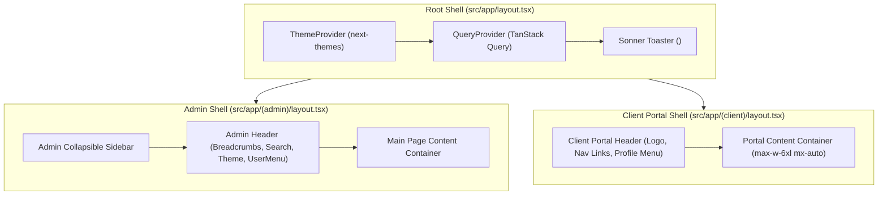

# Event Management System (EMS) — Frontend UI/UX Architecture & Component Design

**Document Version:** 1.0.0  
**Target Application:** `frontend/` (Next.js 16 App Router, React 19, Tailwind CSS v4, shadcn/ui Base UI Nova)  
**Parent Plan:** [frontend/plan.md](file:///C:/Users/N/Documents/projects/EMS/frontend/plan.md)  
**Status:** Authoritative UI/UX Design System Specification  

---

## 1. Design System & Theming Architecture

The EMS frontend implements a high-density, accessible, clean SaaS interface tailored for fast back-office operations and intuitive client interactions.

### 1.1 Foundation & Token Pipeline
- **CSS Engine:** Tailwind CSS v4 with `@tailwindcss/turbopack`.
- **Primitives:** `@base-ui/react` headless components integrated via shadcn Nova preset (`components.json`).
- **Base Color:** Neutral / Zinc with semantic role indicators.
- **Dark/Light Mode:** Supported via `next-themes` with CSS variable token switching.

#### Theme Tokens (`src/app/globals.css`)
```css
:root {
  --background: oklch(1 0 0);
  --foreground: oklch(0.145 0 0);
  --card: oklch(1 0 0);
  --card-foreground: oklch(0.145 0 0);
  --popover: oklch(1 0 0);
  --popover-foreground: oklch(0.145 0 0);
  --primary: oklch(0.205 0 0);
  --primary-foreground: oklch(0.985 0 0);
  --secondary: oklch(0.97 0 0);
  --secondary-foreground: oklch(0.205 0 0);
  --muted: oklch(0.97 0 0);
  --muted-foreground: oklch(0.556 0 0);
  --accent: oklch(0.97 0 0);
  --accent-foreground: oklch(0.205 0 0);
  --destructive: oklch(0.577 0.245 27.325);
  --destructive-foreground: oklch(0.985 0 0);
  --border: oklch(0.922 0 0);
  --input: oklch(0.922 0 0);
  --ring: oklch(0.708 0 0);
  --radius: 0.625rem;
}

.dark {
  --background: oklch(0.145 0 0);
  --foreground: oklch(0.985 0 0);
  --card: oklch(0.165 0 0);
  --card-foreground: oklch(0.985 0 0);
  --popover: oklch(0.165 0 0);
  --popover-foreground: oklch(0.985 0 0);
  --primary: oklch(0.985 0 0);
  --primary-foreground: oklch(0.205 0 0);
  --secondary: oklch(0.269 0 0);
  --secondary-foreground: oklch(0.985 0 0);
  --muted: oklch(0.269 0 0);
  --muted-foreground: oklch(0.708 0 0);
  --accent: oklch(0.269 0 0);
  --accent-foreground: oklch(0.985 0 0);
  --destructive: oklch(0.637 0.237 25.331);
  --destructive-foreground: oklch(0.985 0 0);
  --border: oklch(0.269 0 0);
  --input: oklch(0.269 0 0);
  --ring: oklch(0.439 0 0);
}
```

### 1.2 Typography & Numerical Formatting
- **Body & UI Font:** Geist Sans (`--font-geist-sans`).
- **Data & Numeric Font:** Geist Mono (`--font-geist-mono`).
- **Tabular Numbers:** All financial quantities, invoice balances, percentages, phone numbers, and sequential codes (`EVT-...`, `INV-...`) use `font-mono tracking-tight tabular-nums` to eliminate layout jitter during live updates.
- **Standard Currency Representation:** Indian Rupee symbol (`₹`) formatted with standard Indian lakh/crore group separators:
  ```typescript
  export const formatINR = (val: number | string | null | undefined): string => {
    if (val === null || val === undefined || isNaN(Number(val))) return "₹0.00";
    return new Intl.NumberFormat("en-IN", {
      style: "currency",
      currency: "INR",
      minimumFractionDigits: 2,
      maximumFractionDigits: 2,
    }).format(Number(val));
  };
  ```

---

## 2. Layout Architectures & Navigation



### 2.1 Admin Portal Layout (`src/app/(admin)/layout.tsx`)
- **Desktop Sidebar:** Sticky left sidebar powered by `components/ui/sidebar.tsx` with collapsible states (expanded: 260px, icon-only collapsed: 68px). State persisted in local storage or cookie.
- **Sidebar Navigation Sections:**
  1. **Core Operations:**
     - Dashboard (`/dashboard`) — `LayoutDashboard` icon
     - Master Calendar (`/calendar`) — `Calendar` icon
     - Clients & CRM (`/clients`) — `Users` icon
     - Quotations (`/quotations`) — `FileText` icon
     - Events (`/events`) — `CalendarCheck` icon
  2. **Billing & Finance:**
     - Invoices (`/invoices`) — `Receipt` icon
     - Payments (`/payments`) — `CreditCard` icon
     - Expenses (`/expenses`) — `TrendingDown` icon
  3. **Logistics & Collaborations:**
     - Inventory Master (`/inventory`) — `Package` icon
     - Venue Tie-Ups (`/tie-ups`) — `Building2` icon
- **Mobile Responsive Drawer:** When screen width is `< 768px`, sidebar collapses into a `Sheet` triggered by a hamburger button in the header.
- **Top Header Bar:**
  - Left: Mobile sidebar trigger + Dynamic route breadcrumb trail (`Home / Events / EVT-2026-0001`).
  - Center: Global Search shortcut (`Ctrl+K` / `Cmd+K`) triggering quick command palette.
  - Right: Theme toggle (`Sun` / `Moon`), notification bell, and user avatar dropdown menu (`Profile`, `Logout`).

### 2.2 Client Portal Layout (`src/app/(client)/layout.tsx`)
- **Visual Distinction:** Distinct header with company logo and "Client Portal" badge.
- **Horizontal / Simplified Navigation:**
  - Dashboard (`/portal/dashboard`)
  - My Events (`/portal/events`)
  - Quotations (`/portal/quotations`)
  - Invoices (`/portal/invoices`)
  - My Profile (`/portal/profile`)
- **Restricted Viewport:** Centered layout (`max-w-6xl mx-auto px-4 py-8`) optimized for readability on tablets and mobile devices.

---

## 3. Component Library Specifications

### 3.1 Reusable DataTable Component (`components/shared/data-table.tsx`)
Built upon `@tanstack/react-table` v9 with:
- Search input with 300ms debounce.
- Sortable header columns with ascending/descending visual arrows.
- Column visibility toggle menu.
- Pagination controls: "Previous", "Next", page number buttons, and page size dropdown (10, 20, 50, 100 rows).
- Empty state fallback rendering when results array is empty.
- Loading skeleton rows during fetching.

### 3.2 Canonical Status Badge (`components/shared/status-badge.tsx`)
Standardized badge styling mapped directly to backend Prisma enums:

| Enum Name | Enum Value | Badge Label | Background & Text Style |
|---|---|---|---|
| `EventStatus` | `DRAFT` | Draft | `bg-zinc-100 text-zinc-700 dark:bg-zinc-800 dark:text-zinc-300` |
| `EventStatus` | `CONFIRMED` | Confirmed | `bg-blue-100 text-blue-700 dark:bg-blue-950 dark:text-blue-300` |
| `EventStatus` | `PLANNING` | Planning | `bg-indigo-100 text-indigo-700 dark:bg-indigo-950 dark:text-indigo-300` |
| `EventStatus` | `IN_PROGRESS` | In Progress | `bg-amber-100 text-amber-700 dark:bg-amber-950 dark:text-amber-300` |
| `EventStatus` | `COMPLETED` | Completed | `bg-emerald-100 text-emerald-700 dark:bg-emerald-950 dark:text-emerald-300` |
| `EventStatus` | `CANCELLED` | Cancelled | `bg-rose-100 text-rose-700 line-through dark:bg-rose-950 dark:text-rose-300` |
| `QuotationStatus` | `DRAFT` | Draft | `bg-zinc-100 text-zinc-700` |
| `QuotationStatus` | `SENT` | Sent | `bg-sky-100 text-sky-700 dark:bg-sky-950 dark:text-sky-300` |
| `QuotationStatus` | `VIEWED` | Viewed | `bg-purple-100 text-purple-700 dark:bg-purple-950 dark:text-purple-300` |
| `QuotationStatus` | `ACCEPTED` | Accepted | `bg-emerald-100 text-emerald-700 dark:bg-emerald-950 dark:text-emerald-300` |
| `QuotationStatus` | `REJECTED` | Rejected | `bg-rose-100 text-rose-700 dark:bg-rose-950 dark:text-rose-300` |
| `InvoiceStatus` | `PARTIALLY_PAID` | Partially Paid | `bg-amber-100 text-amber-700 dark:bg-amber-950 dark:text-amber-300` |
| `InvoiceStatus` | `PAID` | Paid | `bg-emerald-100 text-emerald-700 dark:bg-emerald-950 dark:text-emerald-300` |
| `InvoiceStatus` | `OVERDUE` | Overdue | `bg-rose-100 text-rose-700 font-bold dark:bg-rose-950 dark:text-rose-300` |
| `TaskPriority` | `URGENT` | Urgent | `bg-red-600 text-white font-bold animate-pulse` |
| `TaskPriority` | `HIGH` | High | `bg-orange-100 text-orange-700 dark:bg-orange-950 dark:text-orange-300` |
| `TaskPriority` | `MEDIUM` | Medium | `bg-amber-100 text-amber-700 dark:bg-amber-950 dark:text-amber-300` |
| `TaskPriority` | `LOW` | Low | `bg-zinc-100 text-zinc-700 dark:bg-zinc-800 dark:text-zinc-300` |

### 3.3 Reusable Stat Card (`components/shared/stat-card.tsx`)
Card widget displaying key operational indicators:
- Title (e.g., "Total Active Events")
- Value in large font (`text-2xl font-bold`)
- Lucide icon in subtle rounded background badge
- Helper trend description or sub-label (e.g., "+3 from last month" or "5 overdue")

### 3.4 Confirm Dialog Component (`components/shared/confirm-dialog.tsx`)
Built upon `components/ui/dialog.tsx`:
- Trigger button
- Dialog title and description
- Optional input field for confirmation reason (e.g., cancellation note)
- "Cancel" button (secondary) and "Confirm" button (destructive or primary)
- Loading spinner state during async execution

---

## 4. Page-by-Page Screen Specifications

### 4.1 Authentication Screens

#### Unified Login (`src/app/(auth)/login/page.tsx`)
- **Layout:** Centered card (`max-w-md w-full mx-auto`) with company logo and title "Sign in to your account".
- **Fields:**
  - Email: `<Input type="email" placeholder="name@company.com" />`
  - Password: `<Input type="password" placeholder="••••••••" />` with toggle visibility eye icon.
- **Actions:** "Sign In" button with loading spinner.
- **Post-Login Routing:**
  - Inspects `user.role` from `POST /api/v1/auth/login`.
  - If `ADMIN` → Redirects to `/dashboard`.
  - If `CLIENT` → Redirects to `/portal/dashboard`.

#### Client Portal Activation (`src/app/activate-portal/page.tsx`)
- **Route:** Public page accessible via link delivered in invitation email:
  `/activate-portal?token=<token_string>`
- **Behavior:**
  - Extracts `token` from `useSearchParams()`.
  - Prompts: "Welcome! Choose a password to activate your account."
  - Form Fields:
    - New Password (`min(6)`)
    - Confirm New Password
  - Submits to `POST /api/v1/auth/activate-portal` with `{ token, password }`.
  - Backend automatically issues JWT cookies; frontend redirects to `/portal/dashboard`.

---

### 4.2 Admin Portal Screens

#### 1. Executive Dashboard (`/dashboard`)
```text
+------------------------------------------------------------------------------------+
|  [ Stat: Active Events ] [ Stat: Monthly Invoiced ] [ Stat: Overdue ] [ Stat: Cash ]|
+------------------------------------------------------------------------------------+
|  [ Area Chart: Invoicing & Collections (Last 6 Months) ]  [ Doughnut: Event Status ]|
+------------------------------------------------------------------------------------+
|  [ Upcoming Events Table (Next 14 Days) ]    [ CRM Activity / Urgency Checklist ]   |
+------------------------------------------------------------------------------------+
```
- **Top Row Stat Cards:**
  1. Active Events (`CONFIRMED`, `PLANNING`, `IN_PROGRESS`)
  2. Total Invoiced This Month (₹)
  3. Outstanding Receivables (₹ balance from unpaid invoices)
  4. Scheduled Site Visits & Meetings (from Calendar entries)
- **Charts (Recharts):**
  - **Inflow vs Invoiced Chart:** Stacked Bar / Area Chart comparing total billed vs payments collected month-by-month.
  - **Event Status Breakdown:** Donut chart showing distribution of event stages.
- **Bottom Sections:**
  - Upcoming events list with countdown tags.
  - Urgent Task list (`priority === URGENT` or `dueDate <= today`).

#### 2. Client Management Hub (`/clients` and `/clients/[id]`)
- **Directory (`/clients`):**
  - Table: Name, Phone (with `tel:` link), Email, City, Events Count, Invoices Count, Portal Status.
  - Action Button: **"+ New Client"** opens Client Creation Dialog.
- **Client Profile View (`/clients/[id]`):**
  - **Top Banner:** Client Name, Phone, Address, Creation Date.
  - **Portal Management Card:**
    - If `NOT_ASSIGNED`: Displays message "Portal not yet enabled" + **"Assign Portal Access"** button.
    - If `INVITATION_PENDING`: Displays "Invite pending client activation" + **"Copy Invite Link"** + **"Resend Invite"** button.
    - If `INVITATION_EXPIRED`: Displays warning "Invite link expired" + **"Generate Fresh Invite"** button.
    - If `ACTIVE`: Displays green badge "Portal Active" + Toggle Switch to deactivate account (`PATCH /clients/:id/status`).
  - **Tabs System:**
    - **Tab 1: Events:** Table of events created for this client with live statuses.
    - **Tab 2: Quotations:** Quotation history with accepted/sent badges.
    - **Tab 3: Invoices:** Itemized invoices with paid and balance columns.
    - **Tab 4: Payments:** Payments received from client with transaction reference numbers.
    - **Tab 5: CRM Timeline:** Chronological feed of meetings, calls, and site visits + **"+ Log Activity"** button.

#### 3. Quotation Studio (`/quotations` and `/quotations/[id]`)
```text
+------------------------------------------------------------------------------------+
|  Quotation: QUO-2026-0001           Status: [ DRAFT ]     Actions: [ Send ] [ Edit ]|
+------------------------------------------------------------------------------------+
|  Client: Rahul Sharma | Event Type: Wedding | Date: 15-Dec-2026 | Venue: Grand Palace|
+------------------------------------------------------------------------------------+
|  # | Item Description             | Qty  | Unit  | Unit Price (₹) | Total (₹)     |
|----+------------------------------+------+-------+----------------+----------------|
|  1 | Stage Decoration & Lighting   | 1    | set   | 45,000.00      | 45,000.00      |
|  2 | Sound System & DJ Setup      | 2    | days  | 12,000.00      | 24,000.00      |
+------------------------------------------------------------------------------------+
|                                                  Subtotal:        ₹69,000.00       |
|                                                  Discount (10%):  -₹6,900.00       |
|                                                  GST (18%):       ₹11,178.00       |
|                                                  Grand Total:     ₹73,278.00       |
+------------------------------------------------------------------------------------+
|  [ Convert to Event ] (Enabled when status is ACCEPTED)                            |
+------------------------------------------------------------------------------------+
```
- **Quotation Form:**
  - Client selector (searchable combobox).
  - Title, Event Type, Event Date, Venue, Guest Count.
  - Dynamic line item table: Add row, Remove row, Drag handle.
  - Real-time totals card:
    - Subtotal updates automatically.
    - Discount type: Toggle between Fixed (`₹`) and Percentage (`%`).
    - GST Tax Rate: Dropdown (0%, 5%, 12%, 18%).
    - Grand Total rendered in large bold rupees.
- **Workflow Actions:**
  - Transition `DRAFT` → `SENT` (records `sentAt`).
  - When status is `ACCEPTED`: Button **"Convert to Event"** becomes active. Clicking opens a modal that pre-fills event title, client, date, and venue from quotation, executing `POST /api/v1/quotations/:id/convert-to-event`.

#### 4. Event Operations Command Center (`/events/[id]`)
- **Header Section:** Event Number (`EVT-2026-0001`), Event Title, Client Name, Event Date, Venue Name.
- **Lifecycle Stepper:** Visual breadcrumb stepper representing state machine:
  `DRAFT` ➔ `CONFIRMED` ➔ `PLANNING` ➔ `IN_PROGRESS` ➔ `COMPLETED`
  - Action dropdown: "Transition Status" only displays valid transitions allowed by backend logic.
  - "Cancel Event" button triggers Confirm Dialog requiring a cancellation reason.
- **Financial Summary Widget (Admin Only):**
  - Planned Budget: `₹xx,xxx`
  - Total Invoiced: `₹xx,xxx`
  - Total Paid: `₹xx,xxx`
  - Total Event Expenses: `₹xx,xxx`
  - Balance Receivable: `₹xx,xxx`
  - Net Profit Margin: `₹xx,xxx`
- **Sub-Tabs:**
  - **Tab 1: Overview & Notes:** Venue address, guest count, description, and internal notes.
  - **Tab 2: Itinerary / Day Schedule:** Timeline list of schedule items (`startAt`, `endAt`, title) + **"+ Add Schedule"** button.
  - **Tab 3: Task Checklist:** Checklist of operational tasks (`TODO`, `IN_PROGRESS`, `COMPLETED`) with priority chips (`URGENT`, `HIGH`, `MEDIUM`, `LOW`) and due dates.
  - **Tab 4: Invoices & Billing:** Invoices linked to this event.
  - **Tab 5: Inventory Allocation (Adapter):** Assigned equipment list.

#### 5. Invoicing & PDF Viewer (`/invoices` and `/invoices/[id]`)
- **Invoice Creation Screen:**
  - Linked Client and optional linked Event.
  - Issue Date and Due Date (with validation `dueDate >= invoiceDate`).
  - Line Items: Item Name, Description, Quantity, Unit Price, Type (`PROFORMA` vs `FINAL`), and Advance Adjusted (₹).
  - Discount and Tax rate configuration.
- **Invoice Detail View:**
  - Detailed tax breakdown.
  - Paid Amount and Live Balance indicator.
  - Payment Allocations Ledger: Lists payments contributing to this invoice.
  - Action Button: **"Download PDF"** streams binary PDF directly from `GET /api/v1/invoices/:id/pdf` and opens in browser or downloads locally.

#### 6. Payment Allocation Wizard (`/payments/new`)
```text
+------------------------------------------------------------------------------------+
|  RECORD CLIENT PAYMENT                                                             |
+------------------------------------------------------------------------------------+
|  Step 1: Select Client -> [ Rahul Sharma                            v ]            |
|  Step 2: Payment Details:                                                          |
|          Amount Received: [ ₹50,000.00 ]     Date: [ 10-Nov-2026 ]                 |
|          Method: [ UPI          v ]          Reference: [ UPI/23490184018 ]        |
|          Type:   [ PARTIAL      v ]          Notes:     [ Advance payment ]        |
+------------------------------------------------------------------------------------+
|  Step 3: Allocate to Pending Invoices:                                             |
|  Invoice #     | Due Date    | Total (₹)   | Balance (₹) | Allocate Amount (₹)     |
|----------------+-------------+-------------+-------------+-------------------------|
|  INV-2026-0001 | 15-Nov-2026 | 73,278.00   | 73,278.00   | [ 50,000.00           ] |
+------------------------------------------------------------------------------------+
|  Total Allocated: ₹50,000.00 / ₹50,000.00    Remaining Unallocated: ₹0.00          |
|  [ Submit Payment & Update Invoices ]                                              |
+------------------------------------------------------------------------------------+
```
- **Validation Guardrails:**
  - Allocation amount on any row cannot exceed the invoice's remaining balance.
  - Total allocated across all rows cannot exceed the received payment amount.
  - Real-time indicator displays remaining unallocated balance.

---

### 4.3 Client Portal Screens

#### 1. Client Dashboard (`/portal/dashboard`)
- **Welcome Banner:** "Welcome back, {clientName}!"
- **Quick Cards:**
  - Next Upcoming Event: Title, Date countdown ("5 days to go"), Venue.
  - Invoices to Review: Count of pending invoices and total balance.
  - Quotations Awaiting Approval: Count of quotations in `SENT` status.
- **Clean Action Links:** Quick jump to review quotations or view invoices.

#### 2. Client Quotation Review Screen (`/portal/quotations/[id]`)
- **Real-Time CRM Hook:** When client loads this page, backend automatically marks status as `VIEWED` if it was `SENT`.
- **Display:** Clean itemized quotation with item names, quantities, unit prices, line totals, taxes, and grand total. Internal company margins are omitted.
- **Client Decision Banner:**
  - If status is `SENT` or `VIEWED`:
    - **"Accept Quotation"** (Green button) opens modal: "Are you sure you want to approve this quotation? Our team will begin event confirmation immediately."
    - **"Reject Quotation"** (Red button) opens modal with optional feedback textarea.
  - If status is `ACCEPTED`: Displays green celebration banner "Quotation Approved on {date}".
  - If status is `REJECTED`: Displays notice "Quotation Rejected".

#### 3. Client Invoices & Receipts (`/portal/invoices/[id]`)
- Shows clean invoice view with itemized charges, discount, GST, and total.
- Shows total paid amount and remaining balance.
- **"Download Official PDF"** button: Triggers direct binary stream download of `INV-YYYY-XXXX.pdf`.

---

## 5. Responsive Design & Accessibility

### 5.1 Responsive Breakpoints
- **Mobile (< 640px):** Single-column stacked layouts, sidebar collapses into Sheet drawer, full-width inputs, touch-friendly buttons (minimum 44px tap target).
- **Tablet (640px – 1024px):** 2-column grid for stat cards and forms, compact data table columns with horizontal scroll.
- **Desktop (> 1024px):** Expanded persistent sidebar, multi-column dashboard grids, side-by-side forms and calculation preview cards.

### 5.2 Accessibility (a11y) Standards
- WCAG 2.1 Level AA color contrast compliance in both dark and light modes.
- Accessible ARIA labels on all icon-only buttons (`aria-label="Download Invoice PDF"`).
- Keyboard navigation: Full tab navigation through forms, data tables, and modal dialogs with focus trap enabled.
- Screen-reader announcements for toast notifications via Sonner (`role="status"`).
