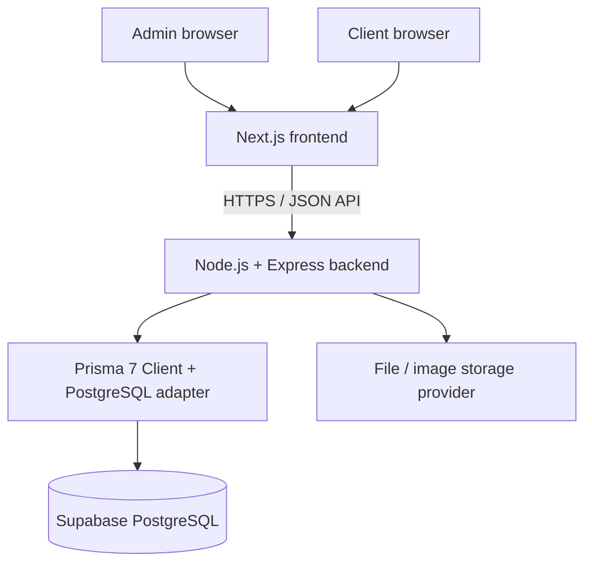

# Event Management System (EMS) — Product & Engineering Plan

**Document type:** Product plan / implementation baseline  
**Status:** Working baseline for LLD creation  
**Currency / business context:** India, INR (₹)  
**Architecture:** Separate Next.js frontend and Node.js backend  
**Database:** PostgreSQL with Prisma ORM 7  

> This plan consolidates the decisions currently made for the EMS. It distinguishes confirmed decisions from recommendations and open questions. An implementation AI must inspect the actual repository and Prisma schema before changing anything. Do not invent business rules where this plan says **Open decision**.

---

## 1. Product overview

Build a web-based Event Management System for a small event-management business. The software should centralize client information, events, invoices and payments, inventory, banquet/restaurant/hotel tie-ups, business expenses, and owner withdrawals.

The initial system is intended for a small team (approximately 2–7 users) and has two application roles:

- **Admin:** manages the business and has access to operational and financial management features.
- **Client:** can access only their own client-facing information and permitted event, invoice, and payment details.

The first version should be straightforward to deploy and operate, but the code should be modular enough to scale later.

### 1.1 Main goals

1. Keep client and event information in one system.
2. Track event budgets, invoices, received payments, and outstanding balances.
3. Track reusable inventory and its movement into and out of events.
4. Track external tie-ups such as banquet halls, restaurants, and hotels.
5. Track event-level operating expenses and commissions.
6. Track business-level purchases and expenses separately from event expenses.
7. Track owner/personal withdrawals separately from business expenses.
8. Produce reliable event-wise and business-level financial summaries.
9. Maintain clear audit history for important financial and stock operations.

### 1.2 Out of scope for the first release

Do not implement these unless explicitly approved later:

- Staff roles, task assignment, employee attendance, or staff payroll. There are currently only Admin and Client roles; task assignment is deferred.
- Multi-tenant SaaS support or a separate database for each customer/business. The current system is for one business.
- A complex accounting/ERP replacement, GST filing, or statutory accounting engine.
- A vendor marketplace or public booking marketplace.
- Native mobile applications.
- AI automation inside the product. AI may be used as a development assistant, not assumed as a product requirement.

---

## 2. Confirmed decisions and design principles

| Area | Current decision |
|---|---|
| User roles | Admin and Client only |
| Frontend | Next.js |
| Backend | Separate Node.js + Express application |
| Language | TypeScript for the current backend setup; keep frontend/backend implementation consistent with the actual repositories |
| ORM | Prisma 7 (currently generated Prisma Client 7.10.1) |
| Database | PostgreSQL hosted on Supabase |
| Project layout | Separate `frontend/` and `backend/` folders/projects; do not convert to a monorepo |
| Database schema | Existing `prisma/schema.prisma` is the source of truth to inspect before proposing schema changes |
| Prisma generator output | `backend/src/generated/prisma` (verify actual generator configuration) |
| Prisma config | `prisma7.config.js` |
| Runtime database URL | `DATABASE_URL` |
| Migration database URL | `DIRECT_URL` |
| Tie-up types | Restaurant, Hotel (design so more types can be added later) |
| Tie-up security deposit | Refundable; track it as a deposit/advance, not automatically as an expense |
| Commission | Support the commission configuration already represented in the schema; inspect `CommissionType` and existing fields before implementation |
| Expense separation | Event-based expenses, business-level expenses, and owner withdrawals are distinct concepts |
| Task assignment | Deferred; do not add staff/task modules to the first release |

### 2.1 Required engineering principles

- Keep business logic in services, request handling in controllers, and URL definitions in routes.
- Validate every API request at the backend boundary.
- Enforce ownership and role authorization on the server. Hiding a frontend button is not security.
- Use database transactions for operations that update multiple related records.
- Use Decimal for monetary values. Do not use JavaScript floating-point arithmetic for authoritative money calculations.
- Store timestamps consistently and display them in the business/user's intended timezone.
- Keep credentials and secrets in environment variables. Never commit `.env` files or expose database URLs to the browser.
- Do not silently change existing schema names, enums, relations, or business behavior. Explain and justify any required migration.
- Prefer derived totals/statuses where practical; avoid storing duplicate values that can drift out of sync.
- Keep inventory stock changes in a movement ledger; do not change stock without recording the reason/movement.

---

## 3. Proposed high-level architecture



### 3.1 Frontend

- Next.js application in its own `frontend/` folder.
- Use a clear feature-based structure for pages, components, hooks, API clients, and validation.
- Protect client/admin routes in the UI for usability, but rely on backend authorization for enforcement.
- Use a consistent API client that handles authentication, errors, and loading states.
- Keep reusable UI components for tables, forms, dialogs, filters, status labels, and financial summaries.
- Do not put database credentials or privileged Supabase keys in client-side code.

### 3.2 Backend

- Separate Node.js + Express application in `backend/`.
- TypeScript source code.
- Suggested layers: routes → middleware → controllers → services → Prisma/data access.
- Keep modules independent (auth, users/clients, events, invoices, payments, inventory, tie-ups, expenses, withdrawals, reports).
- Keep calculations and business rules in services, not directly in route handlers.
- Add centralized error handling, request validation, authentication, authorization, and logging.

### 3.3 Database / Prisma

- PostgreSQL is the persistent database.
- Prisma 7 manages schema and migrations.
- Runtime code uses `DATABASE_URL` and the PostgreSQL driver adapter configured for Prisma 7.
- Prisma CLI/migrations use `DIRECT_URL` through `prisma7.config.js`.
- Never expose either connection string to the frontend.
- Keep generated Prisma Client files out of manual editing; regenerate with `npx prisma generate` after schema changes.

### 3.4 Deployment direction

The intended preference is low-cost deployment with a simple operational setup. An Oracle Cloud Always Free VM has been considered for self-hosting, and Supabase PostgreSQL is the current database choice. Treat all free-tier capacity/availability as subject to provider limits and policy changes; do not promise lifetime availability.

The final frontend host, backend host, reverse proxy, storage provider, backup method, and domain/DNS setup remain deployment decisions to verify when deployment is implemented. Keep deployment portable using environment variables, a production build, process management, HTTPS, and database backups.

---

## 4. Roles and access control

### 4.1 Admin

Admin is the business operator. Admin can, subject to feature permissions:

- Create and manage clients and events.
- Manage event details, budgets, and operational status.
- Create invoices and record client payments.
- Manage inventory items, purchases, stock movements, and event allocations.
- Manage tie-ups, security deposits, commissions, and tie-up transactions.
- Create and manage expenses and expense payments.
- Record and view owner withdrawals.
- View dashboards and business reports.
- Manage user access and system settings that are included in the first release.

### 4.2 Client

A Client should only be able to access records associated with their own account. The exact client-facing feature set should be confirmed from the existing UI/schema, but the intended baseline is:

- View their own profile/basic account information.
- View their own events and permitted event details.
- View their own invoices and payment history.
- View their own outstanding amount/status.
- Never access another client's records or internal business expenses, inventory cost, tie-up commission, deposits, or owner withdrawals.

### 4.3 Authorization rules

- Resolve the authenticated user from a verified server-side session/token.
- Check `role` on the backend for every protected operation.
- For Client requests, scope database queries by the authenticated user's client relationship; never trust a client-supplied `userId`/`clientId` as proof of ownership.
- Admin-only actions must return `403 Forbidden` to clients.
- Unauthenticated requests must return `401 Unauthorized`.
- Keep authorization tests for cross-client data access.

**Open decision:** Confirm whether a client account is represented directly by `User`, or whether a separate `Client` model/profile exists in the current schema. The implementation AI must inspect the schema and avoid creating duplicate identity models.

---

## 5. Functional modules and workflows

## 5.1 Authentication and user management

**Purpose:** Secure access for Admin and Client users.

Core capabilities:
- Login/logout.
- Secure password hashing if password-based authentication is used.
- User role management (Admin/Client).
- Account activation/deactivation if supported by current requirements.
- Authenticated profile retrieval/update with field-level restrictions.
- Session/token expiry and logout/revocation strategy.

Security recommendations:
- Prefer short-lived access tokens and a secure refresh-session strategy if JWT authentication is selected.
- Store refresh tokens as hashes server-side if persisted; use secure, HttpOnly, SameSite cookies where applicable.
- Do not store long-lived authentication tokens in browser localStorage.
- Add rate limiting to login and sensitive endpoints.
- Never log passwords, tokens, or secrets.

**Open decision:** Final authentication method, password reset flow, email/SMS provider, and whether a client can self-register or must be created/invited by Admin.

## 5.2 Client management

**Purpose:** Maintain client records and connect clients to their events and invoices.

Expected capabilities:
- Create/view/update client profile.
- Search and filter clients.
- View a client's event history.
- View associated invoices and payment history.
- Prevent duplicate or ambiguous client records where possible.

The AI must inspect the existing `User` and related models first. Do not introduce a separate `Client` table unless the existing model design requires it and the change is approved.

## 5.3 Event management

**Purpose:** Create and manage each event as the central operational record.

Expected event information (map fields to the actual schema; do not add every field blindly):
- Client/owner relationship.
- Event name/type and description.
- Event date/time and venue/location.
- Planning budget.
- Event status (use existing enum or propose a controlled lifecycle only after inspection).
- Linked invoices/payments.
- Linked inventory allocations.
- Linked tie-up/banquet arrangements.
- Linked event expenses.

Expected capabilities:
- Create, view, edit, search, and filter events.
- View an event's financial and operational summary.
- Link a tie-up/banquet to the event through the appropriate junction model (currently `TieUpEvent`).
- Track inventory issued/allocated and returned for the event.
- View event invoices, payments, and expenses from one event detail screen.

Important rule:
- `Event.budget` is a planning/budget figure. It must not automatically be treated as actual revenue or money received.
- Actual revenue should come from the approved invoice/sales records, while received cash should come from payment records.

**Open decisions:** Full event lifecycle/status list, cancellation/rescheduling rules, event types, and whether multiple invoices are allowed per event.

## 5.4 Invoice and client payment management

**Purpose:** Track what the business charges a client and what the client has paid.

Expected capabilities:
- Create invoice linked to the correct client and event (subject to current schema).
- Store invoice number, issue/due dates, line items/tax/discount if in scope, total, and status.
- Record one or multiple partial payments.
- Support existing `PaymentMethod` values (for example CASH, UPI, BANK_TRANSFER, CARD, CHEQUE, OTHER); inspect the enum before changing it.
- Show amount paid, amount due, and payment history.
- Avoid accepting payments that exceed the allowed outstanding amount unless an approved advance/overpayment rule exists.

Suggested derived calculation:

`amountDue = invoiceTotal - sum(successfulPayments)`

Payment status should be derived or updated transactionally and consistently (for example unpaid, partially paid, paid, overdue), based on the actual existing schema and business rules.

**Open decisions:** Invoice numbering, GST/tax rules, discounts, advance payments, refunds, overpayments, and invoice cancellation/credit-note behavior.

## 5.5 Inventory management

**Purpose:** Track reusable event inventory and every stock movement.

Expected capabilities:
- Create/update inventory items.
- Store item name, unit, purchase/cost information, current stock, and reorder threshold if required.
- Record purchases as stock-in movements.
- Allocate/issue inventory to an event.
- Record returns from an event.
- Record damage, loss, and manual stock adjustments with reasons.
- View movement history and current available stock.

The existing schema already includes concepts such as `InventoryItem`, `InventoryMovement`, and `EventInventory`. Inspect exact names and fields before changing them. The existing movement types include concepts such as PURCHASE, EVENT_ISSUE, EVENT_RETURN, DAMAGE, LOSS, ADJUSTMENT_IN, and ADJUSTMENT_OUT; use the enum actually present in the schema.

Stock rules:
- Every stock change must have a movement record.
- Do not allow a negative stock balance unless the business explicitly approves that behavior.
- Validate that an event cannot be issued more than the available quantity.
- Returned quantity cannot exceed the quantity issued and not yet returned.
- Damage/loss must be recorded as a movement, not silently deleted from stock.
- If `currentStock` is stored for fast reads, update it in the same database transaction as the movement record. Periodically reconcile it against the movement ledger.

Financial rule:
- Purchasing inventory is a cash outflow and creates/updates an inventory asset; it should not automatically be counted as an event's consumed cost.
- Inventory consumed/used, damaged, or lost should be handled according to the agreed costing policy.
- Avoid double-counting an inventory purchase as both an expense and event consumption cost in profit reports.

**Open decisions:** Unit/cost valuation (weighted average, FIFO, or simple purchase cost), whether partially used/consumed quantities need a separate movement type, and how to value damage/loss.

## 5.6 Tie-up and collaboration management

**Purpose:** Manage external venues/partners used for events, especially banquet halls, restaurants, and hotels.

Current tie-up types:
- Restaurant
- Hotel

Expected tie-up information:
- Business/venue name and contact information.
- Tie-up type.
- Address and notes.
- Commission configuration (use existing `CommissionType` and schema fields).
- Refundable security deposit amount and its transaction history.
- Active/inactive status if required.

Expected capabilities:
- Create and manage tie-up records.
- Link a tie-up to a particular event through `TieUpEvent`.
- Store event-specific commission terms/snapshot so future changes to the tie-up's default commission do not rewrite historical event calculations.
- Record deposit received, deposit refunded, and other supported tie-up transactions.
- Show outstanding/refundable deposit balance.
- View tie-up event history and commission history.

Important rules:
- A security deposit is refundable and must be tracked separately from operating expenses. It is not automatically an expense when paid.
- A deposit refund reduces the deposit balance; it is not ordinary event revenue.
- A commission is associated with the specific event/tie-up relationship (`TieUpEvent`), not merely with the general tie-up record.
- Preserve the commission terms used for each event as a historical snapshot.
- Commission calculation must use the agreed base amount and commission type; do not guess whether it is based on invoice total, event budget, or another value.

**Open decisions:** Confirm commission base calculation (invoice value, agreed event amount, or another base), whether a commission can be both fixed and percentage in the same tie-up/event, deposit settlement timing, and the full list of `TieUpTransactionType` values.

## 5.7 Expense management

**Purpose:** Record business costs and correctly distinguish event-related costs from business-level costs.

Current expense categories and concepts:

### A. Event-based expenses
- Transportation.
- Banquet/tie-up commission.
- Other operating expenses.

### B. Business-level / non-event expenses
- Inventory purchase (linked to inventory stock-in movement).
- Other operating expenses if required by the final category design.

The current schema design includes the concepts `ExpenseScope` (EVENT / BUSINESS) and `ExpenseCategory` (including TRANSPORTATION, BANQUET_COMMISSION, OTHER_OPERATING, INVENTORY_PURCHASE). Inspect the actual schema and retain its exact enum values unless a migration is deliberately approved.

Expected expense fields/concepts:
- Title and description.
- Amount (`Decimal`, not floating point).
- Scope and category.
- Expense date.
- Payee/vendor (`paidTo`) and receipt attachment URL if available.
- Optional event link for event-scope costs.
- Optional `TieUpEvent` link for banquet commission.
- Expense payment history (one or many payments).
- Creator/audit metadata.
- Link to one or more inventory movements for inventory purchase reconciliation where appropriate.

Validation rules:
- EVENT scope requires a valid `eventId`.
- BUSINESS scope should not have an `eventId`.
- BANQUET_COMMISSION requires a valid `tieUpEventId` and its event must match the expense's `eventId`.
- INVENTORY_PURCHASE should be reconciled with relevant PURCHASE inventory movements.
- Sum of expense payments must not exceed the expense amount unless an approved overpayment/advance rule exists.
- Create the expense, related payments, and stock movements atomically when one user action is expected to create all of them.

## 5.8 Owner / personal withdrawal management

**Purpose:** Record money taken out of the business by the owner.

Expected fields/concepts:
- Amount (`Decimal`).
- Withdrawal date.
- Payment method.
- Purpose/note/reference number.
- Created-by user and timestamps.

Important accounting rule:
- Owner withdrawal is not a business operating expense and must not reduce event profit or operating profit.
- It is a cash/bank outflow and should appear in cash movement / owner withdrawal reports.
- Keep it separate from `Expense` so expense totals remain meaningful.

## 5.9 Dashboard and reports

Admin dashboard should provide useful operational/financial summaries without mixing different accounting concepts.

Suggested initial reports:
- Events by status and date range.
- Event budget vs actual invoiced amount.
- Invoice amount, received payments, and outstanding receivables.
- Event-wise income and operating expenses.
- Event-wise banquet commission.
- Inventory available stock and movement history.
- Inventory purchases and inventory consumption/cost summary.
- Tie-up security deposit balances and deposit transactions.
- Tie-up commission by event and partner.
- Expense totals by category, scope, and date range.
- Owner withdrawals by date range.
- Business cash-flow summary.

Financial definitions that must remain distinct:

| Metric | Meaning |
|---|---|
| Event budget | Planned estimate; not automatically revenue |
| Invoiced amount | Amount charged to client |
| Received amount | Sum of successfully recorded client payments |
| Receivable | Invoice amount still due |
| Event operating cost | Event-related transport, commission, and other operating expenses |
| Inventory purchase cash outflow | Money spent to acquire stock; not automatically consumed cost |
| Inventory consumption cost | Cost assigned to stock used/consumed for an event under the chosen valuation policy |
| Event profit estimate | Actual recognized event revenue minus event operating costs and inventory consumption cost, using an agreed revenue/cost policy |
| Owner withdrawal | Owner cash outflow; not a business expense and not a reduction in event profit |
| Refundable security deposit | Deposit asset/balance; not automatically an expense |

Illustrative example (not an accounting policy by itself): If an event's actual revenue is ₹15,000, operating expenses are ₹5,000, and banquet commission is ₹2,000, then the event has ₹8,000 remaining before inventory consumption cost and any other applicable costs. If ₹1,000 is then spent buying inventory and ₹2,000 is withdrawn by the owner, neither amount should simply be subtracted from that event profit: inventory purchase is a stock/cash movement, and owner withdrawal is an owner/cash movement. The event should be charged for inventory cost when the inventory is consumed/allocated according to the adopted costing policy.

**Open decisions:** Revenue recognition timing, whether profit is cash-based or accrual/earned-revenue based, tax treatment, and the inventory costing policy. Reports must label estimates clearly until these decisions are finalized.

---

## 6. Current conceptual data model

The existing Prisma schema is authoritative. The following is a conceptual inventory of model responsibilities based on current planning; it is not permission to recreate models or rename fields.

| Model / concept | Responsibility |
|---|---|
| `User` | Login identity, role, and user metadata |
| `Event` | Central event record, including planning budget |
| `Invoice` | Client bill/charge for an event, subject to actual schema |
| `Payment` | Client payment against invoice/event, subject to actual schema |
| `InventoryItem` | Reusable item and stock information |
| `InventoryMovement` | Purchase, issue, return, damage, loss, and adjustment ledger |
| `EventInventory` | Event-to-inventory allocation/issue relationship |
| `TieUp` | Restaurant/hotel/venue/partner master data and default terms |
| `TieUpEvent` | Tie-up linked to a particular event and event-specific commission snapshot |
| `TieUpTransaction` | Deposit/commission/other tie-up money movements, according to its enum |
| `Expense` | Event or business expense record |
| `ExpensePayment` | One or more payments made against an expense |
| `OwnerWithdrawal` | Owner's personal/business withdrawal record, separate from expenses |

### 6.1 Relationship rules to verify in the actual schema

- A User may create expenses, expense payments, and owner withdrawals (using the existing named relations, if present).
- An Event may have many expenses, invoices/payments, inventory allocations, and tie-up event links.
- An Expense may link to an Event when it is event-scoped.
- An Expense may link to a `TieUpEvent` for a banquet commission.
- `InventoryMovement` may link to an Expense for stock purchase reconciliation.
- A `TieUpEvent` connects one TieUp and one Event and stores the commission snapshot for that event.
- `ExpensePayment` belongs to one Expense.
- `OwnerWithdrawal` is independent of Event and Expense.

The implementation AI must compare these conceptual relationships against the uploaded/current schema and report any mismatch before generating migration code.

---

## 7. Core business workflows

### 7.1 Client → Event → Invoice → Payment

1. Admin creates or selects a client.
2. Admin creates an event and links it to that client.
3. Admin records the event's planned budget and event details.
4. Admin creates an invoice using the agreed billing rules.
5. Client payment(s) are recorded against the invoice.
6. System shows invoice total, received amount, and outstanding amount.
7. Client can view only their permitted event and billing data.

### 7.2 Event inventory workflow

1. Admin creates an inventory item.
2. Admin records a purchase and stock-in movement.
3. Admin allocates/issues a quantity to an event.
4. System validates available stock and records the movement.
5. After the event, Admin records returned, damaged, or lost quantity.
6. System recalculates stock and preserves movement history.
7. Event cost reports apply the agreed inventory valuation/consumption rule, not raw purchase cash outflow.

### 7.3 Tie-up workflow

1. Admin creates a restaurant/hotel/banquet tie-up.
2. Admin records its refundable security deposit and relevant transaction.
3. Admin links the tie-up to an event through `TieUpEvent`.
4. System stores the event-specific commission terms and calculation base.
5. Commission payable/paid is recorded according to the agreed tie-up transaction/expense workflow.
6. Deposit refunds and commission payments remain distinguishable in history and reports.

### 7.4 Expense workflow

1. Admin chooses EVENT or BUSINESS scope.
2. Admin selects a category and enters title, amount, date, payee, and optional receipt.
3. For an event expense, Admin selects the event.
4. For a banquet commission, Admin selects the exact `TieUpEvent` and the system verifies its event.
5. Admin records full or partial expense payment(s).
6. If it is an inventory purchase, the relevant stock purchase movement(s) are recorded/reconciled.
7. System shows total, paid amount, and remaining amount without double-counting linked stock movements.

### 7.5 Owner withdrawal workflow

1. Admin records amount, date, payment method, and optional purpose/reference.
2. System records the withdrawal separately from expenses.
3. Withdrawal appears in cash-flow/withdrawal reports, not event profit calculations.

---

## 8. API design baseline

Use a versioned REST API, for example `/api/v1`. Exact endpoints must be reconciled with the actual backend before implementation.

Suggested route groups:

- `/auth` — login, logout, refresh/session, current user.
- `/users` or `/clients` — Admin-managed user/client operations.
- `/events` — event CRUD, event details, event summaries.
- `/invoices` — invoice CRUD and invoice detail.
- `/payments` — client payment recording/history.
- `/inventory/items` — inventory item CRUD.
- `/inventory/movements` — purchase, issue, return, damage, loss, adjustment.
- `/inventory/events` — event allocation/return operations.
- `/tie-ups` — tie-up CRUD and detail.
- `/tie-ups/events` — link tie-up to event and commission snapshot.
- `/tie-ups/transactions` — deposit and other tie-up transactions.
- `/expenses` — expense CRUD and filters.
- `/expenses/:id/payments` — expense payment history and recording.
- `/withdrawals` — owner withdrawal operations.
- `/dashboard` and `/reports` — Admin summaries and reports.

API conventions:
- Use appropriate HTTP methods and status codes.
- Validate request params, query params, and body payloads.
- Use pagination, sorting, and server-side filters for list endpoints.
- Return a consistent response/error format.
- Do not expose internal stack traces or database credentials.
- Avoid returning internal cost/commission/withdrawal information to Client users.
- Use idempotency or duplicate-request protection for payment and stock-movement operations where retries could create duplicate financial/stock entries.

---

## 9. Data integrity, transactions, and validation

Operations that should usually be atomic:

- Create invoice and its line items.
- Record a client payment and update/derive invoice payment status.
- Record inventory purchase and corresponding movement/expense linkage.
- Issue/return inventory and update stock ledger/current-stock value.
- Create a tie-up event link and preserve its commission snapshot.
- Record an expense and its related payment(s).
- Record a commission payment in the selected canonical workflow without creating duplicate expense/transaction entries.
- Refund a security deposit and update the corresponding deposit balance/transaction history.

Validation checklist:
- Monetary inputs are positive where applicable and use Decimal.
- Dates and references are valid.
- Referenced event/client/tie-up records exist and are accessible to the actor.
- A `TieUpEvent` belongs to the same event referenced by a banquet commission expense.
- Expense payment total does not exceed allowed payable amount.
- Client payment does not silently exceed invoice balance.
- Inventory issue does not exceed available stock.
- Inventory return does not exceed outstanding issued quantity.
- Stock movement and current stock remain consistent.
- Duplicate payment or movement submissions are prevented or safely handled.
- Client cannot read or mutate another client's records.

---

## 10. Non-functional requirements

### Security
- HTTPS in production.
- Secure authentication/session handling.
- Server-side role and ownership authorization.
- Input validation and output filtering.
- Rate limiting for authentication and sensitive endpoints.
- Secure headers and appropriate CORS configuration.
- Secrets only in server-side environment variables.
- Do not expose private receipts/documents through public permanent URLs unless explicitly intended.

### Reliability
- Centralized error handling and structured logs.
- Database transactions for related financial and inventory writes.
- Backups and a tested restore procedure.
- Clear handling of database disconnects and request timeouts.
- Avoid silent failure for payment and stock operations.

### Performance
- Database indexes for common foreign keys, status/date filters, and lookup fields.
- Pagination for potentially large lists.
- Avoid N+1 queries and unnecessarily large nested responses.
- Use database aggregates for reports where appropriate.
- Do not optimize prematurely for very large traffic; the initial expected team is small.

### Maintainability
- Modular folder structure.
- Shared validation and error utilities.
- Consistent naming and API conventions.
- Tests for business rules, not only happy-path UI behavior.
- Document environment setup, migrations, seed data, and deployment.

---

## 11. Suggested backend folder structure

Adapt to the existing repository instead of moving files just to match this example.

```text
backend/
├── prisma/
│   ├── schema.prisma
│   └── migrations/
├── src/
│   ├── generated/
│   │   └── prisma/              # generated; do not edit manually
│   ├── config/
│   ├── lib/
│   │   └── prisma.ts            # one reusable Prisma client instance
│   ├── middleware/
│   ├── modules/
│   │   ├── auth/
│   │   ├── users/
│   │   ├── clients/
│   │   ├── events/
│   │   ├── invoices/
│   │   ├── payments/
│   │   ├── inventory/
│   │   ├── tie-ups/
│   │   ├── expenses/
│   │   ├── withdrawals/
│   │   └── reports/
│   ├── utils/
│   ├── app.ts
│   └── server.ts
├── .env                         # never commit
├── .env.example                 # placeholders only
├── prisma7.config.js
├── package.json
└── tsconfig.json
```

A typical module can contain `*.routes.ts`, `*.controller.ts`, `*.service.ts`, `*.validation.ts`, and `*.types.ts`. Use only the files that provide real separation; avoid unnecessary boilerplate.

## 12. Suggested frontend structure

Adapt to the existing Next.js router and version.

```text
frontend/
├── public/
└── src/
    ├── app/                     # or pages/ if the existing project uses Pages Router
    ├── components/
    │   ├── ui/
    │   └── shared/
    ├── features/
    │   ├── auth/
    │   ├── clients/
    │   ├── events/
    │   ├── invoices/
    │   ├── payments/
    │   ├── inventory/
    │   ├── tie-ups/
    │   ├── expenses/
    │   ├── withdrawals/
    │   └── reports/
    ├── lib/
    ├── services/                # typed API client wrappers
    ├── hooks/
    ├── types/
    └── styles/
```

---

## 13. Implementation roadmap

Implement in dependency order. Do not build every screen before the business rules and API contracts are stable.

### Phase 0 — Repository and schema audit
- Inspect frontend and backend repositories, package files, TypeScript configuration, Prisma config, schema, and migrations.
- Confirm the database connection and Prisma Client generation.
- Identify current models, enums, relations, missing indexes, and schema inconsistencies.
- Produce the LLD and a list of explicit open decisions.

### Phase 1 — Backend foundation
- Express app/server, environment validation, CORS, security headers, logging, centralized errors.
- Prisma 7 PostgreSQL adapter singleton.
- Health-check endpoint and database connectivity test.
- Request validation and API response conventions.

### Phase 2 — Authentication and access control
- Admin/Client authentication.
- Role guards and record ownership checks.
- Tests proving a Client cannot access another Client's data.

### Phase 3 — Clients and events
- Client records/profile mapping.
- Event CRUD and event detail view.
- Event status and budget validation according to confirmed rules.

### Phase 4 — Invoices and payments
- Invoice creation and detail.
- Partial/full payment records.
- Outstanding balance and payment history.
- Transaction and duplicate-submission safety.

### Phase 5 — Inventory
- Inventory item CRUD.
- Purchase/stock-in movement.
- Event issue/allocation and return.
- Damage, loss, and adjustment.
- Stock validation and reconciliation.

### Phase 6 — Tie-ups and collaborations
- Restaurant/hotel/venue records.
- Event-specific tie-up link and commission snapshot.
- Refundable deposit transactions and balance.
- Commission calculation after its base is approved.

### Phase 7 — Expenses and owner withdrawals
- Event and business expenses.
- Expense payments.
- Banquet commission linkage.
- Inventory purchase reconciliation.
- Owner withdrawals separate from expenses.

### Phase 8 — Dashboard and reporting
- Operational dashboard.
- Event-wise financial summary.
- Receivable, expense, inventory, tie-up, deposit, and withdrawal reports.
- Reconcile reports against source transactions.

### Phase 9 — Frontend completion and deployment
- Admin and Client interfaces.
- Responsive layouts and loading/error/empty states.
- Production environment configuration, HTTPS, backups, logging, and deployment verification.

---

## 14. Testing and acceptance criteria

A module is not complete merely because its CRUD endpoints work. Its business rules must be tested.

### Minimum test coverage
- Admin can create and manage permitted records.
- Client can view only their own allowed records.
- Client cannot access internal expense, inventory cost, commission, deposit, or withdrawal data.
- Invoice total, payment total, and outstanding amount reconcile.
- Expense total, expense payments, and unpaid amount reconcile.
- Event-scope expense requires an event; business-scope expense does not accidentally attach to an event.
- Banquet commission expense links to the correct `TieUpEvent` and same event.
- Inventory purchase creates the correct stock-in ledger movement and is not double-counted in profit.
- Inventory issue/return/damage/loss produces the correct stock balance.
- Owner withdrawals do not reduce event operating profit.
- Refundable deposits remain separate from expense and revenue totals.
- Multi-record operations roll back completely when one operation fails.

### Definition of done for each feature
1. Business rule documented.
2. Schema impact reviewed and migration created only when needed.
3. Backend validation and authorization implemented.
4. Service/controller/routes implemented.
5. Tests cover success, validation failure, permission failure, and transaction rollback where relevant.
6. Frontend loading, empty, success, and error states implemented.
7. API/LLD documentation updated.

---

## 15. Open decisions register

The AI must keep these as unresolved until the owner confirms them. It may recommend options, but must not quietly choose one and present it as confirmed.

1. **Client identity:** Is a Client represented directly by `User`, or is there a separate client profile/model?
2. **Registration:** Can clients self-register, or are accounts created/invited by Admin?
3. **Authentication:** Password/JWT, cookie session, or another provider? What is the password reset/verification process?
4. **Event lifecycle:** Exact statuses and allowed transitions; cancellation/rescheduling behavior.
5. **Invoices:** GST, discounts, line items, invoice numbering, advances, refunds, and overpayments.
6. **Commission:** Fixed/percentage rules, commission base, rounding, and whether fixed plus percentage can coexist.
7. **Commission bookkeeping:** Decide one canonical payment/expense/transaction flow so the same commission is not counted twice.
8. **Security deposit:** Exact transaction types, whether deposits are recorded per tie-up or per event, and refund/forfeiture policy.
9. **Inventory costing:** FIFO, weighted average, or another method; treatment of damaged/lost/consumed stock.
10. **Inventory purchase reconciliation:** Whether one expense can link to multiple purchase movements and how partial deliveries are handled.
11. **Profit reporting:** Cash basis vs earned/invoiced revenue basis; tax treatment and inventory consumption rules.
12. **Attachments:** Receipt/document storage provider, access control, file-size/type limits.
13. **Notifications:** Email/WhatsApp/SMS reminders and providers (not in scope until approved).
14. **Audit history:** Which create/update/delete/financial actions require immutable audit records.
15. **Deployment:** Final frontend host, backend host, storage, backup schedule, domain, and monitoring.

---

## 16. Instructions for any AI implementing this project

1. Read this entire `plan.md` before writing code.
2. Inspect the current frontend and backend folders, all relevant source files, `package.json`, `tsconfig.json`, `.env.example`, `prisma7.config.js`, `schema.prisma`, and migrations.
3. Treat the real repository and current Prisma schema as authoritative for existing names and implemented behavior. This plan provides product intent, not permission to fabricate unseen code.
4. First create/update `docs/LLD.md`. Do not start large-scale implementation until the LLD has documented architecture, data relationships, API contracts, security, transactions, workflows, and open questions.
5. Clearly label every item as **Confirmed**, **Proposed**, or **Open decision**.
6. If a business rule is unresolved, document options and consequences. Ask for a decision only when implementation genuinely depends on it; otherwise keep the behavior behind a clearly documented pending decision.
7. Do not add staff/task assignment, extra roles, multi-tenancy, or unrelated modules.
8. Do not replace the selected stack or merge frontend/backend into a monorepo.
9. Do not expose secrets, copy real `.env` values into documentation, or ask the user to paste credentials.
10. Before any schema change, explain the reason, affected models/relations, migration impact, and data-loss risk. Never use destructive reset commands on a database containing user data.
11. Implement in roadmap phases and make small, reviewable changes. After each phase, report changed files, commands run, tests, results, and unresolved issues.
12. Do not claim a feature or test is complete unless it was actually implemented and verified.

---

## 17. First requested deliverables

Before implementation, produce:

- `docs/LLD.md` — detailed Low-Level Design based on this plan and the actual repository.
- `docs/OPEN_QUESTIONS.md` — unresolved business decisions, with recommended options and impact.
- `docs/IMPLEMENTATION_ROADMAP.md` — actionable tasks grouped by phase, with dependencies and acceptance criteria.
- A schema audit summary listing confirmed models, relations, enums, and mismatches against this plan.

**Do not generate a replacement Prisma schema from scratch.** Audit the existing schema and propose only necessary changes.
